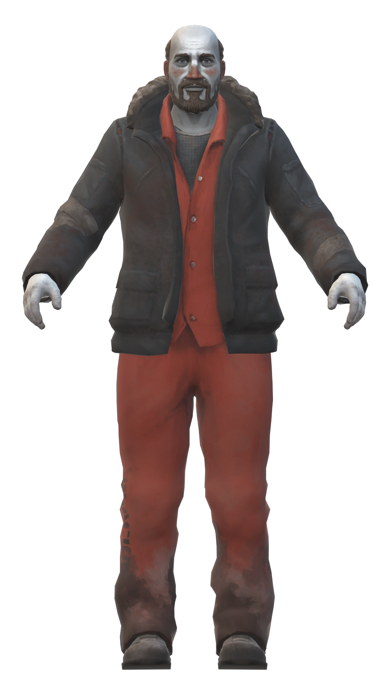
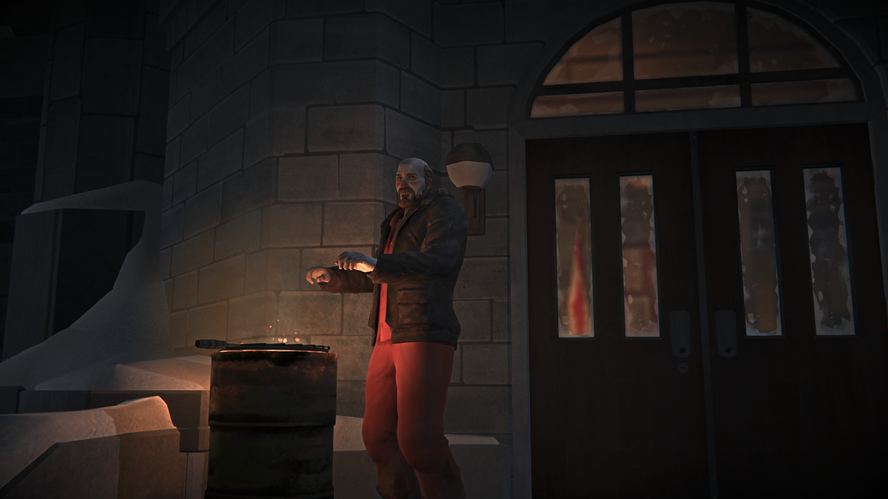
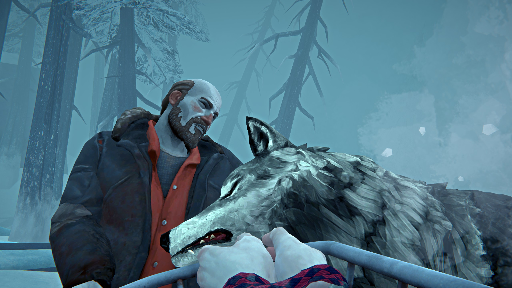
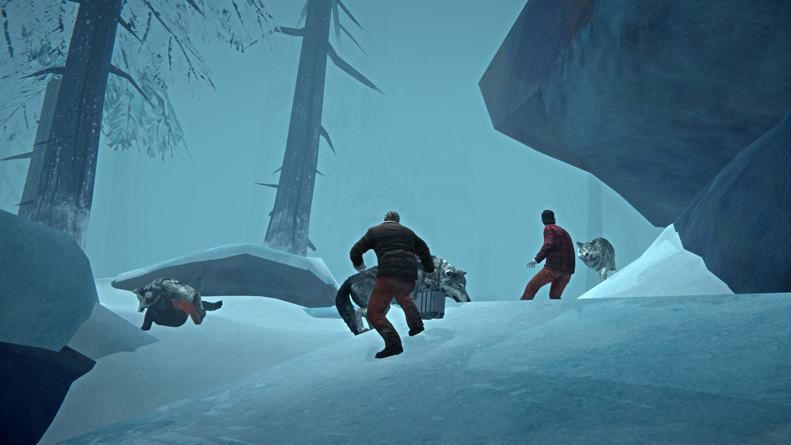
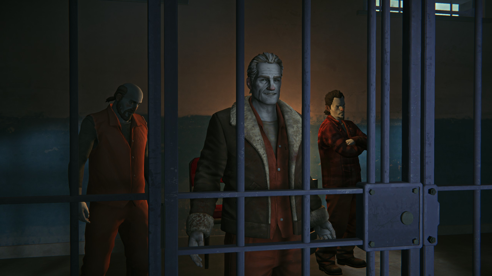

# Vachon

**Categories:** Characters, Pages with update history · **Source:** [Fandom](https://thelongdark.fandom.com/wiki/Vachon)

**Contents**

- [History](#history)
- [Appearance](#appearance)
- [Episode 1](#episode-1)
- [Episode 4](#episode-4)
- [Prologue](#prologue)
- [Blackrock Blues](#blackrock-blues)
- [The Power Plant](#the-power-plant)
- [The Detonators](#the-detonators)
- [Donner (mission)](#donner-mission)
- [Episode 5](#episode-5)
- [To SAR And Back](#to-sar-and-back)
- [Trivia](#trivia)
- [Gallery](#gallery)
- [Update history](#update-history)

**Vachon**

| Property | Details |
| --- | --- |
|  |  / _Vachon.png_ |
| Release | [1.95](./The%20Long%20Dark%20%E2%80%94%20Changelog.md#1.95) |
| Date | 6 October 2021 |
| Wintermute | [Episode 4](./Episode%204%20-%20Fury%2C%20Then%20Silence.md) [Episode 5](./Episode%205%20-%20The%20Light%20At%20The%20End%20Of%20All%20Things.md) |
| **Biographical Information** |  |
| Age | 40's |
| Status | Deceased |
| Place of death | [Perseverance Mills](./Perseverance%20Mills.md) |
| Cause of death | Throwing Hatchet to the chest. Body later burned. |
| Occupation | Criminal |
| **Physical Information** |  |
| Sex | Male |
| **Game Information** |  |
| Voiced by | Jacques Lalonde |

> “__Get going, pilot. The Warden doesn't have much time left. And in case you're thinking of running away. Remember...we still have your precious case.__”
>
> — Vachon

**Vachon**is a member of the [Convicts](./Convicts.md) appearing in [Episode 4: Fury, Then Silence](./Episode%204%20-%20Fury%2C%20Then%20Silence.md). He serves as a secondary antagonist for the episode.

## History

Vachon was one of the prisoners being transported to [Blackrock Prison](./Blackrock%20Prison.md), but his [Prison Bus crashed](./Crashed%20Prison%20Transport%20Bus.md) outside of [Milton](./Milton.md) during the [First Flare](./First%20Flare.md). He escaped the bus with several other Convicts and made his way to [Keeper's Pass South](./Keeper%27s%20Pass%20South.md) and later [Pleasant Valley](./Pleasant%20Valley.md), eventually leaving the region after many of the other Convicts began turning up dead, leading him to realize that [someone](./Molly.md) was hunting them. He is eventually tasked with carrying an unconscious [Will Mackenzie](./Will%20Mackenzie.md) to the Prison via [Mathis'](./Mathis.md) orders, worried that the heavy man will only slow them down and allow the wolves and/or the mysterious hunter to kill them all.

Despite looking like a bully, Vachon isn't as fierce as he looks, often focusing on just his own safety most of the time. This often changes when he fears reprisals from his boss Mathis, or if Heller eggs him on enough to get his act together. Vachon is also somewhat of a more empathetic soul than the other Convicts, despite being a man sentenced to a maximum security prison. He sometimes gives Mackenzie survival advice when his boss isn't there to watch over him, without giving the impression that he will do anything to become friends with Will or [Franklin](./Franklin.md).

Vachon is almost always found paired with [Heller](./Heller.md), being the far less obnoxious and malevolent of the two. Vachon is most likely from the Canadian province of Quebec, because he speaks French and English. He is shown smoking with his own lighter he carries in one scene during the Prologue, but is never shown smoking again.

## Appearance

He is still wearing his prison uniform with a padded leather jacket to keep him warm, and is balding. He is the oldest looking of the 3 main Convicts.

## Episode 1

Vachon does not appear in Episode 1, but his name (VACHON, B.) appears on the [Prison Transport Manifest](./Prison%20Transport%20Manifest.md) near the [Crashed Prison Transport Bus](./Crashed%20Prison%20Transport%20Bus.md), foreshadowing him.

## Episode 4

### [Prologue](./Prologue.md)

Vachon appears with Heller carrying Mackenzie on a stretcher, complaining about having to carry the heavy unconscious pilot. He later comes under attack with the rest of the group and is forced to search for Mackenzie after he escapes.

### [Blackrock Blues](./Blackrock%20Blues.md)

Heller appears with Vachon and Mathis once Mackenzie wakes up in his cell at Blackrock Prison. After Mathis savagely beats the Warden [Franklin](./Franklin.md), Mathis tasks the two criminals to clean him up. He recounts the story of how Mathis' last prison break on the Mainland landed him on a bus to Blackrock Prison.

Heller is later convinced by Mackenzie to secretly let him out of [Blackrock Prison](./Blackrock%20Prison.md) behind Mathis' back in order to find [Blackrock Infirmary Medication](./Blackrock%20Infirmary%20Medication.md) for [Franklin](./Franklin.md). After Heller and Vachon realize that the medication is outside the Prison, and do not wish to risk being killed by hostile wildlife, they reluctantly let the pilot loose. Vachon is at the Prison door and searches the pilot to prevent him from bringing contraband into his cell.

### [The Power Plant](./The%20Power%20Plant.md)

Vachon appears at the start and end of the mission, remarking that he lost a bet that Mackenzie wouldn't make it. He is informed by Mackenzie that the power was unable to be restored at the plant. Vachon says Mathis will be disappointed, and frisks Mackenzie for contraband again before taking him to his cell.

### [The Detonators](./The%20Detonators.md)

Vachon appears with Heller to pester Mackenzie as Mathis interrogates him and Franklin, with Heller telling the pilot to find the [Detonators](./Detonators.md) before "Mathis goes a few more rounds with the Warden."

He later appears at the end of the mission along with Heller, seizing Mackenzie after he delivers the Detonators.

### [Donner (mission)](./Donner%20%28mission%29.md)

Vachon runs out of Mackenzie's cell after the Prison explodes. He later appears behind the blocked door leading to the Warden's office, yelling at other Convicts to break the door down. He later appears in the Prison Yard's 4th guard tower yelling at other Convicts to find and shoot Mackenzie, even spotting him from a spotlight if the player is not careful.

Vachon later appears at the Power Plant in the final cutscene next to Mathis, but has no dialogue, merely looking tough and overlooking the fight with the other convicts.

## Episode 5

### [To SAR And Back](./To%20SAR%20And%20Back.md)

Vachon appears in [Perseverance Mills](./Perseverance%20Mills.md) carrying Donner's unconscious and wounded body into the Medical Clinic for Astrid to work on.

He is later killed by [Jeremiah](./Jeremiah.md) when a Hatchet is thrown into his sternum.

## Trivia

- It is possible to shoot at (and hit) Vachon with a projectile weapon as he stands by the fire barrel near the prison entrance at the end of Blackrock Blues and The Power Plant, but this doesn't affect him in any way.
- Unlike Mathis or Heller, Vachon is the only Convict to occasionally take his coat off of his jumpsuit while inside the prison walls in some cutscenes. His jumpsuit has torn sleeves and he wears a Grey undershirt with long sleeves to compensate for warmth.
- Despite being a major character in Episode 4, Vachon does not get his own [What I Know](./What%20I%20Know.md) character section.

## Gallery

_Vachon waiting for Mackenzie to return_

_Vachon being attacked by a Timberwolf_

_Mathis, Vachon, and Heller attacked by Timberwolves_

_Vachon without his jacket on, revealing his sleeveless prison uniform_

## Update history

- UPDATE **6 October 2021 ([Update](./The%20Long%20Dark%20%E2%80%94%20Changelog.md#1.95)):**
  - Added to game.
