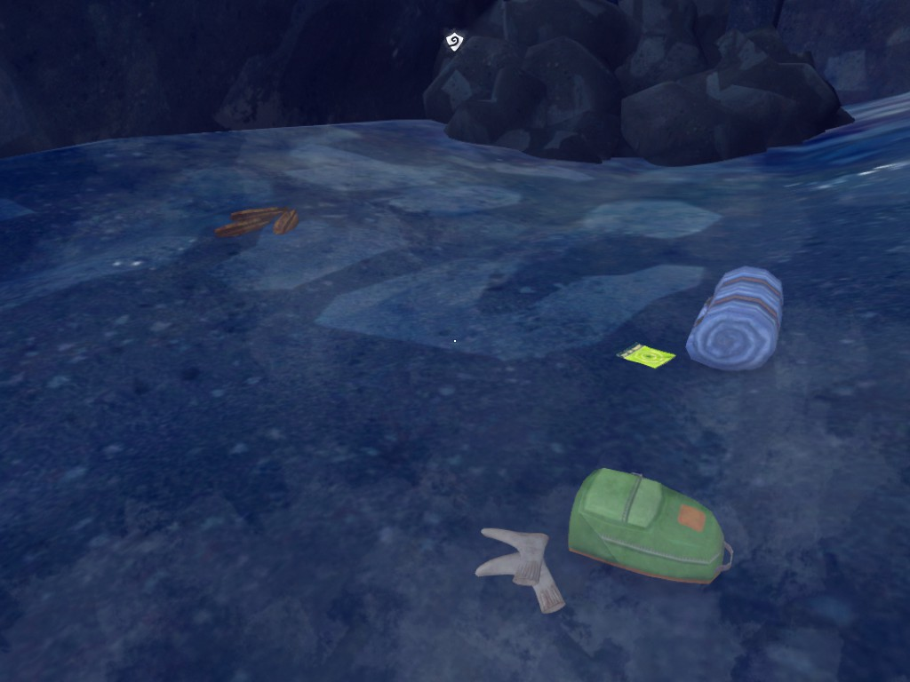

# Valley Cave

**Categories:** Caves, Locations, Locations in Hushed River Valley, Sheltered locations · **Source:** [Fandom](https://thelongdark.fandom.com/wiki/Valley_Cave)

**Valley Cave**

| Property | Details |
| --- | --- |
| | [Valley Cave](../assets/Valley_Cave.jpg) |
| **Location** | |
| | [Valley Cave Location](../assets/Valley_Cave_Location.png) |
| Region | [Hushed River Valley](./Hushed%20River%20Valley.md) |
| Location | Along the river in the central valley near [Little Bear and Cub Falls](./Little%20Bear%20and%20Cub%20Falls.md) |
| Description | An open cave offering some warmth and shelter from the elements |
| **General** | |
| Type | Cave |
| | Provides some shelter |

**Valley Cave** is a location in the east part of [Hushed River Valley](./Hushed%20River%20Valley.md).

## Overview

A small cave hidden by some bushes, a backpack can be found inside along with some wood. Some [cat tail](./Cat%20Tail.md) can be gathered along the frozen river that lead to [Little Bear and Cub Falls](./Little%20Bear%20and%20Cub%20Falls.md). [Research books](./Research%20Book.md) can be found inside the cave, and a [Bedroll](./Bedroll.md) can always be found here in all difficulties other than Interloper, which may prove useful to adventurers who forgot theirs and are too tired to make the climb out of the Lower Valley towards [Pensive Vista](./Pensive%20Vista.md) or [Many Falls Vista](./Many%20Falls%20Vista.md).

## Use as a [base](./Safehouse.md)

As the only warm cave in the [lower part of the region](./Hushed%20River%20Valley.md#lower-valley), this cave is a popular base location for players wishing to explore the nearby area. However, Valley Cave can also be used as a longer-term base location, as there is a rabbit grove nearby, along with a [deer](./Deer.md) spawn point. Furthermore, the surrounding area is abundant in firewood, and [coal](./Coal.md) can be picked up from the Hushed River. A moose may also spawn right across the river, making the cave a prime location for hunting it and curing the valuable hide. One wolf may spawn across the river from the cave, but, aside from that, the nearby area is very safe.

