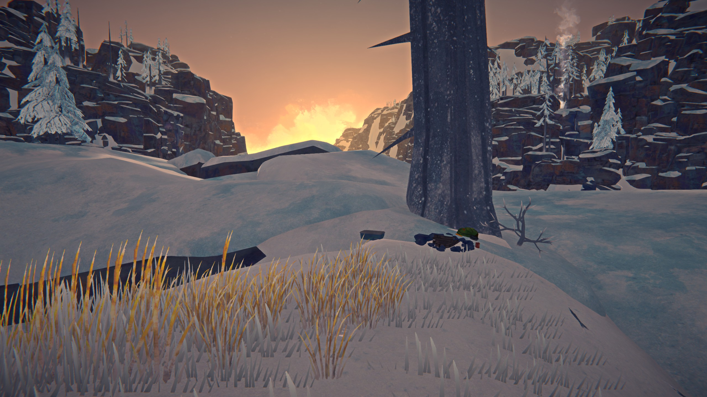

# Valley View Point

**Valley View Point**

| Property | Details |
| --- | --- |
|  |  / *Valley\_View\_Point.jpg* |
| **Location** |  |
|  |  / *Valley\_View\_Point\_Location.png* |
| Region | [Hushed River Valley](./Hushed%20River%20Valley.md)\|- |
| Description | A lookoff offering a view of [Valley Cave](./Valley%20Cave.md) and area. |
| **General** |  |
| Type | Outdoors\|- |
