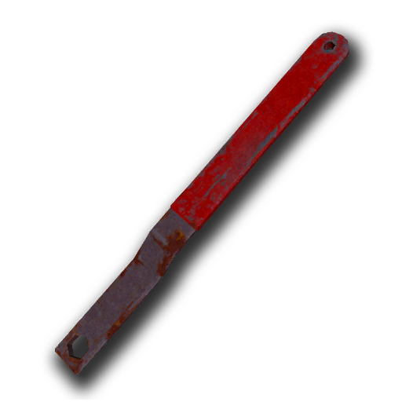

# Valve Socket Handle

<table>
<colgroup>
<col style="width: 33%" />
<col style="width: 33%" />
<col style="width: 33%" />
</colgroup>
<tbody>
<tr>
<td width="40px"><figure>

<figcaption>2120907963_TLD-Wintermute-v2.png.de8a285930f6a8f5ad9cf5878754cf5b.png</figcaption>
</figure></td>
<td>
<strong>Wintermute-Exclusive content.</strong> 

This content only appears in <a href="./Wintermute.md" class="wikilink" title="Wintermute">Wintermute</a>.

</td>
<td>
|}

<table class="infobox">
<caption>Valve Socket Handle</caption>
<colgroup>
<col style="width: 50%" />
<col style="width: 50%" />
</colgroup>
<tbody>
<tr>
<td colspan="2"><figure>

<figcaption>Valve_Socket_Handle_icon.png</figcaption>
</figure></td>
</tr>
<tr>
<td>
Release
</td>
<td>
<a href="./The%20Long%20Dark%20%E2%80%94%20Changelog.md#1.95" class="wikilink" title="6 October 2021">6 October 2021</a>
</td>
</tr>
<tr>
<td>
Wintermute
</td>
<td>
<a href="./Episode%204%20-%20Fury%2C%20Then%20Silence.md" class="wikilink" title="Episode 4">Episode 4</a> - <a href="./The%20Power%20Plant.md" class="wikilink" title="The Power Plant">The Power Plant</a>
</td>
</tr>
<tr>
<td colspan="2" class="section">
<strong>Properties</strong>
</td>
</tr>
<tr>
<td>
Item type
</td>
<td>
<a href="./Collectibles.md" class="wikilink" title="Collectibles">Collectibles</a>|-
</td>
</tr>
<tr>
<td>
Stackable
</td>
<td>
No
</td>
</tr>
<tr>
<td>
Examine
</td>
<td>
A sturdy handle for opening and closing pipe valves.
</td>
</tr>
<tr>
<td colspan="2" class="section">
<strong>Values</strong>
</td>
</tr>
<tr>
<td>
Weight
</td>
<td>
0.00 kg (0 lbs)
</td>
</tr>
<tr>
<td colspan="2" class="section">
<strong>Actions</strong>
</td>
</tr>
<tr>
<td>
Backpack
</td>
<td>
Examine
</td>
</tr>
<tr>
<td>
On ground
</td>
<td>
Take It, Leave It
</td>
</tr>
<tr>
<td colspan="2" class="section">
<strong>Advanced data</strong>
</td>
</tr>
<tr>
<td>
Item key
</td>
<td>
GAMEPLAY_SteamPipeValveHandle
</td>
</tr>
</tbody>
</table>

The <strong>Valve Socket Handle</strong> is a <a href="./Collectibles.md" class="wikilink" title="Collectible">Collectible</a> Tools item found in the <a href="./Wintermute.md" class="wikilink" title="Wintermute">Wintermute</a> story mode of <a href="./The%20Long%20Dark.md" class="wikilink" title="The Long Dark"><em>The Long Dark</em></a>.

<h2 id="Episode_4:_Fury,_Then_Silence"><a href="./Episode%204%20-%20Fury%2C%20Then%20Silence.md" class="wikilink" title="Episode 4: Fury, Then Silence">Episode 4: Fury, Then Silence</a></h2>

During the mission <a href="./The%20Detonators.md" class="wikilink" title="The Detonators">The Detonators</a>, <a href="./Will%20Mackenzie.md" class="wikilink" title="Will Mackenzie">Will Mackenzie</a> journeys to the <a href="./Last%20Prospect.md" class="wikilink" title="Last Prospect">Last Prospect</a> mine and uses 2 of these to redirect airflow throughout certain sections of the mine. At a few points, the handle gets stuck and cannot be dislodged in the ON position.

<h2 id="Episode_5:_The_Light_At_The_End_Of_All_Things"><a href="./Episode%205%20-%20The%20Light%20At%20The%20End%20Of%20All%20Things.md" class="wikilink" title="Episode 5: The Light At The End Of All Things">Episode 5: The Light At The End Of All Things</a></h2>

Will performs the same task to clear away toxic gas in the <a href="./Blackrock%20Foothills.md" class="wikilink" title="Blackrock Foothills">Blackrock Foothills</a> Mine for <a href="./Jace.md" class="wikilink" title="Jace">Jace</a> during Episode 5, with a single handle being found in the episode.

<h2 id="Update_history">Update history</h2>

<ul>
<li>UPDATE <strong>6 October 2021 (<a href="./The%20Long%20Dark%20%E2%80%94%20Changelog.md#1.95" class="wikilink" title="Update">Update</a>):</strong>
<ul>
<li>Added to game.</li>
</ul></li>
<li>UPDATE <strong>31 March 2026 (<a href="./The%20Long%20Dark%20%E2%80%94%20Changelog.md#2.52" class="wikilink" title="Update">Update</a>):</strong>
<ul>
<li>Added to Episode 5.</li>
</ul></li>
</ul>

<strong>Lua execution error in Module:Navbox function navboxLua execution error in Module:Navbox function navbox</strong>
</td>
</tr>
</tbody>
</table>

