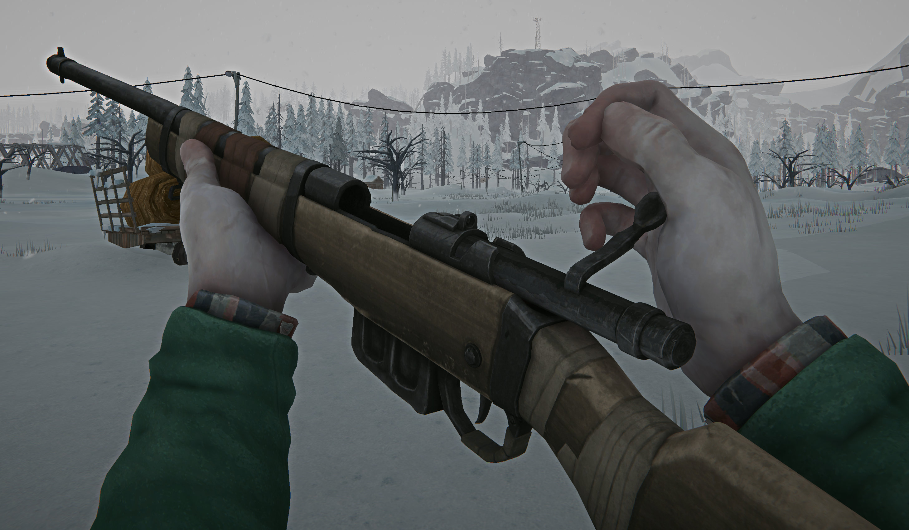

# Vaughn's Rifle

**Categories:** DLC Content, Pages with update history, Tools · **Source:** [Fandom](https://thelongdark.fandom.com/wiki/Vaughn's_Rifle)

**Contents**

- [Overview](#overview)
- [Locations](#locations)
- [Differences from Hunting Rifle](#differences-from-hunting-rifle)
- [Trivia](#trivia)
- [Gallery](#gallery)
- [Update history](#update-history)

**Vaughn's Rifle**

| Property | Details |
| --- | --- |
| | [Vaughn's Rifle icon](../assets/Vaughn%27s_Rifle_icon.png) |
| Release | [5 December 2022](./The%20Long%20Dark%20%E2%80%94%20Changelog.md#2-03-tftft-part-1-forsaken-airfield-update) |
| Wintermute | No |
| Renewable | No (unique item) |
| **Properties** | |
| Item type | [Tools](./Tools.md) |
| Equipable | Yes |
| Stackable | No |
| Examine | A weathered .303 Rifle covered in epoxy and duct tape. Its patchwork exterior hides an improved firing action. A handy tool when working the various industrial sites and power stations that dot Great Bear Island. / Fragile and deadly, just like its owner. |
| **Values** | |
| Weight | 3.00 kg (6.6 lbs) |
| **Actions** | |
| Backpack | Use, Actions, Drop |
| On ground | Take It, Equip It, Leave It |
| **Advanced data** | |
| Item key | GEAR\_Rifle\_Vaughns |

[Ptarmigan icon](../assets/Ptarmigan_icon.png)

**DLC-Exclusive content.**; This content requires the [Tales from the Far Territory](./Tales%20from%20the%20Far%20Territory.md) addon to be installed before it can be seen or used in regular gameplay.

**Vaughn's Rifle** is a unique variant of the [Hunting Rifle](./Hunting%20Rifle.md) in _The Long Dark_, added by the _[Tales from the Far Territory](./Tales%20from%20the%20Far%20Territory.md)_ expansion.

## Overview

Vaughn's Rifle trades durability for a lighter weight and responsiveness. Weighing 1.0kg less than the standard Hunting Rifle and featuring shortened firing delays on reload and aim, this rifle variant has much snappier handling and a slightly faster fire rate overall. The downside is that each shot uses 2% condition, compared to the normal rifle consuming 1.325% condition per use. This means the gun can only fire up to 50 shots from full condition before breaking.

Successful hits on live animals provide experience to the [Rifle Firearm](./Rifle%20Firearm.md) skill.

## Locations

Vaughn's Rifle will spawn a single time per world in various states of repair near the [Carter Hydro Dam](./Carter%20Hydro%20Dam.md) at one of the following locations:

- Inside [Carter Hydro Dam](./Carter%20Hydro%20Dam.md) at one of several potential spawn locations;
  - In the main turbine room upper dam on a catwalk south east corner of the room
  - In the broken window room coming in from Winding River in the lower dam, (in a corner to the left when entering near a metal table)
- Hidden inside the [Winding River](./Winding%20River.md);
  - Inside the pipes at on the dam platform near the exit door to the dam in. It may be behind pallets that need to be broken down.
  - In the small cave to the west at the base of the dam in [Winding River](./Winding%20River.md).

## Differences from Hunting Rifle

- Base weight is 1.0 kg less than Hunting Rifle
- Firing rate is 1.0 second quicker per shot than Hunting Rifle
- Reload cool-down is 0.5 seconds quicker than Hunting Rifle
- Total durability is 33% less than Hunting Rifle (Uses 2%-1% condition per shot based on [Rifle Skill](./Rifle%20Firearm.md))

## Trivia

- The rifle appears to have a shaved down wooden furniture, a modification commonly done to bush and hunting rifles to keep their weight low as it is in game (this is one of many changes done when sporterizing military surplus guns). The rifle has also been wrapped with grip and duct tape in various areas on the rifle likely contributing to its easier handling.
- At [Rifle Skill Level 5](./Rifle%20Firearm.md), Vaughn's rifle can be fired up to a total of 100 times at full condition, this makes it the second least cost efficient rifle to repair and maintain for long-term play, with the [Bunker Rifle](./Bunker%20Rifle.md) having worse durability.
- The rifle's sights are identical to the normal hunting rifle's iron sights.
- Vaughn, the rifle's owner, is mentioned in the [Buffer Memories](./Buffer%20Memories.md) located inside the hydro electric dam. He was one of the 6 skeleton crew workers at the Dam and likely left his rifle behind after the Dam was abandoned (along with all the other technology inside) due to the hostilities with the [Forest Talkers](./Forest%20Talkers.md) in the 1990s ([Carter Hydro Dam (Collectible)](./Carter%20Hydro%20Dam%20%28Collectible%29.md)).
  - The reason the rifle is sometimes found outside the Dam in Winding River is also explained in the Buffer Memories, as Vaughn often wandered outside the Dam without permission.
- Vaughn's Rifle most likely bases its appearance off the early Pre-Alpha hunting rifle model. The tape stock seems to be borrowed off the [second hunting rifle](./Hunting%20Lodge%20Rifle.md) found in [Episode 2](./Episode%202%20-%20Luminance%20Fugue.md), pre [Wintermute](./Wintermute.md) redux update.

## Gallery

## Update history

- UPDATE **5 December 2022 ([Update](./The%20Long%20Dark%20%E2%80%94%20Changelog.md#2-03-tftft-part-1-forsaken-airfield-update)):**
  - Added to game.
