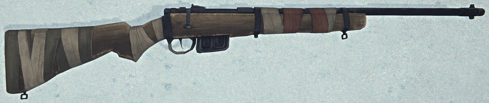
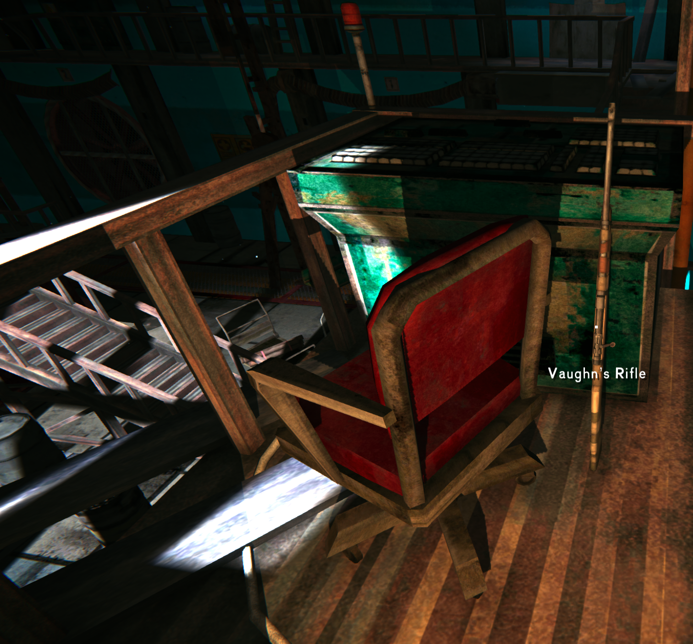
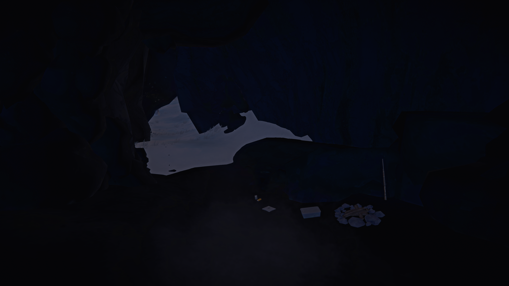
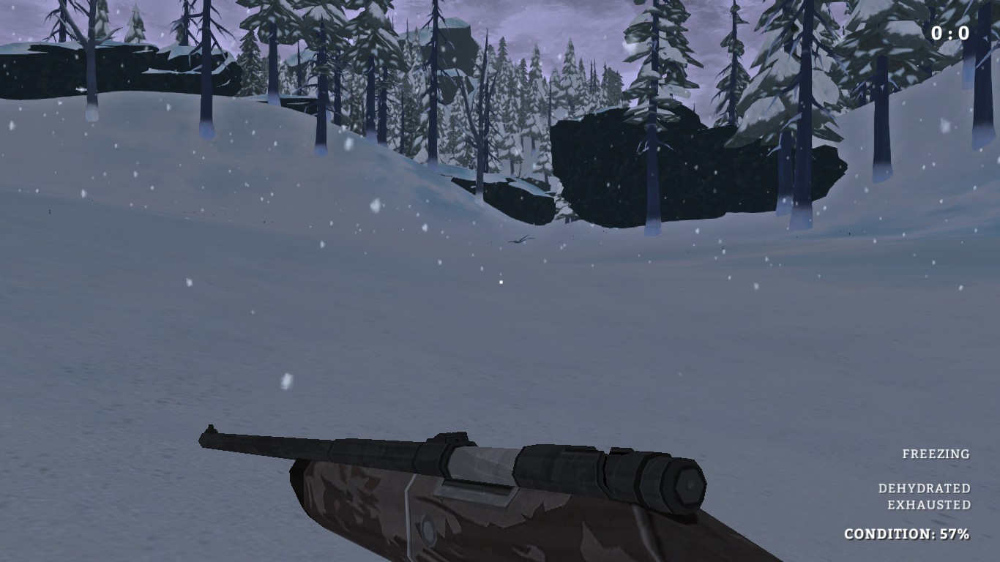
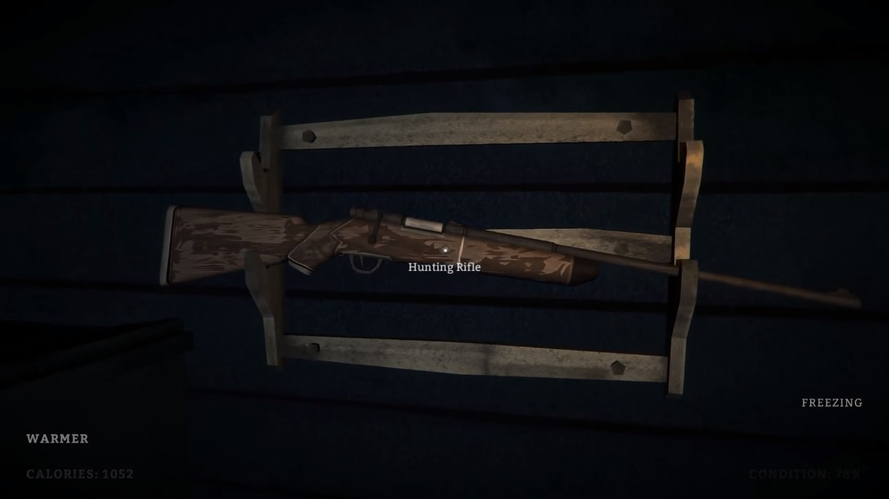

# Vaughn's Rifle

**Categories:** DLC Content, Pages with update history, Tools · **Source:** [Fandom](https://thelongdark.fandom.com/wiki/Vaughn's_Rifle)

**Contents**

- [Overview](#overview)
- [Locations](#locations)
- [Differences from Hunting Rifle](#differences-from-hunting-rifle)
- [Trivia](#trivia)
- [Gallery](#gallery)
- [Update history](#update-history)

**Vaughn's Rifle**

_Vaughn's\_Rifle\_icon.png_

**Release:** [5 December 2022](./The%20Long%20Dark%20%E2%80%94%20Changelog.md#2.03)

**Wintermute:** No

**Renewable:** No (unique item)

**Properties**

**Item type:** [Tools](./Tools.md)

**Stackable:** No

**Examine:** A weathered .303 Rifle covered in epoxy and duct tape. Its patchwork exterior hides an improved firing action. A handy tool when working the various industrial sites and power stations that dot Great Bear Island. / Fragile and deadly, just like its owner.

**Values**

**Weight:** 3.00 kg (6.6 lbs)

**Actions**

**Backpack:** Use, Actions, Drop

**On ground:** Take It, Equip It, Leave It

**Advanced data**

**Item key:** GEAR\_Rifle\_Vaughns

_Ptarmigan\_icon.png_

**DLC-Exclusive content.** / This content requires the [Tales from the Far Territory](./Tales%20from%20the%20Far%20Territory.md) addon to be installed before it can be seen or used in regular gameplay.

_Vaughn's Rifle bolt open_

_Vaughns Rifle ground model_

_One of the areas inside carter hydro dam where the rifle can spawn._

_Sometimes found in the Winding River._

_Vaughn's Rifle cave spawn in Winding River_

_The original Pre-Alpha hunting rifle model._

_The original Pre-Alpha hunting rifle on a rack._

_Vaughn's Rifle seems to borrow the tape from the original Wintermute hunting rifle_

_In game descripiton_
