# Vehicle

**Categories:** Interactable Objects · **Source:** [Fandom](https://thelongdark.fandom.com/wiki/Vehicle)

**Contents**

- [Land Vehicles](#land-vehicles)
- [Cars](#cars)
- [Trucks](#trucks)
- [Tractors](#tractors)
- [Prison Buses](#prison-buses)
- [Shuttle Train Cars](#shuttle-train-cars)
- [Train Cars](#train-cars)
- [Tractor Trailer Trailers](#tractor-trailer-trailers)
- [Haul Truck](#haul-truck)
- [Steam Locomotive](#steam-locomotive)
- [Water Vehicles](#water-vehicles)
- [The Riken](#the-riken)
- [The Harbinger](#the-harbinger)
- [Beached Boats](#beached-boats)
- [Rowboats](#rowboats)
- [Canoe](#canoe)
- [Sutherland's sailboat](#sutherland-s-sailboat)
- [Air Vehicles](#air-vehicles)
- [Planes](#planes)
- [Helicopters](#helicopters)

Strewn across the freezing landscapes of [Great Bear Island](./Great%20Bear%20Island.md) lie many non-functioning motorized **Vehicles**. These mechanized chariots were once the main form of transportation across the Island, but are now mainly used by survivors as temporary shelters. Many vehicles can serve as local landmarks, shelters to escape hostile [Wildlife](./Wildlife.md) and the elements, places to temporarily sleep, and locations that provide opportunities to find loot.

During an [Aurora](./Aurora.md), many vehicles spring back to life, with their dashboards, lights, and radios becoming functional again.

## Land Vehicles

The most common type of vehicle a survivor will find across the Island, their most notable gameplay characteristics often include having interactable elements, such as hoods, trunks, doors, gas caps, glove boxes, visors, radios. They are commonly used to warm a survivor from the cold, as many provide a small warmth value and remove all wind-chill from freezing a survivor, though their meagre warmth value makes them very dangerous to sleep in without warm [Clothing](./Clothing.md) during the night, and can turn them into deathtraps should a blizzard pass through the area, as the lack of warmth will easily freeze a survivor to death.

### Cars

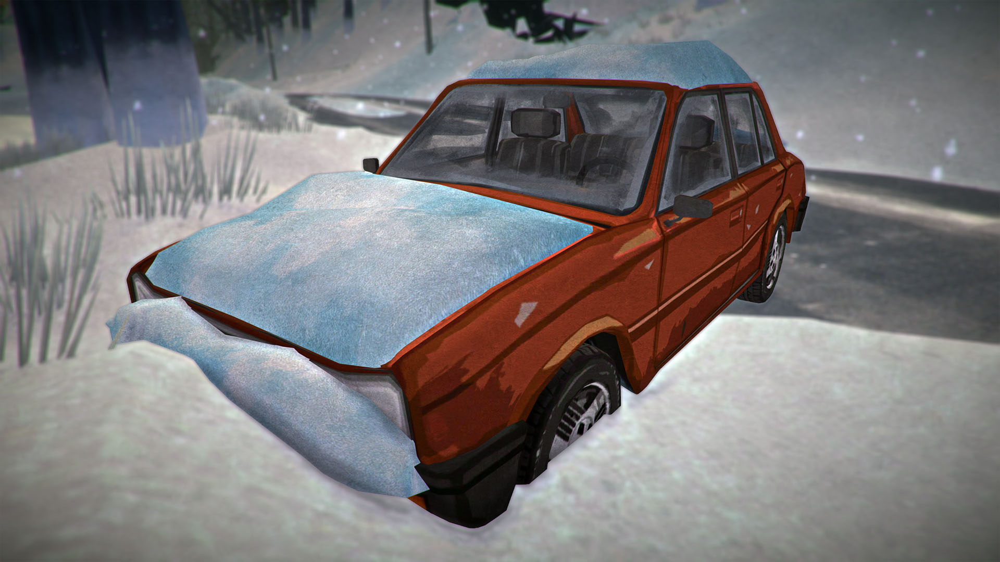

The most common type of vehicle found across the Island, [Cars](./Car.md) are found in most regions near roads or homes in civilized areas of the Island. They come in various colors and are often found on roads or near residential areas. Entering a car will add a windproof protection as well as a bonus ambient temperature of +5o C. A player can choose to sleep inside the Car provided they have a [Bedroll](./Bedroll.md). A survivor can still sleep inside a Car even without a bedroll, as the Car will offer a bed warmth bonus of 3o C.

The [trunks](./Car%20Trunk.md) of Cars can be looted, though they are often locked and thus require a [Prybar](./Prybar.md) to open. Some Cars have a chance to spawn with a salvageable [Car Battery](./Car%20Battery.md) inside the hood, though the front of some Cars are too damaged to open the hood. Car visors can be opened and sometimes contain [Mementos](./Mementos.md). Despite being able to open the gas cap, gasoline cannot be syphoned out.

### Trucks

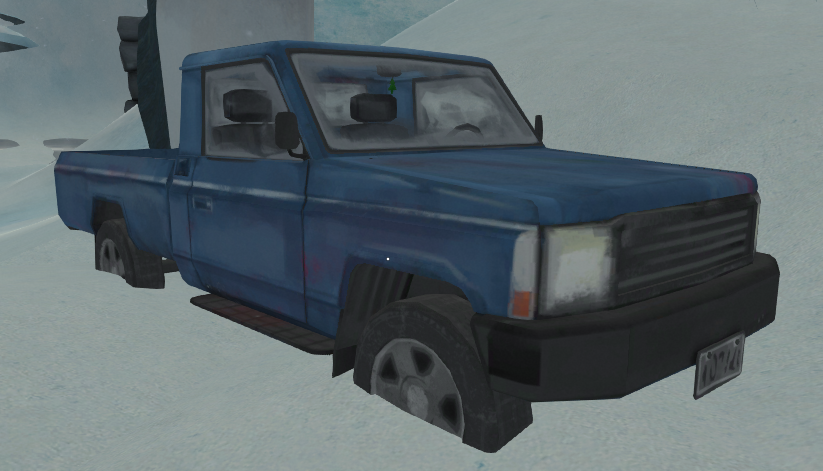

[Trucks](./Truck.md) are the second most common land vehicle found on the Island, often being found near roads and homes, but also more often near industrial areas. Much like Cars, Trucks often have a chance to contain a [Car Battery](./Car%20Battery.md) inside the hood. Some Trucks can be found mounted onto railroads, often near industrial areas and function no differently than any other Truck. Trucks can be entered similarly to Cars, and are often used as temporary shelters to sleep in.

The bed of Trucks sometimes have containers or other small items that can be looted. Some Trucks have a chance to spawn with a salvable [Car Battery](./Car%20Battery.md) inside the hood if lifted. Trucks visors can be opened and sometimes contain [Mementos](./Mementos.md). Despite being able to open the gas cap, gasoline cannot be syphoned out.

### Tractors

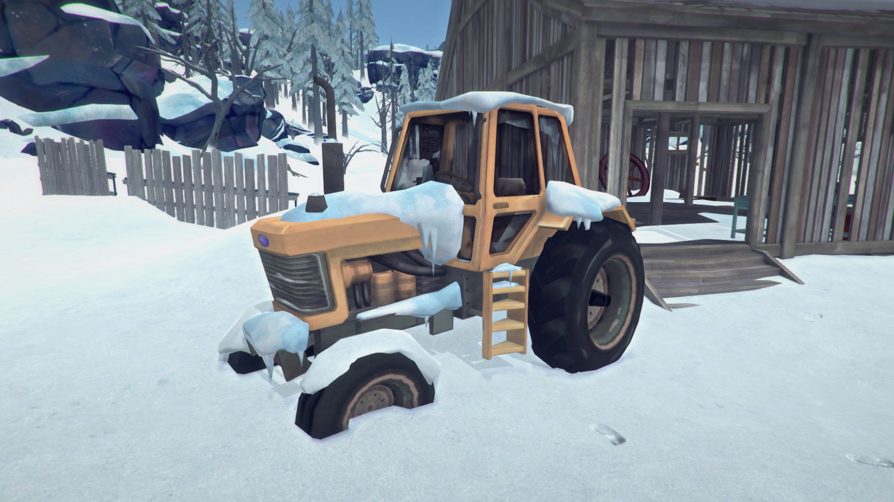

[Tractors](./Tractor.md) are often found near agricultural areas of the Island and contain only 2 interactable doors. They can be slept in and the floorboards often contain small amounts of loot. Tractors do not have Car Batteries due to a lack of an interactable hood and do not contain gas cans or visors. Tractors can be entered similarly to Cars and Trucks, and are often used as temporary shelters to sleep in, though their very small warmth value makes them poor shelters without very warm clothing.

### Prison Buses

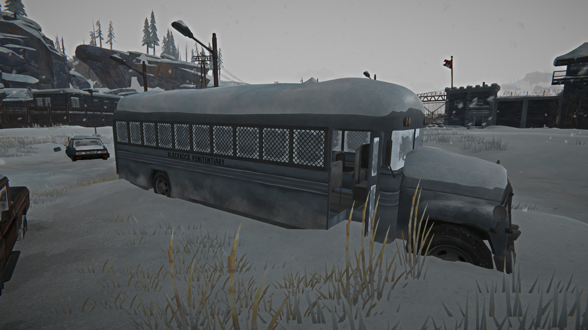

Though very rare, [Buses](./Bus.md) can occasionally be found in some parts of Great Bear Island. Buses can be walked inside of and eliminate any wind-chill factor but cannot be slept inside of without a Bedroll. Curiously, [Campfires](./Campfire.md) can be started inside a Bus with no negative consequences, making them excellent places to safely cook food during bath weather. Despite having open doors, [Wolves](./Wolf.md) cannot enter Buses.

So far, all Buses come from the [Blackrock Prison](./Blackrock%20Prison.md) and were used to transport prisoners across the Island. Buses often only loot inside or around the vehicle, with no other way to interact with them. A single [Crashed Prison Transport Bus](./Crashed%20Prison%20Transport%20Bus.md) can be found in the [Mountain Town](./Mountain%20Town.md) region, with more Buses found in the Blackrock Prison parking lot in the [Blackrock](./Blackrock.md) region.

### Shuttle Train Cars

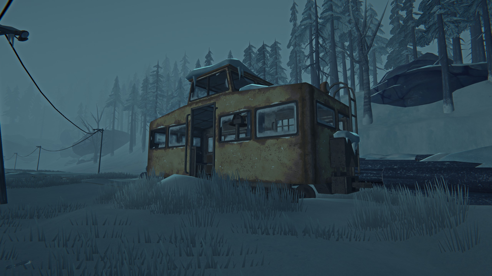

Occasionally found on the [Trans-Island Railway Line](./Trans-Island%20Railway%20Line.md), [Train Shuttle Cars](./Train%20Shuttle.md) provide temporary shelter and possible loot spawns. They contain a single door that can be opened and closed and provide no extra warmth value inside. While the lack of warmth makes them poor shelters, they can often be used to prevent hostile Wolves from attacking the player by simply closing the door on them as they approach. Shuttle Cars can also serve as temporary outdoor shelters to sleep in if a player has a Bedroll, though their lack of warmth must be taken into consideration before they are slept in to prevent freezing to death while a survivor sleeps.

### Train Cars

While technically not a vehicle in of itself, various railroad cars can be found and entered across the [Trans-Island Railway Line](./Trans-Island%20Railway%20Line.md). They range from Flatbed Cars, Boxcars, Tank Cars, Coal Cars, or Timber Cars. Boxcars often serve as shelters and possibly contain loot, bodies, fuel, or fire barrels. Timber, Coal, Tank, and Flatbed railcars can often contain [Scrap Metal](./Scrap%20Metal.md) nearby or nothing at all. Boxcars can also be used as shelters to sleep in, provided the player carries a Bedroll and has sufficiently warm Clothing.

Curiously, a [Locomotive Engine](./Locomotive%20Engine.md) can be found in the [Broken Railroad](./Broken%20Railroad.md) region (and a second in the [Zone of Contamination](./Zone%20of%20Contamination.md)), but it cannot be entered.

### Tractor Trailer Trailers

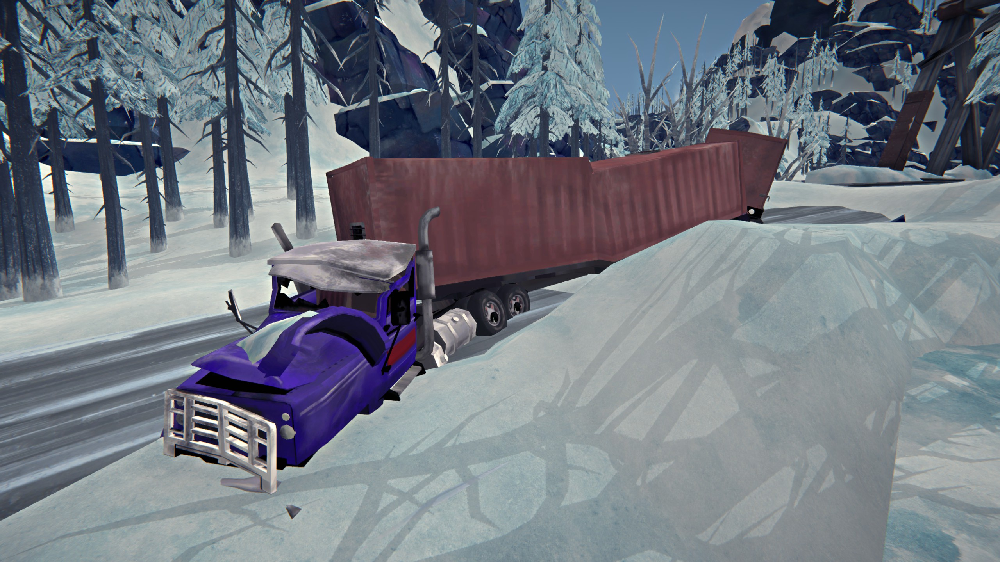

A few locations contain Tractor Trailer cars, but no 18 wheeler automobile. Open trailers can be entered and often contain backpacks and supplies. They are mainly found in [Bleak Inlet](./Bleak%20Inlet.md) with one crashed on the [Long Bridge](./Long%20Bridge.md) and several featuring the Last Resort cannery logo near the cannery. [Blocked Bridge](./Blocked%20Bridge.md) in [Blackrock](./Blackrock.md) also contains a trailer that blocks the bridge. A single trailer cab is found on the road outside of Milton, near the transition to Mystery Lake, but is outside of the playable area. Another is found in [Keeper's Pass South](./Keeper%27s%20Pass%20South.md), on the ruined road to [Keeper's Pass North](./Keeper%27s%20Pass%20North.md) buried under a rockslide.

### Haul Truck

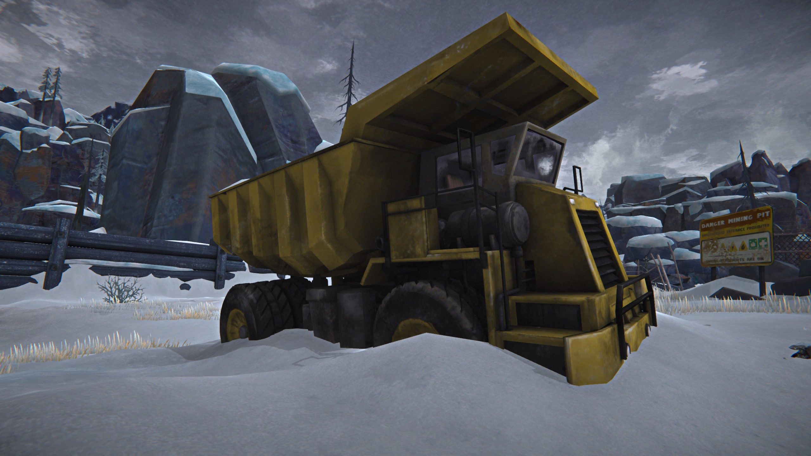

Haul Trucks, or Dump Trucks, are rare industrial vehicles used to move vast quantities of earth and rock around mining sites. 3 can be found around the mines of the [Langston Mine](./Langston%20Mine.md) in the [Zone of Contamination](./Zone%20of%20Contamination.md). They contain a single door that allows a safe place to shelter and the floors often contain food and mining clothing.

### Steam Locomotive

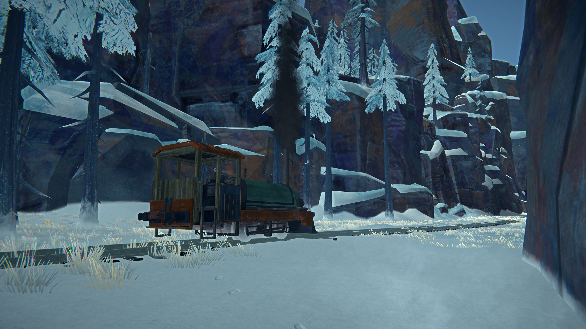

The only player-operable vehicle in the game, the [Steam Locomotive](./Steam%20Train.md) is a coal-fired [0-4-0-ST](https://en.wikipedia.org/wiki/0-4-0) locomotive, numbered 46. It is used by [Astrid Greenwood](./Astrid%20Greenwood.md) in [Episode 5](./Episode%205%20-%20The%20Light%20At%20The%20End%20Of%20All%20Things.md) of [Wintermute](./Wintermute.md) and is capable of pushing road-rail vehicles along the tracks, as well as clearing the tracks.

## Water Vehicles

Despite having various wharfs and docks, Great Bear Island contains very few Water Vehicles. There are no boats found inland despite Great Bear Island having many lakes, thus making any Water Vehicles exclusive to the sea.

### The Riken

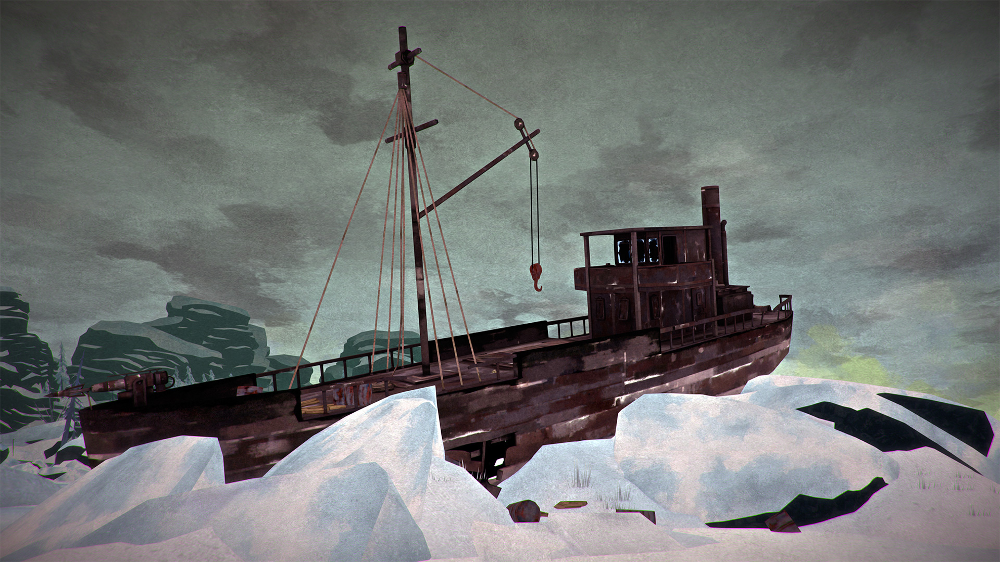

[The Riken](./The%20Riken.md) is a beached whaling sea vessel and a major location in the [Desolation Point](./Desolation%20Point.md) region. The vessel has an indoor area, beds, a [Furnace](./Furnace.md), and sizable amounts of other loot.

### The Harbinger

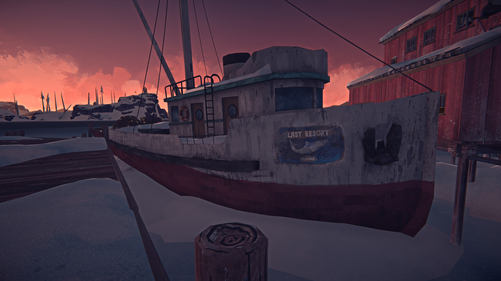

A single fishing trawler can be found at the [Last Resort Cannery](./Last%20Resort%20Cannery.md), and is used as a footpath on the way to the workshop. It always contains a [Backpack](./Backpack.md) and a [Wool Scarf](./Wool%20Scarf.md) on the nearby pier. Judging from the amount of graffiti on the ship, this trawler has been moored and abandoned for some time.

### Beached Boats

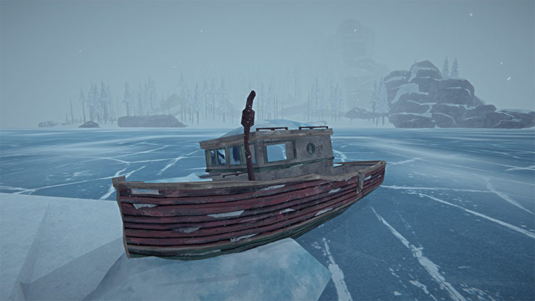

Beached Boats can often be found near regions close to the sea, often when a survivor is [Beachcombing](./Beachcombing.md) the surrounding ocean. They often spawn after heavy blizzards pass through the area and contain sizable amounts of loot.

### Rowboats

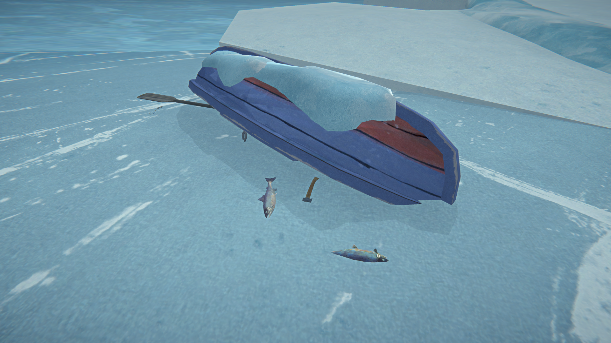

A few rowboats can be found on Great Bear Island. They occasionally have a [Metal Container](./Metal%20Container.md) inside them, but can't otherwise be interacted with. Notable locations include:

- Near [Lonely Lighthouse](./Lonely%20Lighthouse.md)
- Docks near [Old Spence Family Homestead](./Old%20Spence%20Family%20Homestead.md)
- The dock on [Crystal Lake](./Crystal%20Lake.md)
- Outside [Angler's Den](./Angler%27s%20Den.md)
- [Fishing Camp](./Fishing%20Camp.md)
- [Pensive Pond](./Pensive%20Pond.md)

### Canoe

A Canoe can occasionally wash up along the shorelines while [Beachcombing](./Beachcombing.md), and can contain various supplies with it. One is also seen in [Episode 5: The Light At The End Of All Things](./Episode%205%20-%20The%20Light%20At%20The%20End%20Of%20All%20Things.md), bringing [Astrid Greenwood](./Astrid%20Greenwood.md) from [Coastal Highway](./Coastal%20Highway.md) to [Perseverance Mills](./Perseverance%20Mills.md).

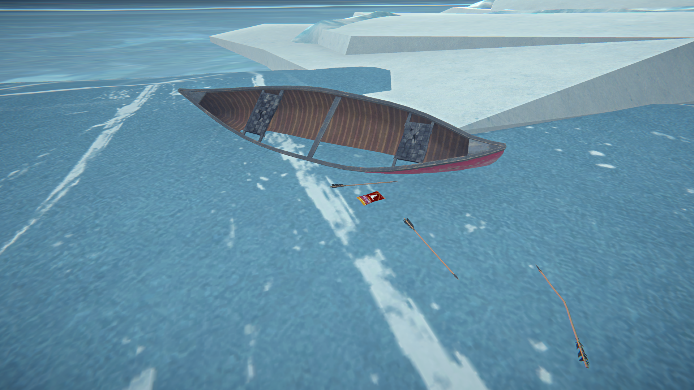

### Sutherland's sailboat

The only "operational" vehicle in Survival mode (though not useable by the Survivor), Sutherland's sailboat shows up off the coast of [Misanthrope's Homestead](./Misanthrope%27s%20Homestead.md) the day after the Survivor completes a [trade](./Trader.md), and is where Sutherland lives. It takes the shape of a small sloop. The boat cannot be reached or otherwise interacted with.

## Air Vehicles

### Planes

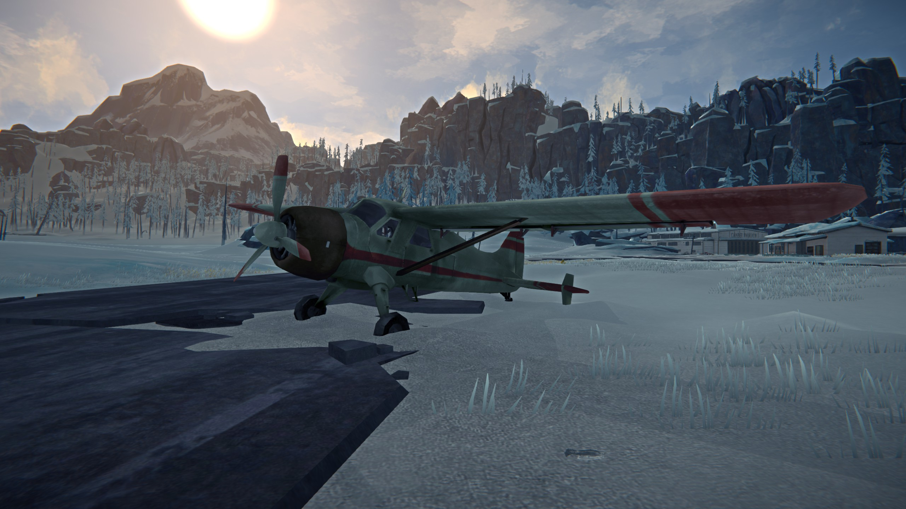

[Planes](./Airplane.md) are rarely found on the Island, and are almost always destroyed if a survivor does find one. Notable examples of planes include the [Crash Site (Pleasant Valley)](./Crash%20Site%20%28Pleasant%20Valley%29.md), the destroyed cargo plane found strewn across [Timberwolf Mountain](./Timberwolf%20Mountain.md) (see [Tail Section](./Tail%20Section.md)), and [Mackenzie's Crashed Plane](./Mackenzie%27s%20Crashed%20Plane.md). Occasionally, smaller [Plane Crashes](./Plane%20Crashes.md) can be found in the Lower Great Bear regions, but are always completely destroyed when the player finds them, with small amounts of loot and presumably the dead body of the pilot found nearby.

The only intact planes that can be found are the various abandoned airplanes found near [Field 31](./Field%2031.md) in the [Forsaken Airfield](./Forsaken%20Airfield.md) region. These planes contain storage hatches on the sides that can be looted and can serve as temporary shelters from hostile wildlife and the cold or places to sleep if entered.

### Helicopters

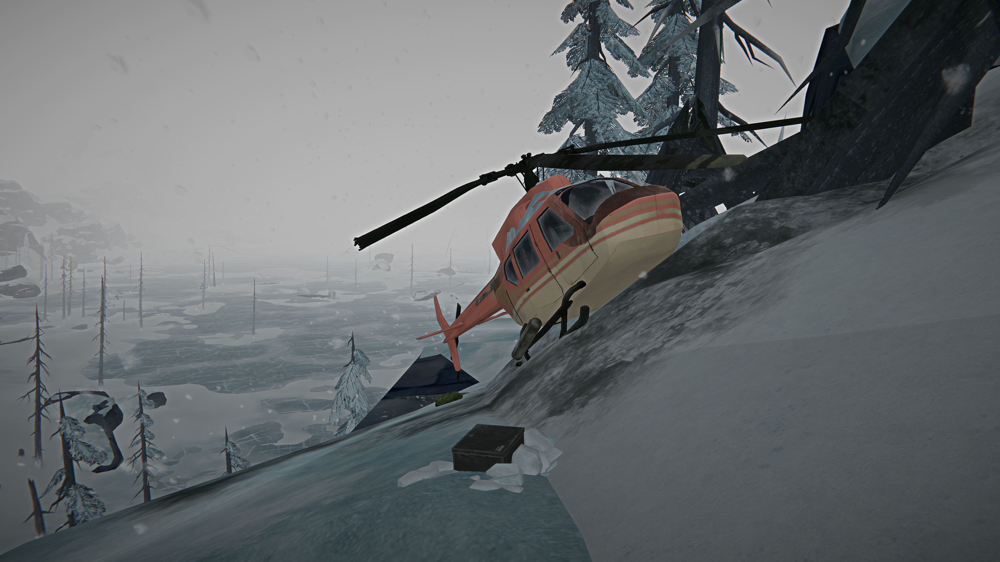

[Helicopters](./Helicopter.md) are the rarest of any vehicle on Great Bear Island. Most are only found in the [Forsaken Airfield](./Forsaken%20Airfield.md) region and provide a small warmth bonus and complete protection from wind-chill as Cars, Trucks, and Tractors would. They can also be used as a temporary location to sleep. Helicopters contain the most loot containers of any vehicle, often containing many lockers inside and outside of the choppers. A unique rescue helicopter, [Final Approach](./Final%20Approach.md), can be found in Forsaken Airfield and contains a medical cot for sleeping, a chance to spawn a [Distress Pistol](./Distress%20Pistol.md) box, and various lockers that can be looted.
