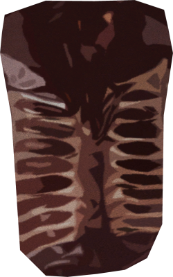

# Venison \(Cooked\)

**Categories:** Food And Drink, Pages with update history · **Source:** [Fandom](https://thelongdark.fandom.com/wiki/Venison_%28Cooked%29)

**Contents**

- [Overview](#overview)
- [Recipe](#recipe)
- [Gallery](#gallery)
- [Trivia](#trivia)
- [Update history](#update-history)

_For the raw version, see [Venison (Raw)](./Venison%20%28Raw%29.md)._

**Venison (Cooked)**

[Venison (Cooked) icon](../assets/Venison_%28Cooked%29_icon.png)

**Release:** [22 September 2014](./The%20Long%20Dark%20%E2%80%94%20Early%20Access%20Changelog.md#0.117)

**Wintermute:** No

**Properties**

**Item type:** [Food And Drink](./Food%20And%20Drink.md)

**Stackable:** No

**Examine:** Cooked flesh from a deer.

**Values**

**Calories:** 800 kcal

**Hydration:** -5.0%

**Weight:** 1.00 kg (2.2 lbs)

**Advanced data**

**Item key:** GAMEPLAY\_VenisonCooked

**Venison (Cooked)** is a cooked food item in _The Long Dark_.

<!-- #Overview -->
​

<!-- #overview -->
## Overview

Venison (Cooked) is obtained by using a lit [Fire](./Fire.md) and improves the [Cooking](./Cooking.md) skill. Cooking increases its condition by 50%, makes it decay 4 times slower than raw meat, and adds a reduced chance of [Food Poisoning](./Food%20Poisoning.md) over raw meat.

Using a [Cooking Pot](./Cooking%20Pot.md) reduces cooking time by 25%. Cooked food on an active fire for too long will burn it, destroying the item and damaging a Cooking Pot if used.

<!-- #Recipe -->
​

<!-- #recipe -->
## Recipe

**Venison (Cooked)**

56.25 minutes

**Requirements**

**Item:** [Venison (Raw)](./Venison%20%28Raw%29.md)

**Quantity:** 1.00 kg

<!-- #Gallery -->
​

<!-- #gallery -->
## Gallery

<!-- #Trivia -->
​

<!-- #trivia -->
## Trivia

- At 0% condition food disappears if inside of a container, but not outside of containers or in the player's inventory.
- Meat decays slower outdoors than indoors.

<!-- #update_history -->
​

<!-- #Update_history -->
​

<!-- #Update_History -->
​

<!-- #update-history -->
## Update history

- UPDATE **22 September 2014 ([Update](./The%20Long%20Dark%20%E2%80%94%20Early%20Access%20Changelog.md#0.117)):**
  - Added to game.

[ru:Оленина (приготовленная)](https://ru.wikipedia.org/wiki/%D0%9E%D0%BB%D0%B5%D0%BD%D0%B8%D0%BD%D0%B0_%28%D0%BF%D1%80%D0%B8%D0%B3%D0%BE%D1%82%D0%BE%D0%B2%D0%BB%D0%B5%D0%BD%D0%BD%D0%B0%D1%8F%29)
