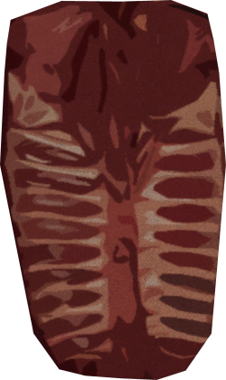

# Venison \(Raw\)

**Categories:** Food And Drink, Pages with update history · **Source:** [Fandom](https://thelongdark.fandom.com/wiki/Venison_%28Raw%29)

**Contents**

- [Overview](#overview)
- [Products](#products)
- [Gallery](#gallery)
- [Update history](#update-history)

**Venison (Raw)**

[Venison (Raw) icon](../assets/Venison_%28Raw%29_icon.png)

**Release:** [22 September 2014](./The%20Long%20Dark%20%E2%80%94%20Early%20Access%20Changelog.md#0.117)

**Wintermute:** No

**Renewable:** Yes

**Properties**

**Item type:** [Food And Drink](./Food%20And%20Drink.md)

**Stackable:** No

**Examine:** Flesh from a deer. Cook to eat safely.

**Values**

**Calories:** 900 kcal

**Hydration:** 0%

**Weight:** 1.00 kg (2.2 lbs)

**Advanced data**

**Item key:** GAMEPLAY\_VenisonRaw

_For the cooked version, see [Venison (Cooked)](./Venison%20%28Cooked%29.md)._

**Venison (Raw)** is a raw food item in _The Long Dark_.

<!-- #Overview -->
​

<!-- #overview -->
## Overview

Venison is harvested from [Deer](./Deer.md) carcasses, which contain between 8.0 and 10.0 kg of raw meat. Consuming raw meat carries a high chance of contracting [Food Poisoning](./Food%20Poisoning.md).

- At 0% condition food disappears if inside of a container, but not outside of containers or in the player's inventory.
- Meat decays slower outdoors than indoors.

Carcasses of deer slain by [wolves](./Wolf.md) will have reduced yields (including meat) proportional to the time the wolf has been feeding, until "ravaged" where the carcass is un-harvestable.

Frozen deer carcasses created during world generation always contain 1 [deer hide](./Fresh%20Deer%20Hide.md), 2 [guts](./Fresh%20Gut.md) and 0.5-2.0 kg of meat.

<!-- #Products -->
​

<!-- #products -->
## Products

| Item | Skills | Materials |
| --- | --- | --- |
| [Breyerhouse Pie](./Breyerhouse%20Pie.md) | None | - 0.50 kg × [Ptarmigan (Raw)](./Ptarmigan%20%28Raw%29.md) - 0.50 kg × [Rabbit (Raw)](./Rabbit%20%28Raw%29.md) - 0.50 kg × [Venison (Raw)](./Venison%20%28Raw%29.md) - 0.15 L × [Water (Potable)](./Water%20%28Potable%29.md) - 0.05 L × [Cooking Oil](./Cooking%20Oil.md) - 0.20 kg × [Old Mill Flour](./Old%20Mill%20Flour.md) |
| [Ranger Stew](./Ranger%20Stew.md) | None | - 0.50 kg × [Venison (Raw)](./Venison%20%28Raw%29.md) - 0.50 kg × [Rabbit (Raw)](./Rabbit%20%28Raw%29.md) - 1 × [Potato](./Potato.md) - 0.20 kg × [Carrot](./Carrot.md) - 0.40 L × [Broth](./Broth.md) - 0.05 kg × [Old Mill Flour](./Old%20Mill%20Flour.md) |
| [Venison (Cooked)](./Venison%20%28Cooked%29.md) | None | - 1.00 kg × [Venison (Raw)](./Venison%20%28Raw%29.md) |
| [Venison Pie](./Venison%20Pie.md) | None | - 0.50 kg × [Venison (Raw)](./Venison%20%28Raw%29.md) - 0.15 L × [Water (Potable)](./Water%20%28Potable%29.md) - 0.05 L × [Cooking Oil](./Cooking%20Oil.md) - 0.20 kg × [Old Mill Flour](./Old%20Mill%20Flour.md) |
| [Venison Stew](./Venison%20Stew.md) | None | - 0.50 kg × [Venison (Raw)](./Venison%20%28Raw%29.md) - 0.20 L × [Broth](./Broth.md) - 0.05 kg × [Old Mill Flour](./Old%20Mill%20Flour.md) |

<!-- #Gallery -->
​

<!-- #gallery -->
## Gallery

<!-- #update_history -->
​

<!-- #Update_history -->
​

<!-- #Update_History -->
​

<!-- #update-history -->
## Update history

- UPDATE **22 September 2014 ([Update](./The%20Long%20Dark%20%E2%80%94%20Early%20Access%20Changelog.md#0.117)):**
  - Added to game.

[ru:Оленина (сырая)](https://ru.wikipedia.org/wiki/%D0%9E%D0%BB%D0%B5%D0%BD%D0%B8%D0%BD%D0%B0_%28%D1%81%D1%8B%D1%80%D0%B0%D1%8F%29)
