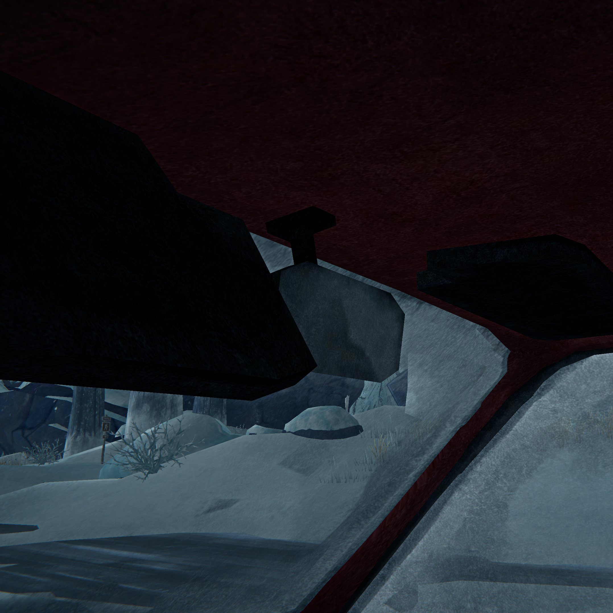

# Visor

 **Visors** are searchable scenery inside vehicles.

## Overview

They have a small chance of containing <a href="./Mementos.md" class="wikilink" title="Mementos">Mementos</a> notes and keys, or <a href="./Polaroids.md" class="wikilink" title="Polaroids">Polaroids</a>, but can otherwise be used to mark looted vehicles instead of opening the hood, which may obstruct visibility of potential predators.

**Visor Mementos Notes** often contain the location of a potential loot stash.

**Lua execution error in Module:Navbox function navbox**

