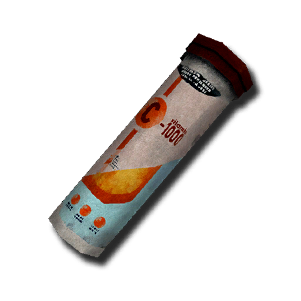

# Vitamin\-C Pills

| Column 1 | Column 2 | Column 3 |
| --- | --- | --- |
|  / *Ptarmigan\_icon.png* | **DLC-Exclusive content.** / This content requires the [Tales from the Far Territory](./Tales%20from%20the%20Far%20Territory.md) addon to be installed before it can be seen or used in regular gameplay. | \|} / **Vitamin-C Pills** / \| Property \| Details \| / \| --- \| --- \| / \|  \|  / *Vitamin-C\_Pills\_icon.png* \| / \| Release \| [2 December 2024](./The%20Long%20Dark%20%E2%80%94%20Changelog.md#2.33) \| / \| Wintermute \| No \| / \| Renewable \| Yes ([Trader](./Trader.md) only, by trading [Old Man's Beard Lichen](./Old%20Man%27s%20Beard%20Lichen.md) or [Birch Bark](./Birch%20Bark.md)) \| / \| **Properties** \|  \| / \| Item type \| [First Aid](./First%20Aid.md)\\|- \| / \| Stackable \| Yes \| / \| Examine \| Vitamin-C supplement. Delays the onset of Scurvy. \| / \| **Values** \|  \| / \| Calories \| 5 kcal \| / \| [Vitamin C](./Scurvy.md) \| Major (125%) \| / \| Weight \| 0.10 kg (0.22 lbs) \| / \| **Advanced data** \|  \| / \| Item key \| GEAR\_BottleVitaminC \| / **Vitamin-C Pills** are a [First Aid](./First%20Aid.md) item in *[The Long Dark](./The%20Long%20Dark.md)*. / ## Overview / Vitamin-C Pills are used to help eliminate [Scurvy Risk](./Scurvy%20Risk.md) or [Scurvy](./Scurvy.md), and are only acquired from the [Trader](./Trader.md). / - Each bottle contains 5 Pills and provides a "Major" dose of Vitamin-C. / - This equals to 125 units dose. *Four pills would therefore cure Scurvy completely.* / - Each pill gives 5 Calories (25 Calories a bottle). / - Each pill weighs 0.02 kg, for 0.10kg a bottle. / ## Location / Vitamin-C Pills are acquired by trading with the [Trader](./Trader.md), and are only unlocked after reaching 400 Trust. / ## Update History / **Template:update history****Lua execution error in Module:Navbox function navbox** [ru:Витамин С в таблетках](ru:%D0%92%D0%B8%D1%82%D0%B0%D0%BC%D0%B8%D0%BD_%D0%A1_%D0%B2_%D1%82%D0%B0%D0%B1%D0%BB%D0%B5%D1%82%D0%BA%D0%B0%D1%85) |
|  / *Vitamin-C\_Pills\_icon.png* |  |  |
| Release | [2 December 2024](./The%20Long%20Dark%20%E2%80%94%20Changelog.md#2.33) |  |
| Wintermute | No |  |
| Renewable | Yes ([Trader](./Trader.md) only, by trading [Old Man's Beard Lichen](./Old%20Man%27s%20Beard%20Lichen.md) or [Birch Bark](./Birch%20Bark.md)) |  |
| **Properties** |  |  |
| Item type | [First Aid](./First%20Aid.md)\|- |  |
| Stackable | Yes |  |
| Examine | Vitamin-C supplement. Delays the onset of Scurvy. |  |
| **Values** |  |  |
| Calories | 5 kcal |  |
| [Vitamin C](./Scurvy.md) | Major (125%) |  |
| Weight | 0.10 kg (0.22 lbs) |  |
| **Advanced data** |  |  |
| Item key | GEAR\_BottleVitaminC |  |
