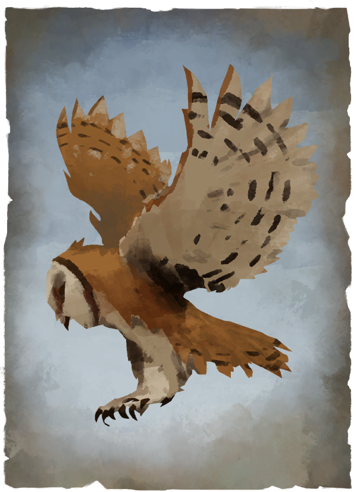

# Voyageur

<figure>

<figcaption>Voyageur_icon.png</figcaption>
</figure>

|  |  |  |
|----|----|----|
| “ | Equal parts hunter and hunted, your struggle to survive will eventually lead to mastering the elements. | ” |

**Voyageur** is the 2nd <a href="./Survival%20Mode.md" class="wikilink" title="Survival Mode">Survival Mode</a> Experience in *<a href="./The%20Long%20Dark.md" class="wikilink" title="The Long Dark">The Long Dark</a>*. It is the standard "normal" difficulty setting.

## Overview

Voyageur takes <a href="./Pilgrim.md" class="wikilink" title="Pilgrim">Pilgrim</a> and increases the difficulty, removing the Wildlife pacifying effect from predators to make them a threat. The game world is only slightly more harsh, with <a href="./Needs.md" class="wikilink" title="Needs">Needs</a> and <a href="./Clothing.md" class="wikilink" title="Clothing">Clothing</a> needing a bit more maintenance. Overall, the game is still quite easy to survive on, with food, clothing, tools, and resources being quite plentiful.

This Experience also introduces Two new Afflictions;

- <a href="./Cabin%20Fever.md" class="wikilink" title="Cabin Fever">Cabin Fever</a>: the player cannot sleep or pass time indoors once contracted after spending too much time inside, and must spend time outside. This removes the ability for the player to endlessly spend most of their time indoors.
- <a href="./Scurvy.md" class="wikilink" title="Scurvy">Scurvy</a>: A debilitating disease that slowly destroys the player's health, though it is quite forgiving.

## Voyageur Settings

- <a href="./Great%20Bear%20Island.md" class="wikilink" title="Great Bear Island">Great Bear Island</a> has regular items to be found.
  - Moderate and mid-quality starting supplies.
  - High-quality items may spawn, but are uncommon.
  - Firearms may spawn.

<!-- -->

- Possible starting equipment:
  - <a href="./Accelerant.md" class="wikilink" title="Accelerant">Accelerant</a>, <a href="./Tinder%20Plug.md" class="wikilink" title="Tinder Plug">Tinder Plug</a>, 12 <a href="./Wood%20Matches.md" class="wikilink" title="Wood Matches">Wood Matches</a>
  - 6 <a href="./Antibiotics.md" class="wikilink" title="Antibiotics">Antibiotics</a>, 2 <a href="./Bandage.md" class="wikilink" title="Bandage">Bandage</a>, 6 <a href="./Painkillers.md" class="wikilink" title="Painkillers">Painkillers</a>
  - <a href="./Cotton%20Toque.md" class="wikilink" title="Cotton Toque">Cotton Toque</a>, <a href="./Thin%20Wool%20Sweater.md" class="wikilink" title="Thin Wool Sweater">Thin Wool Sweater</a>, <a href="./Driving%20Gloves.md" class="wikilink" title="Driving Gloves">Driving Gloves</a>, <a href="./Jeans.md" class="wikilink" title="Jeans">Jeans</a>, <a href="./Thermal%20Underwear.md" class="wikilink" title="Thermal Underwear">Thermal Underwear</a>, <a href="./Wool%20Socks.md" class="wikilink" title="Wool Socks">Wool Socks</a>, <a href="./Leather%20Shoes.md" class="wikilink" title="Leather Shoes">Leather Shoes</a>
  - 0.50 <a href="./Water%20%28Potable%29.md" class="wikilink" title="Water (Potable)">Water (Potable)</a>
  - <a href="./Bedroll.md" class="wikilink" title="Bedroll">Bedroll</a>, <a href="./Flare.md" class="wikilink" title="Flare">Flare</a>, <a href="./Recycled%20Can.md" class="wikilink" title="Recycled Can">Recycled Can</a>, <a href="./Sewing%20Kit.md" class="wikilink" title="Sewing Kit">Sewing Kit</a>

<!-- -->

- Normal <a href="./Needs.md" class="wikilink" title="Needs">Needs</a>.
- Hostile <a href="./Wildlife.md" class="wikilink" title="Wildlife">Wildlife</a> will not spawn for the first 24 hours.
- Chance to start at night, outdoors, during poor weather, or in an inhospitable <a href="./Region.md" class="wikilink" title="Region">Region</a>.
- Moderate <a href="./Decay.md" class="wikilink" title="Decay">Decay</a> of items.
- All <a href="./Fire.md" class="wikilink" title="Fires">Fires</a> prevent <a href="./Hypothermia.md" class="wikilink" title="freezing">freezing</a> (regardless of ambient temperature).
- Automatically wake from <a href="./Sleep.md" class="wikilink" title="sleep">sleep</a> when <a href="./Hypothermia.md" class="wikilink" title="freezing">freezing</a> IF you are sleeping next to a <a href="./Fire.md" class="wikilink" title="fire">fire</a>.
- The player will automatically wake up once their <a href="./Fatigue.md" class="wikilink" title="Fatigue">Fatigue</a> meter is fully rested, and they cannot go back to sleep until sufficiently tired.
- <a href="./Cabin%20Fever.md" class="wikilink" title="Cabin Fever">Cabin Fever</a> is enabled, but has a very forgiving grace period.
- The option to enable the <a href="./Trader.md" class="wikilink" title="Trader">Trader</a>, <a href="./Cougar.md" class="wikilink" title="Cougar">Cougar</a>, and <a href="./Scurvy.md" class="wikilink" title="Scurvy">Scurvy</a> on or off is present.
- Allows four active <a href="./Feats.md" class="wikilink" title="Feats">Feats</a>.

<table>
<thead>
<tr>
<th scope="col">
DIFFICULTY
</th>
<th scope="col">
VOYAGEUR
</th>
</tr>
</thead>
<tbody>
<tr>
<td colspan="2" style="background-color: rgb(50,50,50)">
GAME START
</td>
</tr>
<tr>
<td>
Baseline resource availability
</td>
<td>
High
</td>
</tr>
<tr>
<td>
Starting time of day
</td>
<td>
Random
</td>
</tr>
<tr>
<td>
Starting weather
</td>
<td>
Heavy Fog
</td>
</tr>
<tr>
<td>
Indoor spawns permitted
</td>
<td>
Yes
</td>
</tr>
<tr>
<td>
Survivor monologue
</td>
<td>
Yes
</td>
</tr>
<tr>
<td colspan="2" style="background-color: rgb(50,50,50)">
ENVIRONMENT
</td>
</tr>
<tr>
<td>
Length of day multiplier
</td>
<td>
1x
</td>
</tr>
<tr>
<td>
Weather variability
</td>
<td>
Medium
</td>
</tr>
<tr>
<td>
Blizzard frequency
</td>
<td>
Medium
</td>
</tr>
<tr>
<td>
World gets colder over time
</td>
<td>
Low
</td>
</tr>
<tr>
<td>
Wind variability
</td>
<td>
Medium
</td>
</tr>
<tr>
<td>
Aurora frequency
</td>
<td>
Medium
</td>
</tr>
<tr>
<td>
Fire overcomes ambient air temp
</td>
<td>
Yes
</td>
</tr>
<tr>
<td>
Endless night (v1.83)
</td>
<td>
No
</td>
</tr>
<tr>
<td colspan="2" style="background-color: rgb(50,50,50)">
HEALTH
</td>
</tr>
<tr>
<td>
Calorie burn rate
</td>
<td>
Medium
</td>
</tr>
<tr>
<td>
Thirst rate
</td>
<td>
Medium
</td>
</tr>
<tr>
<td>
Fatigue rate
</td>
<td>
High
</td>
</tr>
<tr>
<td>
Freezing rate
</td>
<td>
Medium
</td>
</tr>
<tr>
<td>
At-rest condition recovery rate
</td>
<td>
High
</td>
</tr>
<tr>
<td>
Condition recovery rate
</td>
<td>
High
</td>
</tr>
<tr>
<td>
Hypothermia recovery time
</td>
<td>
Medium
</td>
</tr>
<tr>
<td>
Frostbite rate
</td>
<td>
Medium
</td>
</tr>
<tr>
<td>
Cabin fever
</td>
<td>
Yes
</td>
</tr>
<tr>
<td>
Intestinal parasites
</td>
<td>
No
</td>
</tr>
<tr>
<td>
Dysentery
</td>
<td>
Yes
</td>
</tr>
<tr>
<td>
Sprains
</td>
<td>
Yes
</td>
</tr>
<tr>
<td>
Food poisoning
</td>
<td>
Yes
</td>
</tr>
<tr>
<td>
Broken ribs
</td>
<td>
Yes
</td>
</tr>
<tr>
<td>
Rest as a resource
</td>
<td>
Yes
</td>
</tr>
<tr>
<td>
Scurvy - Vitamin-C drain rate
</td>
<td>
Medium
</td>
</tr>
<tr>
<td>
Fires prevent freezing
</td>
<td>
Yes
</td>
</tr>
<tr>
<td>
Wake up player when freezing near a fire
</td>
<td>
Yes
</td>
</tr>
<tr>
<td>
Birch bark tea crafting <strong>(v.1.64)</strong>
</td>
<td>
Yes
</td>
</tr>
<tr>
<td colspan="2" style="background-color: rgb(50,50,50)">
GEAR
</td>
</tr>
<tr>
<td>
Item decay rate
</td>
<td>
Medium
</td>
</tr>
<tr>
<td>
Loose item availability
</td>
<td>
High
</td>
</tr>
<tr>
<td>
Empty container chance modifier
</td>
<td>
None
</td>
</tr>
<tr>
<td>
Stick, branch, and stone respawn frequency
</td>
<td>
High
</td>
</tr>
<tr>
<td>
Starting gear allocation
</td>
<td>
High
</td>
</tr>
<tr>
<td>
Rifle availability
</td>
<td>
Yes
</td>
</tr>
<tr>
<td>
Revolver availability <strong>(v.1.64)</strong>
</td>
<td>
Yes
</td>
</tr>
<tr>
<td>
Harvestable plant availability
</td>
<td>
High
</td>
</tr>
<tr>
<td>
Reduce container item density
</td>
<td>
None
</td>
</tr>
<tr>
<td colspan="2" style="background-color: rgb(50,50,50)">
WILDLIFE SPAWNS
</td>
</tr>
<tr>
<td>
Cougar spawn chance
</td>
<td>
Medium
</td>
</tr>
<tr>
<td>
Wolf spawn chance
</td>
<td>
Medium
</td>
</tr>
<tr>
<td>
Timberwolf spawn chance
</td>
<td>
Medium
</td>
</tr>
<tr>
<td>
Deer spawn chance
</td>
<td>
High
</td>
</tr>
<tr>
<td>
Rabbit spawn chance
</td>
<td>
High
</td>
</tr>
<tr>
<td>
Bear spawn chance
</td>
<td>
Medium
</td>
</tr>
<tr>
<td>
Moose spawn chance
</td>
<td>
Medium
</td>
</tr>
<tr>
<td>
Time to wildlife respawn
</td>
<td>
Medium
</td>
</tr>
<tr>
<td>
Reduce wildlife population over time
</td>
<td>
Low
</td>
</tr>
<tr>
<td>
Wolf spawn distance
</td>
<td>
Close
</td>
</tr>
<tr>
<td>
Predator grace period
</td>
<td>
Yes
</td>
</tr>
<tr>
<td colspan="2" style="background-color: rgb(50,50,50)">
WILDLIFE BEHAVIOUR
</td>
</tr>
<tr>
<td>
Wildlife smell range
</td>
<td>
Medium
</td>
</tr>
<tr>
<td>
Scent increase from Meat/Blood
</td>
<td>
Medium
</td>
</tr>
<tr>
<td>
Passive wildlife
</td>
<td>
No
</td>
</tr>
<tr>
<td>
Wildlife attacks during rest
</td>
<td>
Yes
</td>
</tr>
<tr>
<td>
Wolf fear
</td>
<td>
Medium
</td>
</tr>
<tr>
<td>
Timberwolf morale
</td>
<td>
Medium
</td>
</tr>
<tr>
<td>
Wildlife detection range
</td>
<td>
Medium
</td>
</tr>
<tr>
<td colspan="2" style="background-color: rgb(50,50,50)">
WILDLIFE STRUGGLE
</td>
</tr>
<tr>
<td>
Struggle bonus
</td>
<td>
Medium
</td>
</tr>
<tr>
<td>
Struggle condition damage modifier
</td>
<td>
None
</td>
</tr>
<tr>
<td>
Struggle clothing damage modifier
</td>
<td>
Low
</td>
</tr>
<tr>
<td>
Struggle damage severity
</td>
<td>
Medium
</td>
</tr>
</tbody>
</table>

**Lua execution error in Module:Navbox function navbox**

