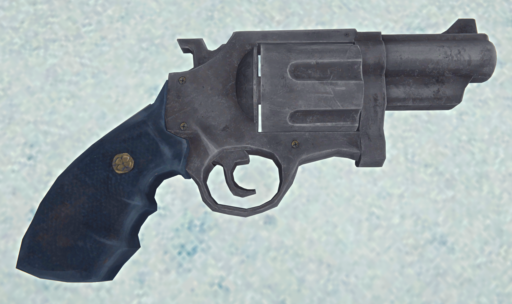

# Warden's Revolver

**Categories:** DLC Content, Pages with update history, Tools · **Source:** [Fandom](https://thelongdark.fandom.com/wiki/Warden's_Revolver)

**Contents**

- [Overview](#overview)
- [Revolver Range](#revolver-range)
- [Location](#location)
- [Differences from Revolver](#differences-from-revolver)
- [Trivia](#trivia)
- [Gallery](#gallery)
- [Update history](#update-history)

| Column 1 | Column 2 | Column 3 | Column 4 |
| --- | --- | --- | --- |

|  / _Warden's\_Revolver\_icon.png_ |  |  |  |
| Release | [21 June 2023](./The%20Long%20Dark%20%E2%80%94%20Changelog.md#2.17) |  |  |
| Wintermute | No |  |  |
| Renewable | No (unique item) |  |  |
| **Properties** |  |  |  |
| Item type | [Tools](./Tools.md)\|- |  |  |
| Stackable | No |  |  |
| Examine | Quick draw sidearm. Out of place in the wilderness, but its short barrel and light weight allow for a faster aiming action. |  |  |
| **Values** |  |  |  |
| Weight | 1.25 kg (2.75 lbs) |  |  |
| **Actions** |  |  |  |
| Backpack | Use, Actions, Drop |  |  |
| On ground | Take It, Equip It, Leave It |  |  |
| **Advanced data** |  |  |  |
| Item key | GEAR\_RevolverStubNosed |  |  |
|  / _Wardens Revolver Ground Model_ |  / _Wardens Revolver Iron Sights_ |  / _The front door revolver location_ |  / _The bathroom in the Warden's Office revolver location_ |
|  / _The Warden's Revolver in broad daylight. Note the lack of rear iron sights._ |  |  |  |
