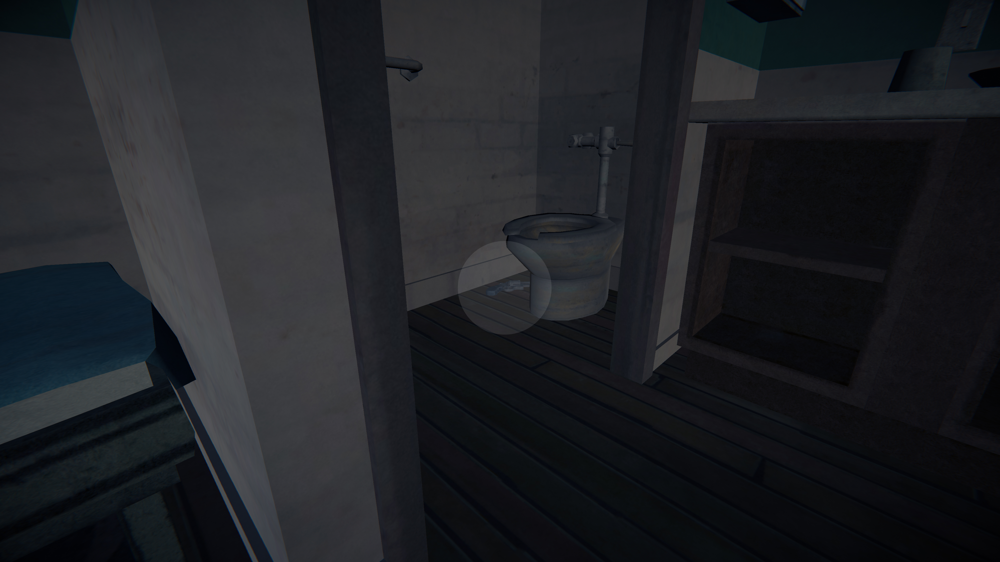
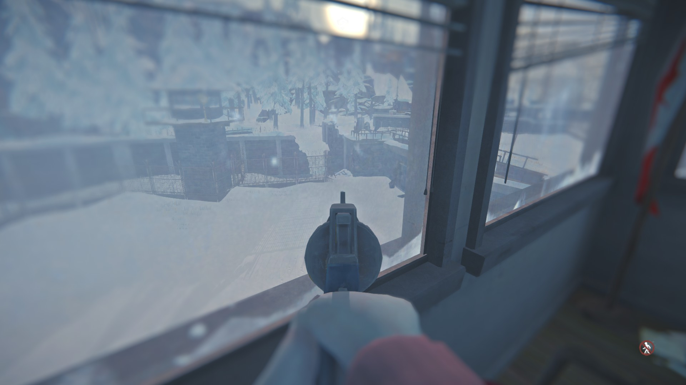

# Warden's Revolver

**Categories:** DLC Content, Pages with update history, Tools · **Source:** [Fandom](https://thelongdark.fandom.com/wiki/Warden's_Revolver)

**Contents**

- [Overview](#overview)
- [Revolver Range](#revolver-range)
- [Location](#location)
- [Differences from Revolver](#differences-from-revolver)
- [Trivia](#trivia)
- [Gallery](#gallery)
- [Update history](#update-history)

**DLC-Exclusive content.**

This content requires the [Tales from the Far Territory](./Tales%20from%20the%20Far%20Territory.md) addon to be installed before it can be seen or used in regular gameplay.

**Warden's Revolver**

| Property | Details |
| --- | --- |
|  | [Warden's Revolver icon](../assets/Warden%27s_Revolver_icon.png) |
| Release | [21 June 2023](./The%20Long%20Dark%20%E2%80%94%20Changelog.md#2.17) |
| Wintermute | No |
| Renewable | No (unique item) |
| **Properties** |  |
| Item type | [Tools](./Tools.md) |
| Equipable | Yes |
| Stackable | No |
| Examine | Quick draw sidearm. Out of place in the wilderness, but its short barrel and light weight allow for a faster aiming action. |
| **Values** |  |
| Weight | 1.25 kg (2.75 lbs) |
| **Actions** |  |
| Backpack | Use, Actions, Drop |
| On ground | Take It, Equip It, Leave It |
| **Advanced data** |  |
| Item key | GEAR\_RevolverStubNosed |

**Warden's Revolver** is a unique variant of the [Revolver](./Revolver.md) in _The Long Dark_, added by the _[Tales from the Far Territory](./Tales%20from%20the%20Far%20Territory.md)_ expansion.

## Overview

The Warden's Revolver has been modified for portability with a snub-nose barrel, and custom blue grip featuring golden four leaf clover inlays. It has the lowest weight of any firearm available; weighing 0.25 Kg less than the standard revolver, and has a 25% faster aiming action. The downside is that the guns effective range is reduced by 33%.

The Warden's Revolver has no rear iron sights and a very tall and wide front sight post, making long distance aiming difficult.

## Revolver Range

The range decrease is applied to a ray-trace fired from the center of the screen when a shot is fired, normally the standard Revolver's ray-trace range is about 30 meters long, but the Warden's Revolver's is 20.1 meters long. Past this range the weapon will be unable to damage any [Wildlife](./Wildlife.md).

## Location

The Warden's revolver spawns a single time per world in various states of repair. The gun's location may differ between saves, but it can be located around [Blackrock Prison](./Blackrock%20Prison.md) in the [Blackrock Region](./Blackrock.md):

- Under the table in the accessible rope climb watchtower.
- Next to the toilet in the bathroom in the Warden's Office.
- Behind a piece of debris in the main prison hall entrance, to the right most back side.

## Differences from Revolver

- Base weight is 0.25kg less than the Revolver
- Aim down sights time is 25% faster than the Revolver
- Range is 33% less than the Revolver
- Lacks rear iron sights

## Trivia

- Given its namesake and the location it is found, this firearm most likely belonged to [Franklin](./Franklin.md), the former Warden of Blackrock Federal Penitentiary.

## Gallery

## Update history

- UPDATE **21 June 2023 ([Update](./The%20Long%20Dark%20%E2%80%94%20Changelog.md#2.17)):**
  - Added to game.
