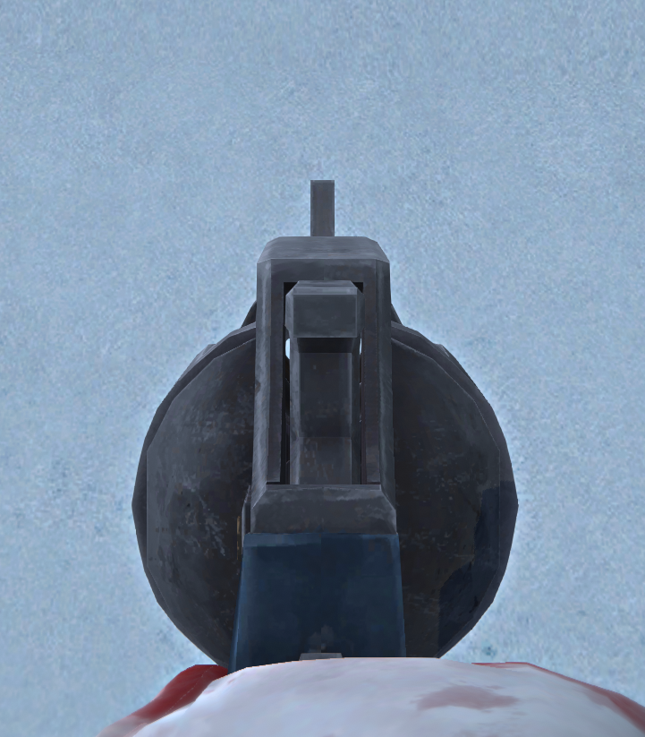

# Warden's Revolver

**Contents**

- [Overview](#Overview)
- [Revolver Range](#Revolver_Range)
- [Location](#Location)
- [Differences from Revolver](#Differences_from_Revolver)
- [Trivia](#Trivia)
- [Gallery](#Gallery)
- [Update history](#Update_history)

<table>
<colgroup>
<col style="width: 33%" />
<col style="width: 33%" />
<col style="width: 33%" />
</colgroup>
<tbody>
<tr>
<td width="40px"><figure>
[Missing image: Ptarmigan_icon.png]
<figcaption>Ptarmigan_icon.png</figcaption>
</figure></td>
<td>
<strong>DLC-Exclusive content.</strong> 

This content requires the <a href="./Tales%20from%20the%20Far%20Territory.md" class="wikilink" title="Tales from the Far Territory">Tales from the Far Territory</a> addon to be installed before it can be seen or used in regular gameplay.

</td>
<td>
|}

<table class="infobox">
<caption>Warden's Revolver</caption>
<colgroup>
<col style="width: 50%" />
<col style="width: 50%" />
</colgroup>
<tbody>
<tr>
<td colspan="2"><figure>

<figcaption>Warden's_Revolver_icon.png</figcaption>
</figure></td>
</tr>
<tr>
<td>
Release
</td>
<td>
<a href="./The%20Long%20Dark%20%E2%80%94%20Changelog.md#2.17" class="wikilink" title="21 June 2023">21 June 2023</a>
</td>
</tr>
<tr>
<td>
Wintermute
</td>
<td>
No
</td>
</tr>
<tr>
<td>
Renewable
</td>
<td>
No (unique item)
</td>
</tr>
<tr>
<td colspan="2" class="section">
<strong>Properties</strong>
</td>
</tr>
<tr>
<td>
Item type
</td>
<td>
<a href="./Tools.md" class="wikilink" title="Tools">Tools</a>|-
</td>
</tr>
<tr>
<td>
Stackable
</td>
<td>
No
</td>
</tr>
<tr>
<td>
Examine
</td>
<td>
Quick draw sidearm. Out of place in the wilderness, but its short barrel and light weight allow for a faster aiming action.
</td>
</tr>
<tr>
<td colspan="2" class="section">
<strong>Values</strong>
</td>
</tr>
<tr>
<td>
Weight
</td>
<td>
1.25 kg (2.75 lbs)
</td>
</tr>
<tr>
<td colspan="2" class="section">
<strong>Actions</strong>
</td>
</tr>
<tr>
<td>
Backpack
</td>
<td>
Use, Actions, Drop
</td>
</tr>
<tr>
<td>
On ground
</td>
<td>
Take It, Equip It, Leave It
</td>
</tr>
<tr>
<td colspan="2" class="section">
<strong>Advanced data</strong>
</td>
</tr>
<tr>
<td>
Item key
</td>
<td>
GEAR_RevolverStubNosed
</td>
</tr>
</tbody>
</table>

<strong>Warden's Revolver</strong> is a unique variant of the <a href="./Revolver.md" class="wikilink" title="Revolver">Revolver</a> in <em>The Long Dark</em>, added by the <em><a href="./Tales%20from%20the%20Far%20Territory.md" class="wikilink" title="Tales from the Far Territory">Tales from the Far Territory</a></em> expansion.

<h2 id="Overview">Overview</h2>

The Warden's Revolver has been modified for portability with a snub-nose barrel, and custom blue grip featuring golden four leaf clover inlays. It has the lowest weight of any firearm available; weighing 0.25 Kg less than the standard revolver, and has a 25% faster aiming action. The downside is that the guns effective range is reduced by 33%.

The Warden's Revolver has no rear iron sights and a very tall and wide front sight post, making long distance aiming difficult.

<h2 id="Revolver_Range">Revolver Range</h2>

The range decrease is applied to a ray-trace fired from the center of the screen when a shot is fired, normally the standard Revolver's ray-trace range is about 30 meters long, but the Warden's Revolver's is 20.1 meters long. Past this range the weapon will be unable to damage any <a href="./Wildlife.md" class="wikilink" title="Wildlife">Wildlife</a>.

<h2 id="Location">Location</h2>

The Warden's revolver spawns a single time per world in various states of repair. The gun's location may differ between saves, but it can be located around <a href="./Blackrock%20Prison.md" class="wikilink" title="Blackrock Prison">Blackrock Prison</a> in the <a href="./Blackrock.md" class="wikilink" title="Blackrock Region">Blackrock Region</a>:

<ul>
<li>Under the table in the accessible rope climb watchtower.</li>
<li>Next to the toilet in the bathroom in the Warden's Office.</li>
<li>Behind a piece of debris in the main prison hall entrance, to the right most back side.</li>
</ul>
<h2 id="Differences_from_Revolver">Differences from Revolver</h2>
<ul>
<li>Base weight is 0.25kg less than the Revolver</li>
<li>Aim down sights time is 25% faster than the Revolver</li>
<li>Range is 33% less than the Revolver</li>
<li>Lacks rear iron sights</li>
</ul>
<h2 id="Trivia">Trivia</h2>
<ul>
<li>Given its namesake and the location it is found, this firearm most likely belonged to <a href="./Franklin.md" class="wikilink" title="Franklin">Franklin</a>, the former Warden of Blackrock Federal Penitentiary.</li>
</ul>
<h2 id="Gallery">Gallery</h2>
<table class="gallery">
<colgroup>
<col style="width: 25%" />
<col style="width: 25%" />
<col style="width: 25%" />
<col style="width: 25%" />
</colgroup>
<tbody>
<tr>
<td><figure>

<figcaption>Wardens Revolver Ground Model</figcaption>
</figure></td>
<td><figure>

<figcaption>Wardens Revolver Iron Sights</figcaption>
</figure></td>
<td><figure>
[Missing image: Warden's_Revolver_Location.jpg]
<figcaption>The front door revolver location</figcaption>
</figure></td>
<td><figure>
[Missing image: Revolver.jpg]
<figcaption>The bathroom in the Warden's Office revolver location</figcaption>
</figure></td>
</tr>
<tr>
<td><figure>
[Missing image: WardenADSBroadDaylight.jpg]
<figcaption>The Warden's Revolver in broad daylight. Note the lack of rear iron sights.</figcaption>
</figure></td>
<td></td>
<td></td>
<td></td>
</tr>
</tbody>
</table>
<h2 id="Update_history">Update history</h2>

<ul>
<li>UPDATE <strong>21 June 2023 (<a href="./The%20Long%20Dark%20%E2%80%94%20Changelog.md#2.17" class="wikilink" title="Update">Update</a>):</strong>
<ul>
<li>Added to game.</li>
</ul></li>
</ul>

<strong>Lua execution error in Module:Navbox function navbox</strong>

<a href="ru:%D0%A0%D0%B5%D0%B2%D0%BE%D0%BB%D1%8C%D0%B2%D0%B5%D1%80_%D0%BD%D0%B0%D1%87%D0%B0%D0%BB%D1%8C%D0%BD%D0%B8%D0%BA%D0%B0" class="wikilink" title="ru:Револьвер начальника">ru:Револьвер начальника</a>
</td>
</tr>
</tbody>
</table>

