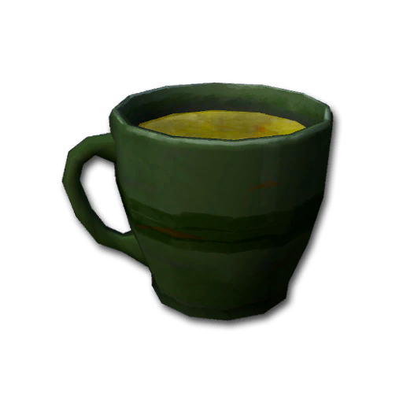
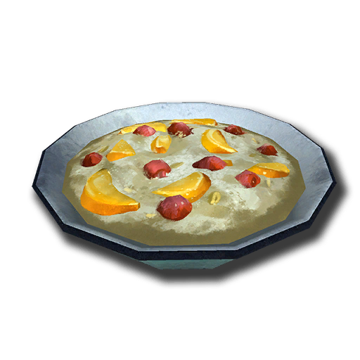

# Warming Up

**Contents**

- [Overview](#Overview)
- [Benefits](#Benefits)
- [Items that can provide Warming Up](#Items_that_can_provide_Warming_Up)
- [Food](#Food)
- [Drink](#Drink)
- [Prepared in Cooking Skillet:](#Prepared_in_Cooking_Skillet%3A)
- [Prepared in Cooking Pot:](#Prepared_in_Cooking_Pot%3A)
- [Trivia](#Trivia)
- [Gallery](#Gallery)

<table class="infobox">
<caption>Warming Up</caption>
<colgroup>
<col style="width: 50%" />
<col style="width: 50%" />
</colgroup>
<tbody>
<tr>
<td colspan="2"><figure>
[Missing image: Warming_Up_icon.png]
<figcaption>Warming_Up_icon.png</figcaption>
</figure></td>
</tr>
<tr>
<td colspan="2" class="section">
<strong>Properties</strong>
</td>
</tr>
<tr>
<td>
Category
</td>
<td>
<a href="./Afflictions.md" class="wikilink" title="Afflictions">Afflictions</a>
</td>
</tr>
<tr>
<td>
Caused By
</td>
<td>
Consume HOT <a href="./Food%20And%20Drink.md" class="wikilink" title="Food And Drink">Food And Drink</a>
</td>
</tr>
<tr>
<td>
Effect
</td>
<td>
Positive
</td>
</tr>
<tr>
<td>
Type
</td>
<td>
Benefit
</td>
</tr>
<tr>
<td>
Benefit Duration
</td>
<td>
45 minutes - 1 hour
</td>
</tr>
</tbody>
</table>

<table>
<colgroup>
<col style="width: 33%" />
<col style="width: 33%" />
<col style="width: 33%" />
</colgroup>
<tbody>
<tr>
<td style="vertical-align: top; font-size: 3em; color: #5d5980; padding-right: 10px">
“
</td>
<td>
That warm food goes straight to your core, heating you from within. Protects against Cold while active.

&#10;

In-game description

</td>
<td style="vertical-align: bottom; font-size: 3em; color: #5d5980; padding-left: 10px">
”
</td>
</tr>
</tbody>
</table>

**Warming Up** is a positive benefit <a href="./Afflictions.md" class="wikilink" title="Affliction">Affliction</a> in the **<a href="./The%20Long%20Dark.md" class="wikilink" title="The Long Dark"><em>The Long Dark</em></a>.** The buff is gained by eating <a href="./Food%20And%20Drink.md" class="wikilink" title="Food And Drink">Food And Drink</a> that has been warmed up by a <a href="./Fire.md" class="wikilink" title="fire">fire</a> and currently has the "HOT" status. While Warming Up is active, the rate of depletion of the <a href="./Warmth.md" class="wikilink" title="Warmth">Warmth</a> meter while <a href="./Feels%20Like.md" class="wikilink" title="Feels Like">Feels Like</a> is below 0 is reduced by half.

## Overview

**HOT** is an attribute that is granted to some foods immediately upon finishing <a href="./Cooking.md" class="wikilink" title="Cooking">Cooking</a> over a Fire.

- Only food or drink that is currently "HOT" will give Warming Up when consumed; which can be checked inside the inventory at any time.
- Items that can be reheated but are now cold will have a blue "COLD" next to their status in the inventory page, whereas heated items will have a red "HOT."
  - Items that cannot be heated do not have this distinction (example: Warming Up cannot be obtained from cooked meat or boiled water, despite requiring a fire to make them.)
  - Some foods cannot be reheated once they are cooked, thus only gain the "HOT" benefit shortly after being prepared (see list below).

"HOT" status is short-lived, wearing off after 15 game minutes indoors or 5 game minutes outdoors. Placing any warm food or drink inside an <a href="./Insulated%20Flask.md" class="wikilink" title="Insulated Flask">Insulated Flask</a> will keep food and drink warmer for much longer than keeping it inside its original container, though not all foods can be inserted into a Flask.

## Benefits

\[Missing image: Warming.jpg\] Placing teas and canned goods near an active fire will warm/cook them, without sacrificing a cooking slot.Consuming items while HOT grants benefits to <a href="./Warmth.md" class="wikilink" title="Warmth">Warmth</a> as long as Warming Up is active:

- Instantly replenishes a small amount of the Warmth bar (20% for drinks, less for food). If <a href="./First%20Aid.md" class="wikilink" title="First Aid">First Aid</a> teas are consumed and the survivor doesn't have <a href="./Afflictions.md" class="wikilink" title="Afflictions">Afflictions</a> that may be cured by the respective cures, the Warmth gain will be 40%.
- A plus sign ('+') appears on the Warmth bar indicating Warming Up Affliction, which slows down the loss of warmth during cold. Reduces Warmth loss by 50% compared to your current <a href="./Feels%20Like.md" class="wikilink" title="Feels Like">Feels Like</a> temperature as long as Warming Up is active.
- Partial consumption provides partial Warmth benefit but resets Afflictions' duration anew which in addition provide a fixed Warmth amount and full Warming Up duration on the final moment of complete consumption.

It is possible to warm up some food and drinks without directly cooking on a fire's cooking slot, thus sparing a cooking slot. By placing them around an active fire, multiple teas and canned goods can be warmed up at once.

## Items that can provide Warming Up

Note that some of these items are only available to players who purchased <a href="./Tales%20from%20the%20Far%20Territory.md" class="wikilink" title="Tales from the Far Territory">Tales from the Far Territory</a>.

### Food

-  <a href="./Canned%20Corn.md" class="wikilink" title="Canned Corn">Canned Corn</a>
-  <a href="./Canned%20Pineapple.md" class="wikilink" title="Canned Pineapple">Canned Pineapple</a>
-  <a href="./Cooked%20Potato.md" class="wikilink" title="Cooked Potato">Cooked Potato</a> (cannot be reheated)
-  <a href="./Pinnacle%20Peaches.md" class="wikilink" title="Pinnacle Peaches">Pinnacle Peaches</a>
-  <a href="./Pork%20and%20Beans.md" class="wikilink" title="Pork and Beans">Pork and Beans</a>
-  <a href="./Pumpkin%20Pie.md" class="wikilink" title="Pumpkin Pie">Pumpkin Pie</a> (discontinued item)
-  <a href="./Tomato%20Soup.md" class="wikilink" title="Tomato Soup">Tomato Soup</a>

### Drink

-  <a href="./Birch%20Bark%20Tea.md" class="wikilink" title="Birch Bark Tea">Birch Bark Tea</a>
-  <a href="./Burdock%20Tea.md" class="wikilink" title="Burdock Tea">Burdock Tea</a>
-  <a href="./Cup%20of%20Acorn%20Coffee.md" class="wikilink" title="Cup of Acorn Coffee">Cup of Acorn Coffee</a>
-  <a href="./Cup%20of%20Coffee.md" class="wikilink" title="Cup of Coffee">Cup of Coffee</a>
-  <a href="./Cup%20of%20Herbal%20Tea.md" class="wikilink" title="Cup of Herbal Tea">Cup of Herbal Tea</a>
-  <a href="./Home-made%20Soup.md" class="wikilink" title="Home-made Soup">Home-made Soup</a>
-  <a href="./Reishi%20Tea.md" class="wikilink" title="Reishi Tea">Reishi Tea</a>
-  <a href="./Rose%20Hip%20Tea.md" class="wikilink" title="Rose Hip Tea">Rose Hip Tea</a>

### Prepared in <a href="./Cooking%20Skillet.md" class="wikilink" title="Cooking Skillet">Cooking Skillet</a>:

(Pies cannot be reheated once Cooked)

-  <a href="./Peach%20Pie.md" class="wikilink" title="Peach Pie">Peach Pie</a>
-  <a href="./Rose%20Hip%20Pie.md" class="wikilink" title="Rose Hip Pie">Rose Hip Pie</a>
-  <a href="./Breyerhouse%20Pie.md" class="wikilink" title="Breyerhouse Pie">Breyerhouse Pie</a>
-  <a href="./Dockworker%27s%20Pie.md" class="wikilink" title="Dockworker&#39;s Pie">Dockworker's Pie</a>
-  <a href="./Prepper%27s%20Pie.md" class="wikilink" title="Prepper&#39;s Pie">Prepper's Pie</a>
-  <a href="./Stalker%27s%20Pie.md" class="wikilink" title="Stalker&#39;s Pie">Stalker's Pie</a>

### Prepared in <a href="./Cooking%20Pot.md" class="wikilink" title="Cooking Pot">Cooking Pot</a>:

(Stews cannot be reheated once Cooked)

-  <a href="./Broth.md" class="wikilink" title="Broth">Broth</a>
-  <a href="./Porridge.md" class="wikilink" title="Porridge">Porridge</a>
-  <a href="./Camber%20Flight%20Porridge.md" class="wikilink" title="Camber Flight Porridge">Camber Flight Porridge</a>
-  <a href="./Rabbit%20Stew.md" class="wikilink" title="Rabbit Stew">Rabbit Stew</a> (cannot be reheated)
-  <a href="./Ptarmigan%20Stew.md" class="wikilink" title="Ptarmigan Stew">Ptarmigan Stew</a> (cannot be reheated)
-  <a href="./Trout%20Stew.md" class="wikilink" title="Trout Stew">Trout Stew</a> (cannot be reheated)
-  <a href="./Venison%20Stew.md" class="wikilink" title="Venison Stew">Venison Stew</a> (cannot be reheated)
-  <a href="./Thomson%20Family%20Stew.md" class="wikilink" title="Thomson Family Stew">Thomson Family Stew</a> (cannot be reheated)
-  <a href="./Ranger%20Stew.md" class="wikilink" title="Ranger Stew">Ranger Stew</a> (cannot be reheated)
-  <a href="./Last%20Resort%20Soup.md" class="wikilink" title="Last Resort Soup">Last Resort Soup</a>
-  <a href="./Porter%27s%20Soup.md" class="wikilink" title="Porter&#39;s Soup">Porter's Soup</a>
-  <a href="./Vagabond%20Soup.md" class="wikilink" title="Vagabond Soup">Vagabond Soup</a>

## Trivia

- A notable food that was always found in the HOT state and never went COLD was the <a href="./Pumpkin%20Pie.md" class="wikilink" title="Pumpkin Pie">Pumpkin Pie</a>. This is the only food item with this distinction, but it was only found in the seasonal <a href="./Challenge.md" class="wikilink" title="Challenge">Challenge</a> <a href="./4%20Days%20of%20Night%20Event.md" class="wikilink" title="4 Days of Night">4 Days of Night</a> (currently <a href="./Cut%20%E2%80%94%20Discontinued%20Content.md" class="wikilink" title="Cut/Discontinued Content">Cut/Discontinued Content</a>).

## Gallery

<table class="gallery">
<colgroup>
<col style="width: 100%" />
</colgroup>
<tbody>
<tr>
<td><figure>
[Missing image: Warming_up.png]
<figcaption>Old icon.</figcaption>
</figure></td>
</tr>
</tbody>
</table>

**Lua execution error in Module:Navbox function navbox**<a href="ru:%D0%A1%D0%BE%D0%B3%D1%80%D0%B5%D0%B2%D0%B0%D0%BD%D0%B8%D0%B5" class="wikilink" title="ru:Согревание">ru:Согревание</a>

