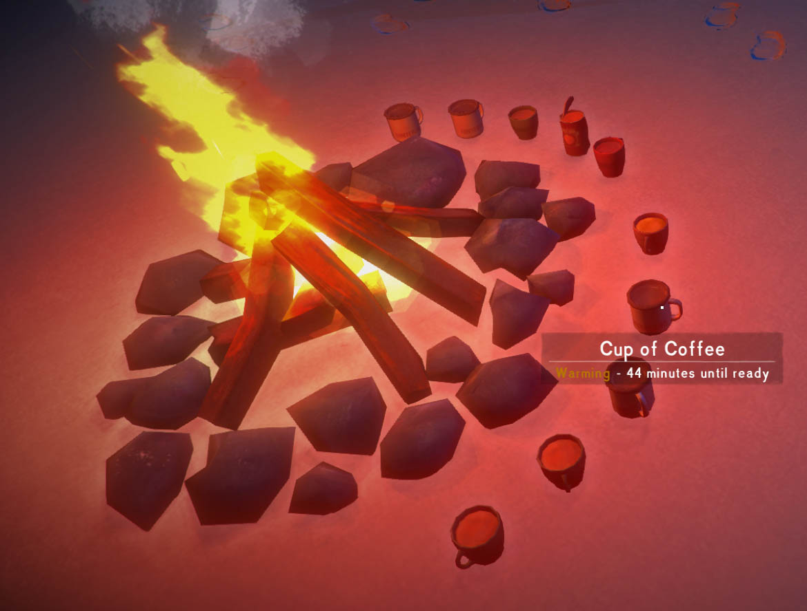
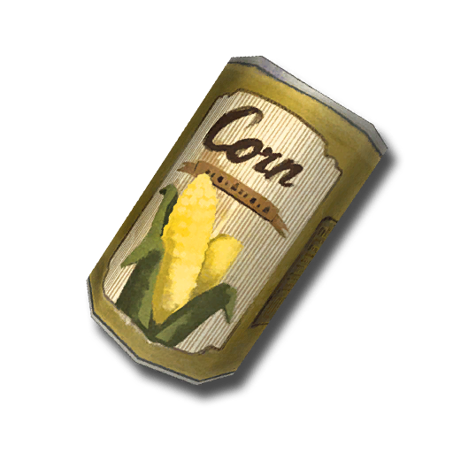
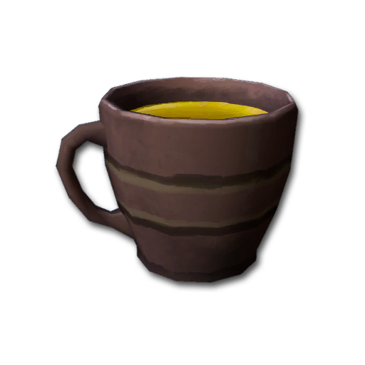

# Warming Up

**Categories:** Afflictions · **Source:** [Fandom](https://thelongdark.fandom.com/wiki/Warming_Up)

**Contents**

- [Overview](#overview)
- [Benefits](#benefits)
- [Items that can provide Warming Up](#items-that-can-provide-warming-up)
- [Food](#food)
- [Drink](#drink)
- [Prepared in Cooking Skillet:](#prepared-in-cooking-skillet)
- [Prepared in Cooking Pot:](#prepared-in-cooking-pot)
- [Trivia](#trivia)
- [Gallery](#gallery)

**Warming Up**

| Property | Details |
| --- | --- |
|  | [Warming Up icon](../assets/Warming_Up_icon.png) |
| **Properties** |  |
| Category | [Afflictions](./Afflictions.md) |
| Caused By | Consume HOT [Food And Drink](./Food%20And%20Drink.md) |
| Effect | Positive |
| Type | Benefit |
| Benefit Duration | 45 minutes - 1 hour |

> “**That warm food goes straight to your core, heating you from within. Protects against Cold while active.**”
>
> — In-game description

**Warming Up** is a positive benefit [Affliction](./Afflictions.md) in the **[_The Long Dark_](./The%20Long%20Dark.md).** The buff is gained by eating [Food And Drink](./Food%20And%20Drink.md) that has been warmed up by a [fire](./Fire.md) and currently has the "HOT" status. While Warming Up is active, the rate of depletion of the [Warmth](./Warmth.md) meter while [Feels Like](./Feels%20Like.md) is below 0 is reduced by half.

## Overview

**HOT** is an attribute that is granted to some foods immediately upon finishing [Cooking](./Cooking.md) over a Fire.

- Only food or drink that is currently "HOT" will give Warming Up when consumed; which can be checked inside the inventory at any time.
- Items that can be reheated but are now cold will have a blue "COLD" next to their status in the inventory page, whereas heated items will have a red "HOT."
  - Items that cannot be heated do not have this distinction (example: Warming Up cannot be obtained from cooked meat or boiled water, despite requiring a fire to make them.)
  - Some foods cannot be reheated once they are cooked, thus only gain the "HOT" benefit shortly after being prepared (see list below).

"HOT" status is short-lived, wearing off after 15 game minutes indoors or 5 game minutes outdoors. Placing any warm food or drink inside an [Insulated Flask](./Insulated%20Flask.md) will keep food and drink warmer for much longer than keeping it inside its original container, though not all foods can be inserted into a Flask.

## Benefits

_Placing teas and canned goods near an active fire will warm/cook them, without sacrificing a cooking slot._Consuming items while HOT grants benefits to [Warmth](./Warmth.md) as long as Warming Up is active:

- Instantly replenishes a small amount of the Warmth bar (20% for drinks, less for food). If [First Aid](./First%20Aid.md) teas are consumed and the survivor doesn't have [Afflictions](./Afflictions.md) that may be cured by the respective cures, the Warmth gain will be 40%.
- A plus sign ('+') appears on the Warmth bar indicating Warming Up Affliction, which slows down the loss of warmth during cold. Reduces Warmth loss by 50% compared to your current [Feels Like](./Feels%20Like.md) temperature as long as Warming Up is active.
- Partial consumption provides partial Warmth benefit but resets Afflictions' duration anew which in addition provide a fixed Warmth amount and full Warming Up duration on the final moment of complete consumption.

It is possible to warm up some food and drinks without directly cooking on a fire's cooking slot, thus sparing a cooking slot. By placing them around an active fire, multiple teas and canned goods can be warmed up at once.

## Items that can provide Warming Up

Note that some of these items are only available to players who purchased [Tales from the Far Territory](./Tales%20from%20the%20Far%20Territory.md).

### Food

-  [Canned Corn](./Canned%20Corn.md)
-  [Canned Pineapple](./Canned%20Pineapple.md)
-  [Cooked Potato](./Cooked%20Potato.md) (cannot be reheated)
-  [Pinnacle Peaches](./Pinnacle%20Peaches.md)
-  [Pork and Beans](./Pork%20and%20Beans.md)
-  [Pumpkin Pie](./Pumpkin%20Pie.md) (discontinued item)
-  [Tomato Soup](./Tomato%20Soup.md)

### Drink

-  [Birch Bark Tea](./Birch%20Bark%20Tea.md)
-  [Burdock Tea](./Burdock%20Tea.md)
-  [Cup of Acorn Coffee](./Cup%20of%20Acorn%20Coffee.md)
-  [Cup of Coffee](./Cup%20of%20Coffee.md)
-  [Cup of Herbal Tea](./Cup%20of%20Herbal%20Tea.md)
-  [Home-made Soup](./Home-made%20Soup.md)
-  [Reishi Tea](./Reishi%20Tea.md)
-  [Rose Hip Tea](./Rose%20Hip%20Tea.md)

### Prepared in [Cooking Skillet](./Cooking%20Skillet.md):

(Pies cannot be reheated once Cooked)

-  [Peach Pie](./Peach%20Pie.md)
-  [Rose Hip Pie](./Rose%20Hip%20Pie.md)
-  [Breyerhouse Pie](./Breyerhouse%20Pie.md)
-  [Dockworker's Pie](./Dockworker%27s%20Pie.md)
-  [Prepper's Pie](./Prepper%27s%20Pie.md)
-  [Stalker's Pie](./Stalker%27s%20Pie.md)

### Prepared in [Cooking Pot](./Cooking%20Pot.md):

(Stews cannot be reheated once Cooked)

-  [Broth](./Broth.md)
-  [Porridge](./Porridge.md)
-  [Camber Flight Porridge](./Camber%20Flight%20Porridge.md)
-  [Rabbit Stew](./Rabbit%20Stew.md) (cannot be reheated)
-  [Ptarmigan Stew](./Ptarmigan%20Stew.md) (cannot be reheated)
-  [Trout Stew](./Trout%20Stew.md) (cannot be reheated)
-  [Venison Stew](./Venison%20Stew.md) (cannot be reheated)
-  [Thomson Family Stew](./Thomson%20Family%20Stew.md) (cannot be reheated)
-  [Ranger Stew](./Ranger%20Stew.md) (cannot be reheated)
-  [Last Resort Soup](./Last%20Resort%20Soup.md)
-  [Porter's Soup](./Porter%27s%20Soup.md)
-  [Vagabond Soup](./Vagabond%20Soup.md)

## Trivia

- A notable food that was always found in the HOT state and never went COLD was the [Pumpkin Pie](./Pumpkin%20Pie.md). This is the only food item with this distinction, but it was only found in the seasonal [Challenge](./Challenge.md) [4 Days of Night](./4%20Days%20of%20Night%20Event.md) (currently [Cut/Discontinued Content](./Cut%20%E2%80%94%20Discontinued%20Content.md)).

## Gallery

