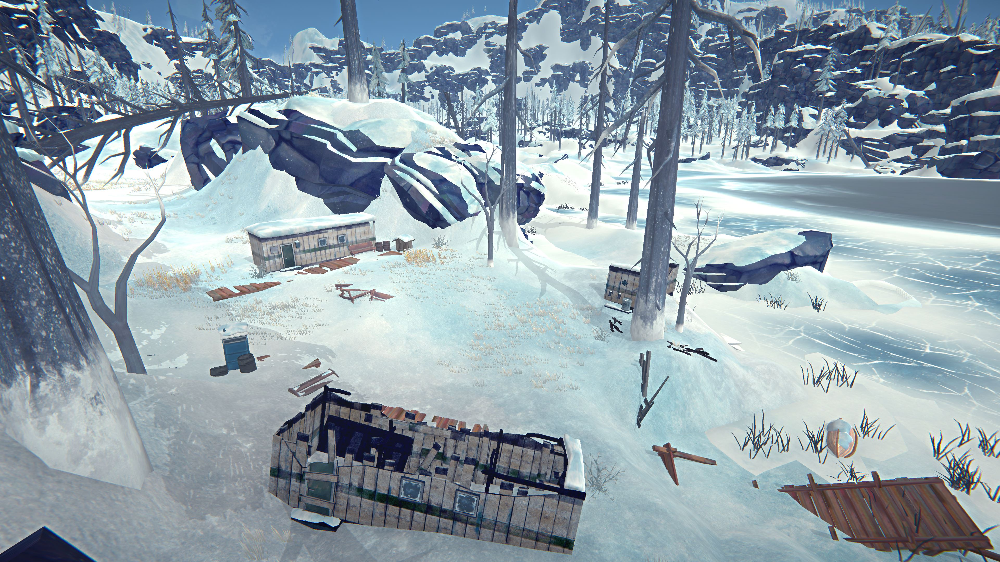

# Washed Out Trailers

**Washed Out Trailers**

| Property | Details |
| --- | --- |
|  |  / *SS-BI-WashedOut01.jpg* |
| **Location** |  |
|  |  / *Washed\_Out\_Trailers\_Location.png* |
| Region | [Bleak Inlet](./Bleak%20Inlet.md)\|- |
| **General** |  |
|  / *bed\_icon.png* | Has a bed |
|  | Has an interior\|} / **Washed Out Trailers** are a group of two trailers located a short distance northwest of the [Last Resort Cannery](./Last%20Resort%20Cannery.md). One of the trailers can be entered, while the other is wrecked. / ## Overview / While this location makes for an adequate place to spend the night, being considerably safer from [timberwolves](./Timberwolf.md) than the [Last Resort Cannery](./Last%20Resort%20Cannery.md), there are few resources around, making this location well suited if the player gets caught in bad weather on their way from the [Frozen Delta](./Frozen%20Delta.md) to the cannery, but poorly suited for use as a longer-term base. / ## Gallery / \| Column 1 \| Column 2 \| Column 3 \| / \| --- \| --- \| --- \| / \|  / *Washed Out Trailers* \|  / *Washed Out Trailers* \|  / *Washed Out Trailers* \| / **Lua execution error in Module:Navbox function navbox** |
|  / *Washed Out Trailers* |  / *Washed Out Trailers* /  / *Washed Out Trailers* |
