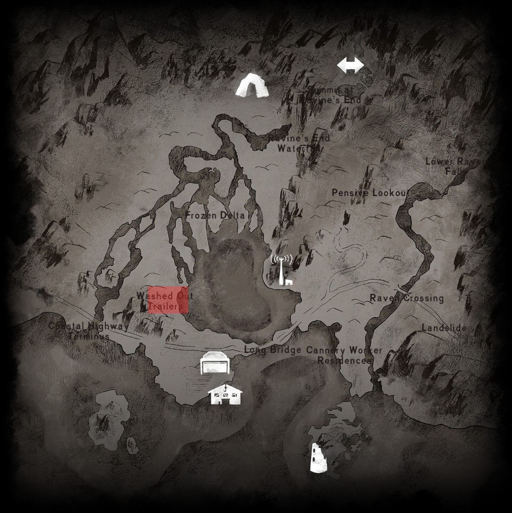
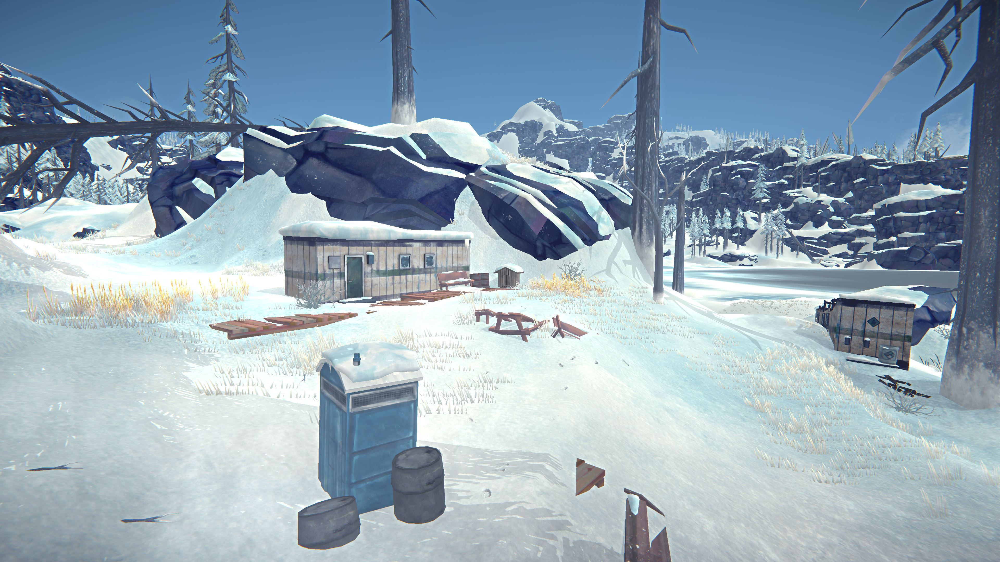

# Washed Out Trailers

**Categories:** Indoor locations, Locations, Locations in Bleak Inlet · **Source:** [Fandom](https://thelongdark.fandom.com/wiki/Washed_Out_Trailers)

**Washed Out Trailers**

_SS-BI-WashedOut01.jpg_

**Location**

_Washed\_Out\_Trailers\_Location.png_

**Region:** [Bleak Inlet](./Bleak%20Inlet.md)

**General**

_bed\_icon.png_

Has a bed

Has an interior / **Washed Out Trailers** are a group of two trailers located a short distance northwest of the [Last Resort Cannery](./Last%20Resort%20Cannery.md). One of the trailers can be entered, while the other is wrecked.

## Overview

While this location makes for an adequate place to spend the night, being considerably safer from [timberwolves](./Timberwolf.md) than the [Last Resort Cannery](./Last%20Resort%20Cannery.md), there are few resources around, making this location well suited if the player gets caught in bad weather on their way from the [Frozen Delta](./Frozen%20Delta.md) to the cannery, but poorly suited for use as a longer-term base.

## Gallery

_Washed Out Trailers_

_Washed Out Trailers_

_Washed Out Trailers_
