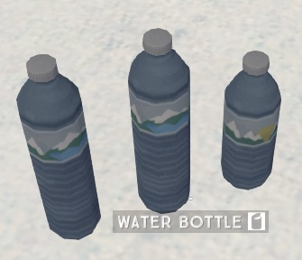

# Water \(Potable\)

**Contents**

- [Purification](#purification)
- [Appearance](#appearance)
- [Products](#products)
- [Trivia](#trivia)
- [Gallery](#gallery)
- [Update history](#update-history)

**Water (Potable)**

| Property | Details |
| --- | --- |
|  |  / *Water\_(Potable)\_icon.png* |
| Release | [12 June 2014](./The%20Long%20Dark%20%E2%80%94%20Changelog.md#0.01) |
| Wintermute | No |
| Renewable | Yes |
| **Properties** |  |
| Item type | [Food And Drink](./Food%20And%20Drink.md)\|- |
| Stackable | No |
| Examine | Water that is safe to drink. |
| **Values** |  |
| Weight | 1.00 kg (2.2 lbs) |
| **Actions** |  |
| Radial | Drink, Place |

**Water (Potable)** is purified water that is safe to drink in [*The Long Dark*](./The%20Long%20Dark.md).

Consuming Potable Water restores [Thirst](./Thirst.md) and carries no risk of disease ([Dysentery](./Dysentery.md)) since it has been properly sterilized. Potable Water will never revert back into [Water (Unsafe)](./Water%20%28Unsafe%29.md).

Bottles of Potable Water can be found indoors, in vehicles, harvested from [Toilets](./Toilet.md), [Industrial Toilets](./Industrial%20Toilet.md), a [Basin](./Basin.md), or produced from boiling Unsafe water at a fire/sterilizing it with [Water Purification Tablets](./Water%20Purification%20Tablets.md).

Unsafe water can be created by melting snow at an active fire's Cooking Spot, and takes 20 minutes to melt 0.5 liter (0.13 gal). Gathering snow is done automatically, though the player must supply a [Recycled Can](./Recycled%20Can.md), [Cooking Pot](./Cooking%20Pot.md), or [Cooking Skillet](./Cooking%20Skillet.md) to contain the snow as it melts into water.

- Water is relatively heavy at 1 kg/L and can quickly overburden the player in large quantities.
- Water always remains at 100% condition and does not [decay](./Decay.md).
- Water left outside will not freeze, or become unsafe once sterilized.

- If left on an active fire, 0.5L of purified water will boil away after 30 minutes (in-game). The more water in the container, the longer it takes to boil away.
- Dehydration deals 2% condition loss per hour if not sated.

For the effects of drinking water on thirst reduction, see [Thirst](./Thirst.md).

## Purification

Unsafe water can be turned into Potable Water through [boiling](./Fire.md#Processing_water) or [purifying](./Water%20Purification%20Tablets.md):

- Boiling 1L of Unsafe Water requires 20 minutes at an active fire's Cooking Spot.
- [Water Purification Tablets](./Water%20Purification%20Tablets.md) can be consumed to convert up to 1L of Unsafe Water into an equivalent amount of Potable Water. They can be found in the "Medical" tab of the Inventory, and then selecting "Use" while carrying them and the Unsafe Water. This sterilization process takes 1 minute (in-game). Alternatively, select "Purify Water" while in the fire menu. Note that a fire/Cooking Spot is not actually required to use purification tablets.

## Appearance

Water requires no container to carry, and despite displaying as a jug in the inventory, will appear as a water bottle when dropped.

- Quantities up to 0.50L will appear as a small plastic bottle.
- Quantities between 0.5L and 1.0L will appear as a large bottle.
- Quantities in excess of 1.0L will be divided into multiple 1.0L bottles, potentially with a smaller bottle as the remainder.
- Quantities in excess of 1.0L which are round numbers (2.0L, 3.0L, etc.) have the potential of being divided between small and large bottles. This cannot be controlled by the player and the division seems to be completely random. Dropping 3.0L, for example, can give you three large 1L bottles or two large 1L bottle and two small 0.50L bottles or any other such combination.

Note: Unsafe and Potable water bottles are identical in appearance, and similar in one's inventory. Take care when dropping bottles of Unsafe Water that they are not close to bottles of Potable Water, to prevent accidental drinking.

## Products

## Trivia

- Water (potable), doesn't give a [Warming Up](./Warming%20Up.md) feat when boiled and immediately consumed. This is likely due to in-game balance reasons, as it would take hours for the water to cool down to a state where it can be consumed and even more to no longer be warm. It would also make acquiring the Warming Up feat too easy.
- Water taken from Toilets always yields Potable Water and never Unsafe Water; this would imply the water is being drawn from a toilet's reservoir tank which is used to flush waste and not the bowl where waste arrives. However, not all toilets in The Long Dark have such tanks, such as Industrial Toilets, which can provide unsafe water.
- Despite teas and coffee being heatable at fires to grant Warming Up, bottles of water (potable or unsafe) cannot.
- Water is non-renewable in the [challenge](./Challenge.md) "[Escape the Darkwalker](./Escape%20the%20Darkwalker.md)" and custom sandbox with the 'endless night' option enabled. This is because matches are finite and non-renewable, and the [magnifying lens](./Magnifying%20Lens.md) is unusable at night.
- The ingredients on the back list: "Pure Water Fresh From Canadian Glaciers." and the product is labeled "Mainland Spring."

## Gallery

| Column 1 | Column 2 | Column 3 | Column 4 |
| --- | --- | --- | --- |
|  / *Water bottles.* |  / *Old model.* |  / *old icon 500ml* |  / *old icon 1000ml* |

## Update history

- UPDATE **12 June 2014 ([Update](./The%20Long%20Dark%20%E2%80%94%20Changelog.md#.01)):**
  - Added to game.

**Lua execution error in Module:Navbox function navbox**
