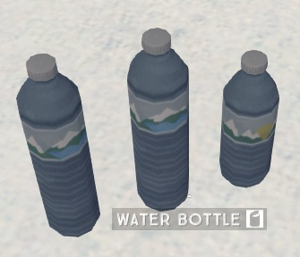

# Water \(Unsafe\)

**Categories:** Food And Drink, Pages with update history · **Source:** [Fandom](https://thelongdark.fandom.com/wiki/Water_%28Unsafe%29)

**Contents**

- [Overview](#overview)
- [Purification](#purification)
- [Appearance](#appearance)
- [Trivia](#trivia)
- [Gallery](#gallery)
- [Update history](#update-history)

**Water (Unsafe)**

| Property | Details |
| --- | --- |
|  |  / _Water\_(Unsafe)\_icon.png_ |
| Release | [12 June 2014](./The%20Long%20Dark%20%E2%80%94%20Changelog.md#0.01) |
| Wintermute | No |
| **Properties** |  |
| Item type | [Food And Drink](./Food%20And%20Drink.md)\|- |
| Stackable | No |
| Examine | Water that may make you ill. |
| **Values** |  |
| Weight | 1.00 kg (2.2 lbs) |

**Water (Unsafe)** is impure water from melted snow in [_The Long Dark_](./The%20Long%20Dark.md).

## Overview

Consuming Unsafe Water restores [Thirst](./Thirst.md), like [Potable Water](./Water%20%28Potable%29.md), but has a chance to infect the player with [Dysentery](./Dysentery.md); a serious and fatal disease if left untreated. The chance for gaining Dysentary is not a set chance unlike eating meat raw ([Food Poisoning](./Food%20Poisoning.md)), as the Affliction is granted via a RNG dice roll depending on how much dirty water is consumed (ex: Sometimes drinking even 0.01L will give Dysentery, while other times it is given after drinking 1.50L of dirty water). Generally speaking, the more Water (Unsafe) is consumed, the higher the chance of acquiring Dysentery.

Water (Unsafe) cannot be accessed in the [Radial Menu](./Radial%20Menu.md) by default; it must be manually be consumed in the Backpack menu of the [Survival Menu](./Survival%20Menu.md).

Unsafe Water can be created by melting snow at in a container at an active [fire's](./Fire.md) Cooking Spot, and takes 20 minutes to melt 0.5 liter (0.13 gal). Gathering snow is done automatically, though the player must supply a [Recycled Can](./Recycled%20Can.md), [Cooking Pot](./Cooking%20Pot.md), or [Cooking Skillet](./Cooking%20Skillet.md) to contain the snow as it melts into water.

- Water is relatively heavy at 1kg/L and can quickly overburden the player in large quantities.
- Water always remains at 100% condition and does not [Decay](./Decay.md).
- Water left outside will not freeze, or become unsafe once sterilized.
- Water is almost exclusively obtained by by melting snow, and only found naturally at the [Quonset Garage](./Quonset%20Garage.md) (contained within a metal [Basin](./Basin.md) on the work bench), and in the [Industrial Toilets](./Industrial%20Toilet.md) of the [Signal Void](./Signal%20Void.md) bunkers. It is also rarely found in containers.
  - It is possible to obtain endless amounts of Unsafe Water from a [Water Tower](./Water%20Tower.md) on [Cauldron Island](./Cauldron%20Island.md).
- Dehydration deals 2% condition loss per hour if not sated.

For the effects of drinking water on thirst reduction, see [Thirst](./Thirst.md).

## Purification

Unsafe water can be turned into [Potable Water](./Water%20%28Potable%29.md) through [boiling](./Fire.md#Processing_water) or purifying:

- Boiling 1L of Unsafe Water requires 20 minutes at an active fire's Cooking Spot.
- [Water Purification Tablets](./Water%20Purification%20Tablets.md) can be consumed to convert up to 1L of Unsafe Water into an equivalent amount of Potable Water. They can be found in the "Medical" tab of the Inventory, and then selecting "Use" while carrying them and the Unsafe Water. This sterilization process takes 1 minute (in-game). Alternatively, select "Purify Water" while in the fire menu. Note that a fire/Cooking Spot is not actually required to use purification tablets.

_Bottles of unsafe and potable water of varied sizes old_

## Appearance

Water requires no container to carry, and despite displaying as a jug in the inventory, will appear as a plastic blue water bottle when dropped.

- Quantities up to 0.50L will appear as a small plastic bottle.

- Quantities between 0.50L and 1.00L will appear as a large bottle.

- Quantities in excess of 1.00L will be divided into multiple 1.00L bottles, potentially with a smaller bottle as the remainder.

Note: Unsafe and Potable water bottles are identical in appearance, and similar in one's inventory. Take care when dropping bottles of Unsafe Water that they are not close to bottles of Potable Water, to prevent accidental consumption. When picked up, the icon for Potable water will be a water symbol, while Unsafe Water will have a circular cross through the water symbol.

## Trivia

Water drawn from Toilets always yields Potable Water and never Unsafe Water, regardless of where on a Toilet one selects; this suggests water is only drawn from the toilet's reservoir tank which is used to flush waste and not the bowl where waste arrives. The only exception to this rule is the Signal Void bunkers.

## Gallery

_Old model._

## Update history

- UPDATE **12 June 2014 ([Update](./The%20Long%20Dark%20%E2%80%94%20Changelog.md#.01)):**
  - Added to game.
