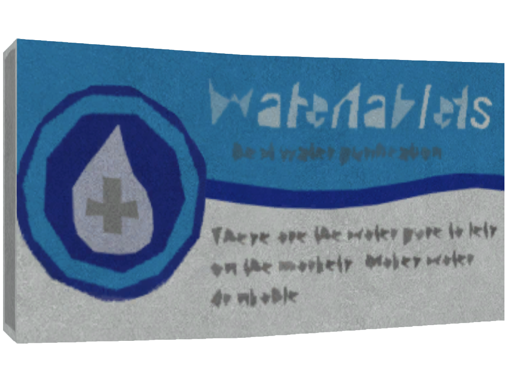

# Water Purification Tablets

**Categories:** First Aid · **Source:** [Fandom](https://thelongdark.fandom.com/wiki/Water_Purification_Tablets)

**Water Purification Tablets**

[Water Purification Tablets icon](../assets/Water_Purification_Tablets_icon.png)

**General**

**Item Type:** [First Aid](./First%20Aid.md)

**Renewable:** Yes ([Beachcombing](./Beachcombing.md))

**Statistics**

**Unit weight:** 0.06 kg/tablet(0.14 lbs/tablet)

**Weight:** [Weight icon](../assets/Weight_icon.png)0.25 kg(0.55 lbs)

**Unit count:** [Unit count icon](../assets/Unit_count_icon.png)4 tablets

> “**A packet of water purification tablets. Can help prevent dysentery. One tablet treats 1L/0.26 gallon of non-potable water.**”
>
> — In-game description

**Water Purification Tablets** are a consumable to convert [Unsafe Water](./Water%20%28Unsafe%29.md) into [Potable Water](./Water%20%28Potable%29.md) in [The Long Dark](./The%20Long%20Dark.md).

<!-- #Overview -->
​

<!-- #overview -->
## Overview

Water Purification Tablets are a consumable item which can be used to convert up to 1 litre of Unsafe Water into 1 litre of Potable Water per tablet. Boxes always initially contain 4 tablets. Purifying water takes one in-game minute.

- Since Unsafe Water is almost exclusively produced at a fire, Water Purification Tablets are of niche usefulness and are comparable to the fuel required to boil 1L of water and make it Potable.
  - Using the tablets instead of boiling the water will save between 19-29 in-game minutes per liter of water, depending on the player's [Cooking](./Cooking.md) level.
- They are relatively rare, consumable, cannot be crafted or harvested.
- Water Purification Tablets degrade in condition over time indoors and outside, and will vanish if inside of a Container when becoming Ruined (0% condition). Ruined tablets outside of containers can still be used, and tablets of the same condition stack. In console edition, ruined (0% condition) tablets are useless. Condition does not affect conversion rate.

- Note: it is more time effective to use these directly from your inventory rather than at a fire - it will take approximately one in-game minute per tablet compared to ten.
- These tablets can be useful when time is of the essence, such as in the [Whiteout](./Whiteout.md) and especially [Hopeless Rescue](./Hopeless%20Rescue.md) [challenges](./Challenge.md) to complete said challenge in the best possible time, but are less useful in Survival and [Wintermute](./Wintermute.md) due to the abundance and accessibility of fuel.

<!-- #Gallery -->
​

<!-- #gallery -->
## Gallery

<!-- #Trivia -->
​

<!-- #trivia -->
## Trivia

- Water purification tablets are packaged with the branding "_Aqua Pur"_.
- The description on the back list: "Works Fast! 1 Tablet Treats 1 Litre!"

[ru:Таблетки\_для\_очистки\_воды](https://ru.wikipedia.org/wiki/%D0%A2%D0%B0%D0%B1%D0%BB%D0%B5%D1%82%D0%BA%D0%B8_%D0%B4%D0%BB%D1%8F_%D0%BE%D1%87%D0%B8%D1%81%D1%82%D0%BA%D0%B8_%D0%B2%D0%BE%D0%B4%D1%8B)
