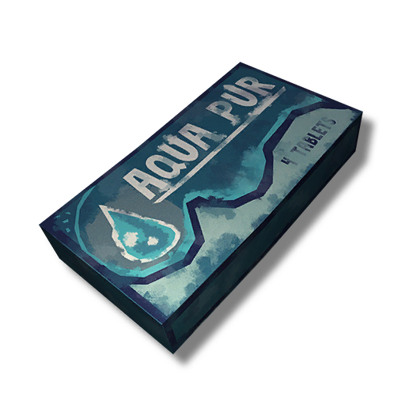

# Water Purification Tablets

<table class="infobox">
<caption>Water Purification Tablets</caption>
<colgroup>
<col style="width: 50%" />
<col style="width: 50%" />
</colgroup>
<tbody>
<tr>
<td colspan="2"><figure>

<figcaption>Water_Purification_Tablets_icon.png</figcaption>
</figure></td>
</tr>
<tr>
<td colspan="2" class="section">
<strong>General</strong>
</td>
</tr>
<tr>
<td>
Item Type
</td>
<td>
<a href="./First%20Aid.md" class="wikilink" title="First Aid">First Aid</a>
</td>
</tr>
<tr>
<td>
Renewable
</td>
<td>
Yes (<a href="./Beachcombing.md" class="wikilink" title="Beachcombing">Beachcombing</a>)
</td>
</tr>
<tr>
<td colspan="2" class="section">
<strong>Statistics</strong>
</td>
</tr>
<tr>
<td>
Unit weight
</td>
<td>
0.06 kg/tablet(0.14 lbs/tablet)
</td>
</tr>
<tr>
<td>
Weight
</td>
<td>
0.25 kg(0.55 lbs)
</td>
</tr>
<tr>
<td>
Unit count
</td>
<td>
4 tablets
</td>
</tr>
</tbody>
</table>

<table>
<colgroup>
<col style="width: 33%" />
<col style="width: 33%" />
<col style="width: 33%" />
</colgroup>
<tbody>
<tr>
<td style="vertical-align: top; font-size: 3em; color: #5d5980; padding-right: 10px">
“
</td>
<td>
A packet of water purification tablets. Can help prevent dysentery. One tablet treats 1L/0.26 gallon of non-potable water.

&#10;

In-game description

</td>
<td style="vertical-align: bottom; font-size: 3em; color: #5d5980; padding-left: 10px">
”
</td>
</tr>
</tbody>
</table>

**Water Purification Tablets** are a consumable to convert <a href="./Water%20%28Unsafe%29.md" class="wikilink" title="Unsafe Water">Unsafe Water</a> into <a href="./Water%20%28Potable%29.md" class="wikilink" title="Potable Water">Potable Water</a> in <a href="./The%20Long%20Dark.md" class="wikilink" title="The Long Dark">The Long Dark</a>.

## Overview

Water Purification Tablets are a consumable item which can be used to convert up to 1 litre of Unsafe Water into 1 litre of Potable Water per tablet. Boxes always initially contain 4 tablets. Purifying water takes one in-game minute.

- Since Unsafe Water is almost exclusively produced at a fire, Water Purification Tablets are of niche usefulness and are comparable to the fuel required to boil 1L of water and make it Potable.
  - Using the tablets instead of boiling the water will save between 19-29 in-game minutes per liter of water, depending on the player's <a href="./Cooking.md" class="wikilink" title="Cooking">Cooking</a> level.
- They are relatively rare, consumable, cannot be crafted or harvested.
- Water Purification Tablets degrade in condition over time indoors and outside, and will vanish if inside of a Container when becoming Ruined (0% condition). Ruined tablets outside of containers can still be used, and tablets of the same condition stack. In console edition, ruined (0% condition) tablets are useless. Condition does not affect conversion rate.

<!-- -->

- Note: it is more time effective to use these directly from your inventory rather than at a fire - it will take approximately one in-game minute per tablet compared to ten.
- These tablets can be useful when time is of the essence, such as in the <a href="./Whiteout.md" class="wikilink" title="Whiteout">Whiteout</a> and especially <a href="./Hopeless%20Rescue.md" class="wikilink" title="Hopeless Rescue">Hopeless Rescue</a> <a href="./Challenge.md" class="wikilink" title="challenges">challenges</a> to complete said challenge in the best possible time, but are less useful in Survival and <a href="./Wintermute.md" class="wikilink" title="Wintermute">Wintermute</a> due to the abundance and accessibility of fuel.

## Gallery

<table class="gallery">
<colgroup>
<col style="width: 100%" />
</colgroup>
<tbody>
<tr>
<td><figure>
[Missing image: Water_purification_tablets.png]
<figcaption>old model</figcaption>
</figure></td>
</tr>
</tbody>
</table>

## Trivia

- Water purification tablets are packaged with the branding "*Aqua Pur"*.
- The description on the back list: "Works Fast! 1 Tablet Treats 1 Litre!"

**Lua execution error in Module:Navbox function navbox**

<a href="ru:%D0%A2%D0%B0%D0%B1%D0%BB%D0%B5%D1%82%D0%BA%D0%B8_%D0%B4%D0%BB%D1%8F_%D0%BE%D1%87%D0%B8%D1%81%D1%82%D0%BA%D0%B8_%D0%B2%D0%BE%D0%B4%D1%8B" class="wikilink" title="ru:Таблетки_для_очистки_воды">ru:Таблетки_для_очистки_воды</a>

