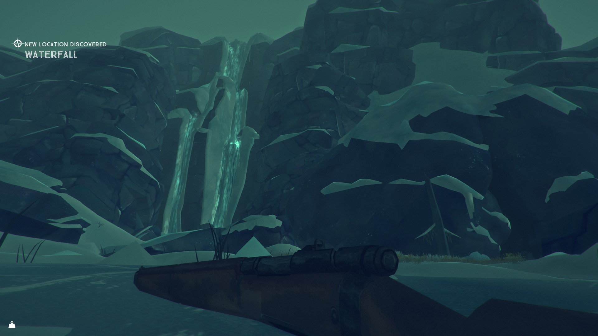

# Waterfall \(Forlorn Muskeg\)

**Categories:** Locations, Locations in Forlorn Muskeg, Military/Sporting locations, Outdoor locations, Waterfalls · **Source:** [Fandom](https://thelongdark.fandom.com/wiki/Waterfall_%28Forlorn_Muskeg%29)

**Waterfall (Forlorn Muskeg)**

_20170304110023\_1.jpg_

**Location**

_Waterfall\_(Forlorn\_Muskeg)\_Location.png_

**Region:** [Forlorn Muskeg](./Forlorn%20Muskeg.md)\|-

**Description:** A waterfall feeding Hat Creek

**General**

**Type:** OutdoorsMilitary/Sporting\|-
