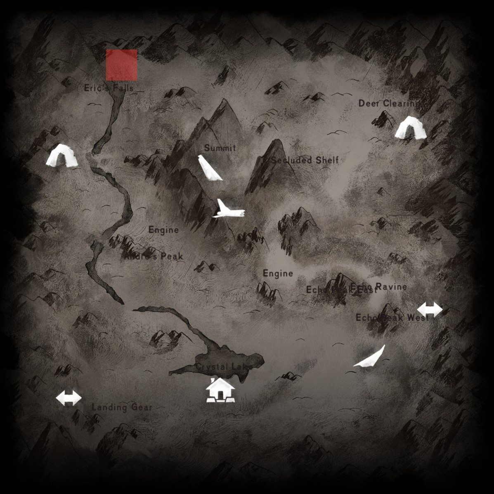

# Waterfall Cave

**Categories:** Caves, Locations, Locations in Timberwolf Mountain, Sheltered locations · **Source:** [Fandom](https://thelongdark.fandom.com/wiki/Waterfall_Cave)

**Waterfall Cave**

_Waterfall\_cave.jpg_

**Location**

_Waterfall\_Cave\_Location.png_

**Region:** [Timberwolf Mountain](./Timberwolf%20Mountain.md)

**General**

**Type:** Cave

## Overview

The cave provides a 10°C warmth bonus. Inside there may be a [Frozen Corpse](./Frozen%20Corpse.md) with loot. It can be a possible [Safe House](./Safehouse.md) location as it acts like an indoor area, and allows [Curing](./Curing.md) of hides and guts inside.

## Gallery

_The inside of the cave_

_The cave provides good shelter_

_A lot of space inside_
