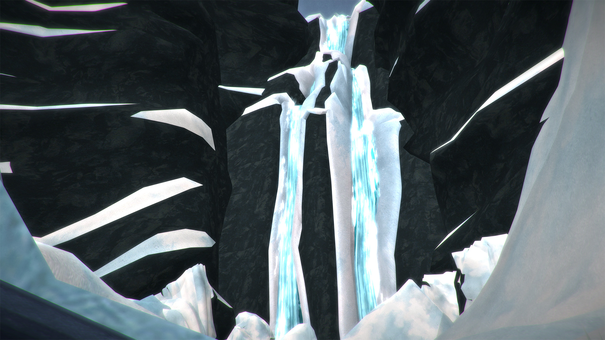

# Waterfall

**Waterfall**

| Property | Details |
| --- | --- |
|  |  / *Waterfall.jpg* |
| **Location** |  |
|  |  / *Waterfall\_Location.png* |
| Region | [Desolation Point](./Desolation%20Point.md)\|- |
| Type | Landmark\|- |
