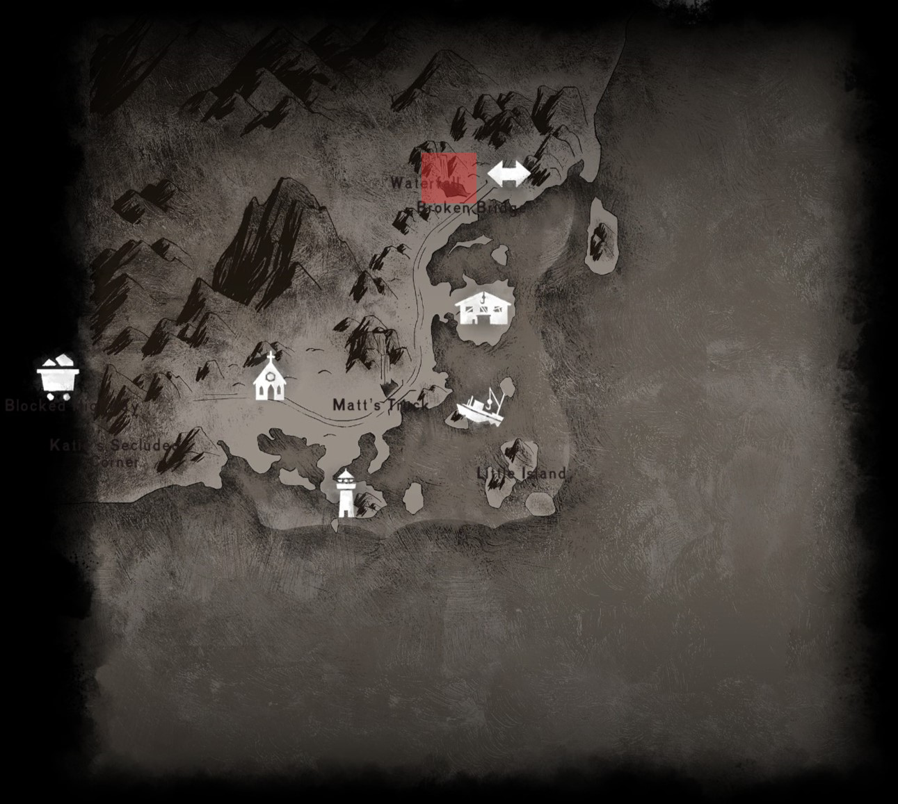

# Waterfall

**Categories:** Article stubs, Landmarks, Locations, Locations in Desolation Point, Outdoor locations, Waterfalls · **Source:** [Fandom](https://thelongdark.fandom.com/wiki/Waterfall)

**Waterfall**

**Location**

**Region:** [Desolation Point](./Desolation%20Point.md)

**Type:** Landmark

## Overview

The Waterfall is located on the northern most side of the region, near [Cave (Desolation Point location)](./Cave%20%28Desolation%20Point%20location%29.md) and [Broken Bridge](./Broken%20Bridge%20%28Desolation%20Point%20location%29.md).

[Rose Hips](./Rose%20Hip.md) can be found in the area.
