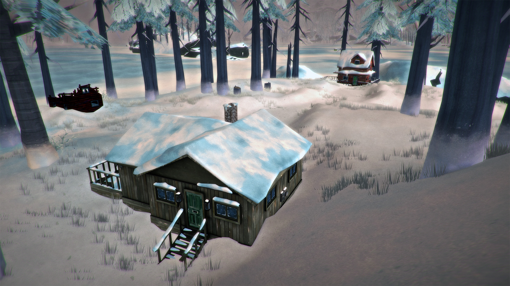

# Waterfront Cottages

**Categories:** Indoor locations, Locations, Locations in Coastal Highway, Residential locations · **Source:** [Fandom](https://thelongdark.fandom.com/wiki/Waterfront_Cottages)

**Waterfront Cottages**

|

**Location**

Region

[Coastal Highway](./Coastal%20Highway.md)

Location

In the southeast corner of the region

Description

A small cluster of houses

**General**

Type

Residential

Has a bed

Has an interior

**Waterfront Cottages** is a collection of cottages to the southeast of the [Coastal Highway](./Coastal%20Highway.md) region.

## Overview

In most difficulties, the Cottages offer a fair amount of supplies and a suitable place to take shelter. There are multiple buildings that are randomly generated as accessible or inaccessible. [Misanthrope's Homestead](./Misanthrope%27s%20Homestead.md) and a [Fishing Hut](./Fishing%20Hut.md) are located nearby, but predators may patrol that area as well.
