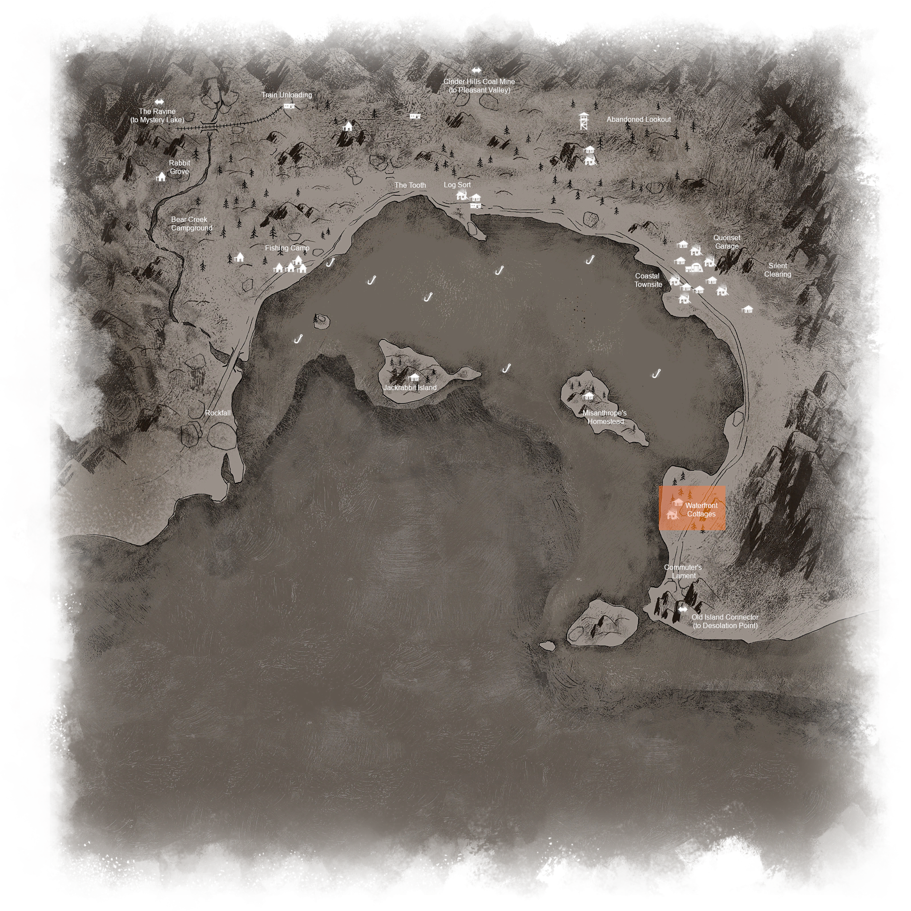

# Waterfront Cottages

<table class="infobox">
<caption>Waterfront Cottages</caption>
<colgroup>
<col style="width: 33%" />
<col style="width: 33%" />
<col style="width: 33%" />
</colgroup>
<tbody>
<tr>
<td colspan="2">
[[File:

<table class="gallery">
<colgroup>
<col style="width: 100%" />
</colgroup>
<tbody>
<tr>
<td><figure>
[Missing image: Waterfront_Cottages.jpg]
<figcaption>Waterfront_Cottages.jpg</figcaption>
</figure></td>
</tr>
</tbody>
</table></td>
<td>
250px]]
</td>
</tr>
<tr>
<td colspan="2">
<strong>Location</strong>
</td>
<td></td>
</tr>
<tr>
<td colspan="2"><figure>

<figcaption>Waterfront_Cottages_map.png</figcaption>
</figure></td>
<td></td>
</tr>
<tr>
<td>
Region
</td>
<td>
<a href="./Coastal%20Highway.md" class="wikilink" title="Coastal Highway">Coastal Highway</a>|-
</td>
<td>
Location
</td>
</tr>
<tr>
<td>
Description
</td>
<td>
A small cluster of houses
</td>
<td></td>
</tr>
<tr>
<td colspan="2">
<strong>General</strong>
</td>
<td></td>
</tr>
<tr>
<td>
Type
</td>
<td>
Residential|-
</td>
<td><figure>

<figcaption>bed_icon.png</figcaption>
</figure></td>
</tr>
<tr>
<td></td>
<td>
Has an interior|}

<strong>Waterfront Cottages</strong> is a collection of cottages to the southeast of the <a href="./Coastal%20Highway.md" class="wikilink" title="Coastal Highway">Coastal Highway</a> region.

<h2 id="Overview">Overview</h2>

In most difficulties, the Cottages offer a fair amount of supplies and a suitable place to take shelter. There are multiple buildings that are randomly generated as accessible or inaccessible. <a href="./Misanthrope%27s%20Homestead.md" class="wikilink" title="Misanthrope&#39;s Homestead">Misanthrope's Homestead</a> and a <a href="./Fishing%20Hut.md" class="wikilink" title="Fishing Hut">Fishing Hut</a> are located nearby, but predators may patrol that area as well.

In most cases, one of the three buildings is not destroyed. In some cases, all cottages may be destroyed, particularly in Interloper. <strong>Lua execution error in Module:Navbox function navbox</strong>
</td>
<td></td>
</tr>
</tbody>
</table>

