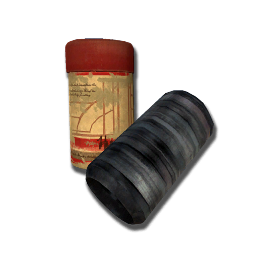

# Wax Cylinders

**Categories:** DLC Content · **Source:** [Fandom](https://thelongdark.fandom.com/wiki/Wax_Cylinders)

**DLC-Exclusive content.**

This content requires the [Iron Road](./Iron%20Road.md) addon to be installed before it can be seen or used in regular gameplay.

 **Wax Cylinders** are [Collectibles](./Collectibles.md) that appear in [Survival Mode](./Survival%20Mode.md) in _[Iron Road](./Iron%20Road.md)_. Most are found on [Cauldron Island](./Cauldron%20Island.md), and these cylinders still function in the new [Aurora](./Aurora.md) stricken world due to their pre-electronic nature. They require a Wax Cylinder Player to function, which is picked up with the first Cylinder.

Wax Cylinders are the most unique Collectibles because their audio can be played again in the Wax Cylinder menu, unlike some of the voice over notes in [_Tales from the Far Territory_](./Tales%20from%20the%20Far%20Territory.md). Most Cylinders are voices of individuals that lived on Cauldron Island over 100 years ago.

| Cylinder # | Region | Location | Narrator |
| --- | --- | --- | --- |
| [Wax Cylinder Player](./Wax%20Cylinder%20Player.md) | [Desolation Point](./Desolation%20Point.md) | [Fulmar Autopilot Boat](./Fulmar%20Autopilot%20Boat.md) | |
| [Wax Cylinder 1](./Wax%20Cylinder%201.md) | [Desolation Point](./Desolation%20Point.md) | [Fulmar Autopilot Boat](./Fulmar%20Autopilot%20Boat.md) | Alice McLeod |
| [Wax Cylinder 2](./Wax%20Cylinder%202.md) | [Desolation Point](./Desolation%20Point.md) | [Lighthouse (Port Remnant)](./Lighthouse%20%28Port%20Remnant%29.md) | Alice McLeod |
| [Wax Cylinder 3](./Wax%20Cylinder%203.md) | [Port Remnant](./Port%20Remnant.md) | [Desecrated Church](./Desecrated%20Church.md) | Alice McLeod |
| [Wax Cylinder 4](./Wax%20Cylinder%204.md) | [Port Remnant](./Port%20Remnant.md) | [Desecrated Church](./Desecrated%20Church.md) | Reverend Angus Hornswallow |
| [Wax Cylinder 5](./Wax%20Cylinder%205.md) | [Port Remnant](./Port%20Remnant.md) | [Desecrated Church](./Desecrated%20Church.md) | Elsa |
| [Wax Cylinder 6](./Wax%20Cylinder%206.md) | [Port Remnant](./Port%20Remnant.md) | [Whale Bone Shrine](./Whale%20Bone%20Shrine.md) | Alice McLeod |
| [Wax Cylinder 7](./Wax%20Cylinder%207.md) | [Anna Island -- Track Section 6](./Anna%20Island%20--%20Track%20Section%206.md) | [Train Shelter](./Train%20Shelter.md) | Alice McLeod |
| [Wax Cylinder 8](./Wax%20Cylinder%208.md) | [Anna Island -- Track Section 6](./Anna%20Island%20--%20Track%20Section%206.md) | [Train Shelter](./Train%20Shelter.md) | Chief Engineer Best |
| [Wax Cylinder 9](./Wax%20Cylinder%209.md) | [Anna Island -- Track Section 4](./Anna%20Island%20--%20Track%20Section%204.md) | Aurora Gate | Alice McLeod |
| [Wax Cylinder 10](./Wax%20Cylinder%2010.md) | [Anna Island -- Track Section 4](./Anna%20Island%20--%20Track%20Section%204.md) | [Repair Depot](./Repair%20Depot.md) | Chief Engineer Best |
| [Wax Cylinder 11](./Wax%20Cylinder%2011.md) | [Port Remnant](./Port%20Remnant.md) | [Broken Shoreline](./Broken%20Shoreline.md) | Elsa |
| [Wax Cylinder 12](./Wax%20Cylinder%2012.md) | [Anna Island -- Track Section 2](./Anna%20Island%20--%20Track%20Section%202.md) | [Repair Depot](./Repair%20Depot.md) | Chief Engineer Best |
| [Wax Cylinder 13](./Wax%20Cylinder%2013.md) | [Anna Island -- Track Section 3](./Anna%20Island%20--%20Track%20Section%203.md) | [Cove (Track Section 3)](./Cove%20%28Track%20Section%203%29.md) | Reverend Angus Hornswallow |
| [Wax Cylinder 14](./Wax%20Cylinder%2014.md) | [Anna Island -- Track Section 1](./Anna%20Island%20--%20Track%20Section%201.md) | [Huts](./Huts.md) | Elsa |
| [Wax Cylinder 15](./Wax%20Cylinder%2015.md) | [Anna Island -- Track Section 2](./Anna%20Island%20--%20Track%20Section%202.md) | [Repair Depot](./Repair%20Depot.md) | Chief Engineer Best |
| [Wax Cylinder 16](./Wax%20Cylinder%2016.md) | [Port Remnant](./Port%20Remnant.md) | [Obstructed Transit](./Obstructed%20Transit.md) | Chief Engineer Best |

## Game History
