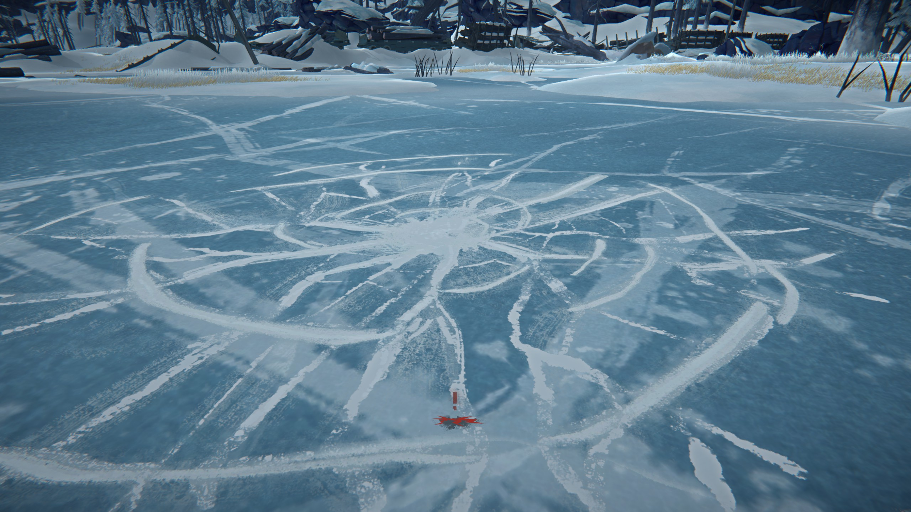
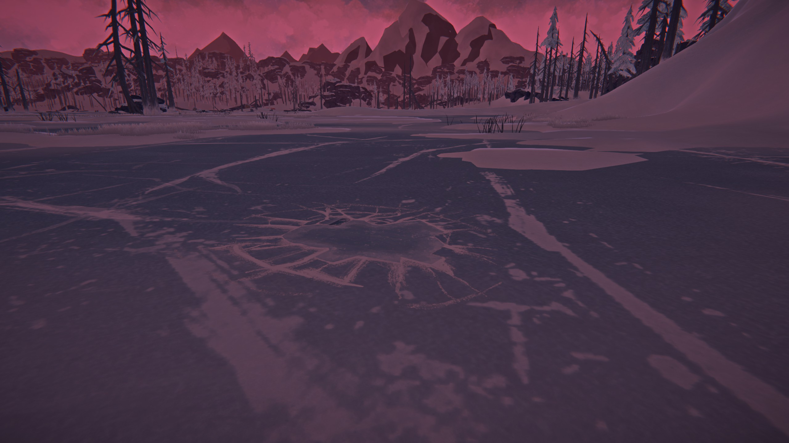
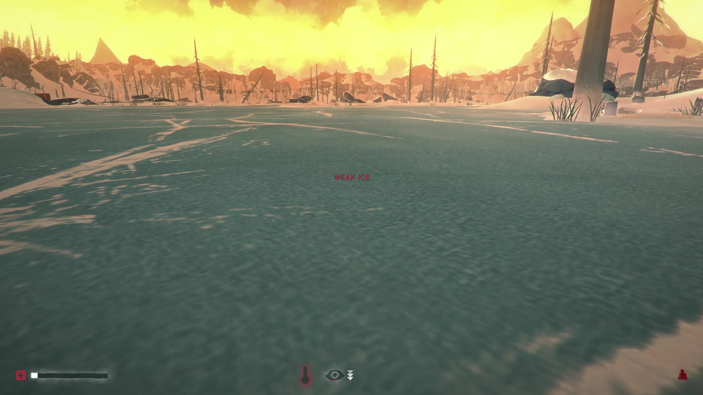
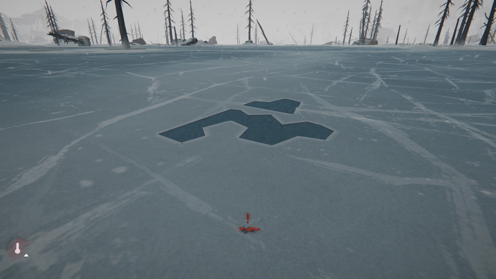

# Weak Ice

**Categories:** Gameplay · **Source:** [Fandom](https://thelongdark.fandom.com/wiki/Weak_Ice)

**Contents**

- [Overview](#overview)
- [Ocean Edge](#ocean-edge)
- [Ponds/Rivers](#ponds-rivers)
- [Falling through Weak Ice](#falling-through-weak-ice)
- [Trivia](#trivia)
- [Gallery](#gallery)

**Weak Ice** (also known as **Thin Ice**) is an uncommon but dangerous [Environmental Hazard](./Environmental%20Hazard.md) found within some [Regions](./Region.md) of [_The Long Dark_.](./The%20Long%20Dark.md)

## Overview

_The Weak Ice icon_ Most of the icy ground of [Great Bear Island](./Great%20Bear%20Island.md) is traversable but some ice sheets are weak and pose a hazard when the survivor moves on them. When standing on thin ice the "Weak Ice" indicator will appear in the center of the screen, a unique sound will play and cracks will form at survivor's feet. If the survivor does not move off the weak ice in time they will fall into the water below.

While standing on Weak ice the "Weak Ice" indicator is present and a hidden timer will play (5 seconds) and at the end if the player is still standing on Weak Ice they will fall through it. [Crampons](./Crampons.md) and [Improvised Crampons](./Improvised%20Crampons.md) can add the [Sure Footing](./Sure%20Footing.md) benefit, granting additional time before falling through (6 seconds with [Crampons](./Crampons.md) and 5.5 seconds with [Improvised Crampons](./Improvised%20Crampons.md) instead of 5 seconds).

[Encumbrance](./Encumbrance.md), [Fatigue](./Fatigue.md) and [Sprained Ankles](./Sprained%20Ankle.md) reduce movement speed and can make it more difficult or even impossible to move off Weak Ice in time. Sprinting can be used to cross some but not all small patches of Weak Ice safely (such as some in Forlorn Muskeg). Wildlife cannot cross Weak Ice, which can be used to the player's advantage to evade wildlife or gauge an area's ice patches in places such as Forlorn Muskeg. Weak Ice also serves as boundary along the ocean.

Below is a list of locations where Weak Ice is present:

### Ocean Edge

- [Coastal Highway](./Coastal%20Highway.md)
- [Old Island Connector](./Crumbling%20Highway.md)
- [Desolation Point](./Desolation%20Point.md)
- [Bleak Inlet](./Bleak%20Inlet.md)

### Ponds/Rivers

- [Forlorn Muskeg](./Forlorn%20Muskeg.md)
- [Bleak Inlet](./Bleak%20Inlet.md) (west side of the map)
- [Keeper's Pass South](./Keeper%27s%20Pass%20South.md)

[Beachcombing](./Beachcombing.md) is a mechanic which causes items and points-of-interest to appear along the beaches of coastal regions. These items may be looted freely, but may put the survivor at risk of Weak Ice.

## Falling through Weak Ice

Falling through Weak Ice will result in a fade to black and the player being moved to a nearby safe location to stand. Time will move forward several in-game minutes and a hole will have formed in the ice where they fell initially through.

- [Warmth](./Warmth.md) reduced to 0%
- [Hypothermia](./Hypothermia.md) affliction
- 10% [Condition](./Condition.md) loss (0% on Pilgrim)
- all Clothing becomes 100% wet

Wet clothes are a serious Condition hazard by [Freezing](./Needs.md), this damage is doubled by the Hypothermia affliction and the risk of [Frostbite](./Frostbite.md).

If the survivor falls through Weak Ice, it is recommend to quickly find shelter and build a fire to warm up. Wet Clothing may be dried by being worn or when dropped/placed indoors or near a lit [Campfire](./Campfire.md) or other fire source.

## Trivia

- [Tales from the Far Territory](./Tales%20from%20the%20Far%20Territory.md) Part 2 Update added a graphical update to Thin Ice when active as well as the updating the Beachcombing mechanic.
- In the real world some Weak ice may be traversed by dispersing one's bodyweight such as crawling while prone. This mechanic is not present within _The Long Dark_, and crouching does not affect Weak Ice.

## Gallery

