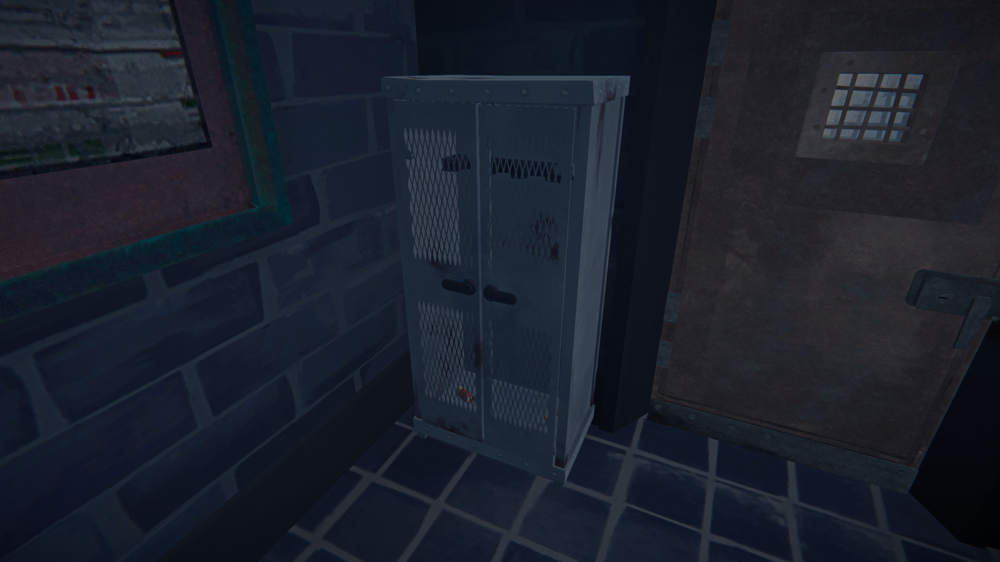
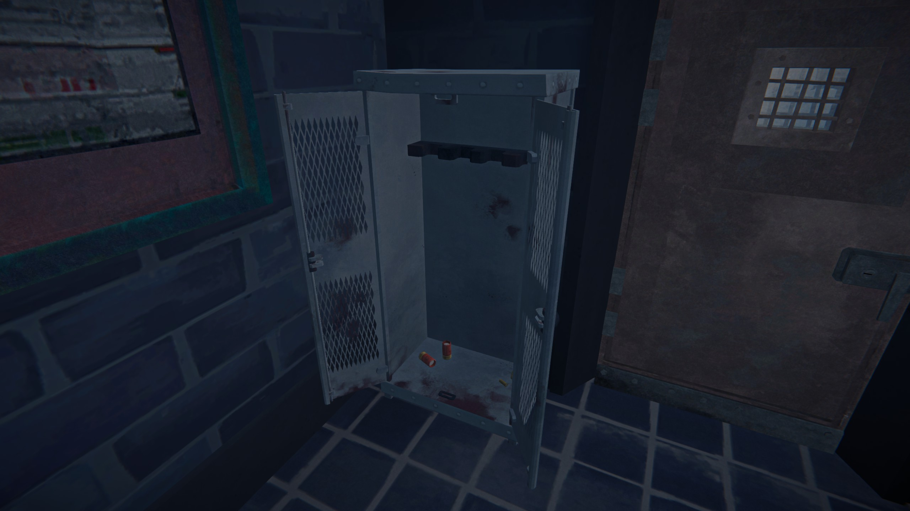

# Weapon Locker

**Categories:** Interactable Objects · **Source:** [Fandom](https://thelongdark.fandom.com/wiki/Weapon_Locker)

**Weapon Locker**

Release

1.60

Story item

Yes

A **Weapon Locker** is a stationary object found rarely in the game world, and often contain weapons as their name implies.

## Overview

They compose a of a single set of doors around a heavy locker. Unlike ordinary [Lockers](./Locker.md), weapon locks are never locked, and never require a [Prybar](./Prybar.md) to open. They occasionally contain firearms or munitions that would need to be safely stored in special location.

A list of potential items that spawn inside Weapon Lockers includes:

- [Flare Shell](./Flare%20Shell.md)
- [Revolver](./Revolver.md)
- [Revolver Ammunition](./Revolver%20Ammunition.md)
- [Rifle Ammunition](./Rifle%20Ammunition.md)
- [Noisemaker](./Noisemaker.md)
- [Can of Gunpowder](./Can%20of%20Gunpowder.md)

## Locations

- [Blackrock Prison](./Blackrock%20Prison.md)
  - At the room by the gate, near the [Contraband Storage](./Contraband%20Storage.md) Locker
  - In the guard barracks near the [Blackrock Lockers](./Blackrock%20Lockers.md)

- [Pleasant Valley Farmstead](./Pleasant%20Valley%20Farmstead.md) Basement (Episode 3 only)
- [Bunker Alpha](./Bunker%20Alpha.md), [Bunker Beta](./Bunker%20Beta.md), [Bunker Gamma](./Bunker%20Gamma.md), and [Bunker Omega](./Bunker%20Omega.md)
