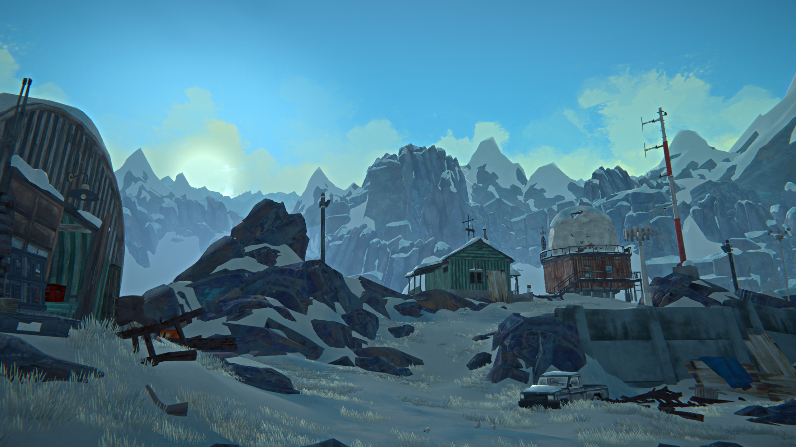

# Weather Station

**Weather Station**

| Property | Details |
| --- | --- |
|  |  / *Main\_Menu\_Weather\_Station.jpg* |
| **Location** |  |
|  |  / *Weather\_Station\_Location.png* |
| Region | [Sundered Pass](./Sundered%20Pass.md)\|- |
|  / *workbench\_icon\_green.png* | Has a workbench\|- |
