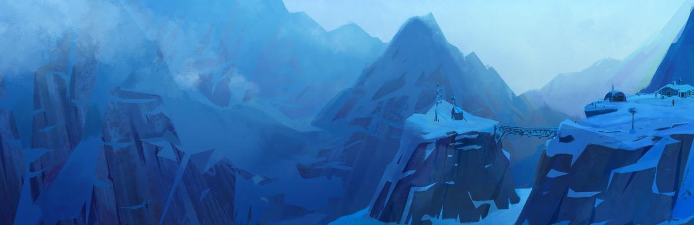
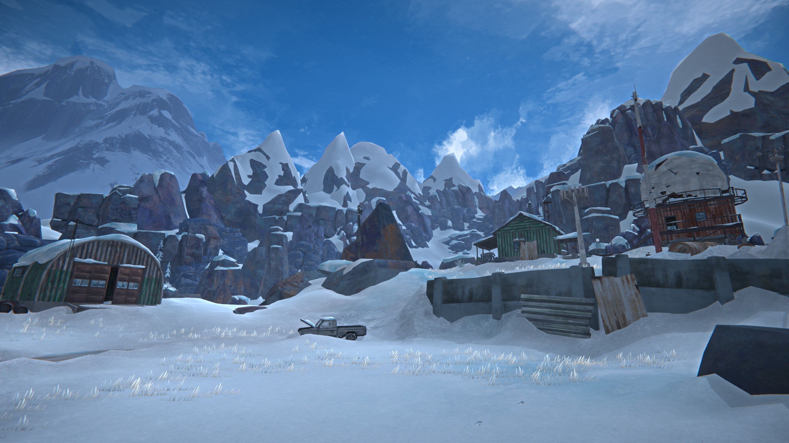
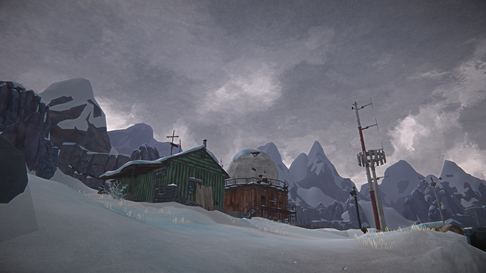
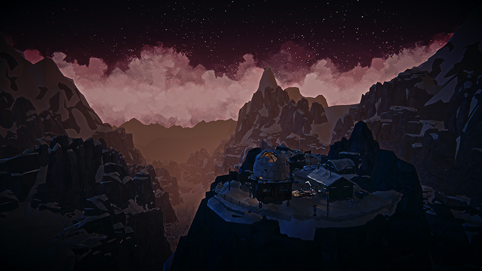
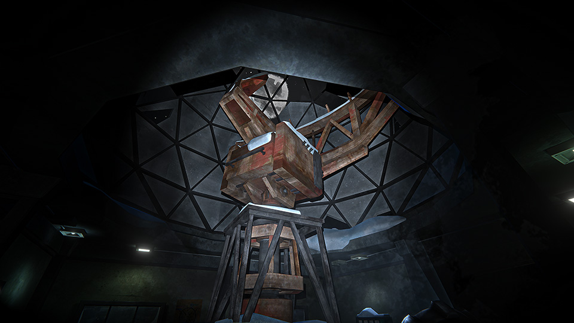
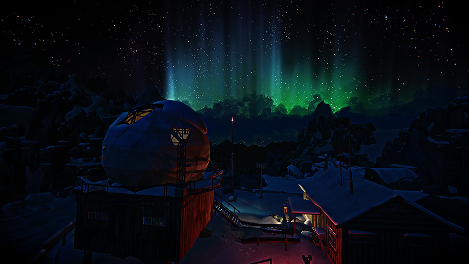
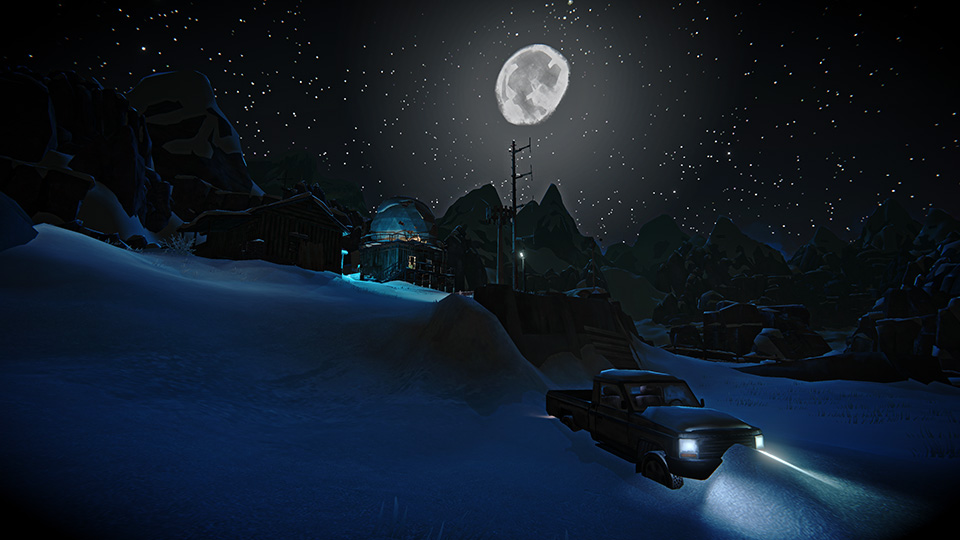

# Weather Station

**Categories:** Indoor locations, Locations, Locations in Sundered Pass, Locations with a workbench · **Source:** [Fandom](https://thelongdark.fandom.com/wiki/Weather_Station)

**Contents**

- [Overview](#overview)
- [Safehouse viability](#safehouse-viability)
- [Trivia](#trivia)
- [Gallery](#gallery)

**Weather Station**

[Main Menu Weather Station](../assets/Main_Menu_Weather_Station.jpg)

**Location**

[Weather Station Location](../assets/Weather_Station_Location.png)

**Region:** [Sundered Pass](./Sundered%20Pass.md)

[Workbench icon green](../assets/Workbench_icon_green.png)

Has a workbench

<!-- #Overview -->
​

<!-- #overview -->
## Overview

The station sits on a plateau on a large pillar and dominates the surrounding landscape. The station can be reached by a route in the east of the region crossing over two bridges and a rope climb and over the Second Pillar. In years past, the station used to be connected to the mountain road by a bridge, which has long since collapsed.

The complex consists of 3 buildings:

- The radar dome
- a storage warehouse
- The [Station Bunkhouse](./Station%20Bunkhouse.md)

A grey [Truck](./Truck.md) is parked outside the buildings, with another blue truck crashed and destroyed along the road further down the side of the mountain.

The first objective of the [Last Horizon](./Last%20Horizon.md) Tale is located here, and is found buried in the snow near the radar station.

Large amounts of [Rifle Ammunition](./Rifle%20Ammunition.md) (at least 3 boxes of 15 rounds) and a single [Hunting Rifle](./Hunting%20Rifle.md) always spawn in the area, with the items changing location each playthrough (can be found in the radar dome, truck, stairwell, etc.).

<!-- #safehouse_viability -->
​

<!-- #Safehouse_viability -->
​

<!-- #Safehouse_Viability -->
​

<!-- #safehouse-viability -->
## Safehouse viability

Making this location a [Safe House](./Safehouse.md) is not advised, as it is very isolated from the rest of the region and has few resources. The high altitude and exposed location also makes the area around the station EXTREMELY cold, even during the warmest evenings.

However, at least 3 [Ptarmigan](./Ptarmigan.md) Nests can be found around this area: one near the Truck, one near Second Pillar and one below the rope climb second below Second Pillar, providing ample opportunities to gather [Ptarmigan Down](./Ptarmigan%20Down.md) and meat for a time. A [Work Bench](./Work%20Bench.md) can be found in the storage shed, one of two in the whole region.

<!-- #Trivia -->
​

<!-- #trivia -->
## Trivia

There is a Hunting Rifle and unusual amount of Rifle Ammunition boxes strewn about the premises. A [Bloody note](./Bloody%20note.md) in the radar building mentions that they belonged to a single worker keeping the Station going, with him complaining that he is running out of supply shipments and cannot simply eat his ammo to survive.

<!-- #Gallery -->
​

<!-- #gallery -->
## Gallery

_A [Cougar](./Cougar.md) stalking a survivor, with the Weather Station in the background_

