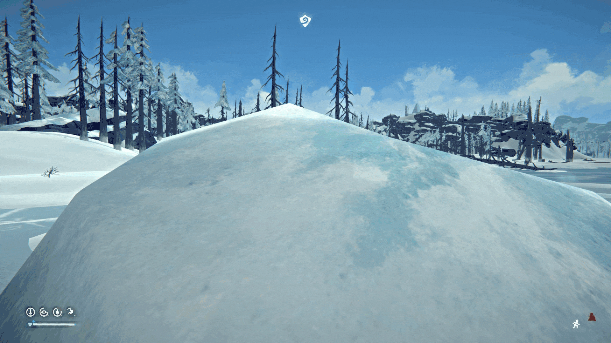
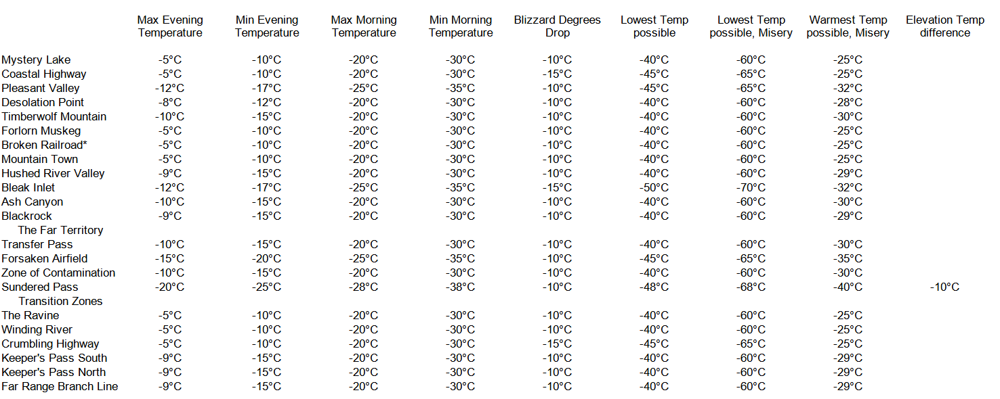

# Weather

**Contents**

- [Overview](#Overview)
- [Types of weather](#Types_of_weather)
- [Wind](#Wind)
- [Wind Shield](#Wind_Shield)
- [Movement Speed Penalty](#Movement_Speed_Penalty)
- [Wind blown fires](#Wind_blown_fires)
- [Air Temperature](#Air_Temperature)
- [World Gets Colder Over Time](#World_Gets_Colder_Over_Time)
- [Lowest and highest temperatures per region](#Lowest_and_highest_temperatures_per_region)
- [Gallery](#Gallery)

<table>
<colgroup>
<col style="width: 33%" />
<col style="width: 33%" />
<col style="width: 33%" />
</colgroup>
<tbody>
<tr>
<td style="vertical-align: top; font-size: 3em; color: #5d5980; padding-right: 10px">
“
</td>
<td>
Mountain blizzards blow through here from time to time. People get stuck indoors, or worse... They wander in circles, only to die within reach of their homes. Even when they are right there in front of them. And they say Grey Mother is blind! Ha!

&#10;

<a href="./Grey%20Mother.md" class="wikilink" title="Grey Mother">Grey Mother</a> discussing blizzards in <a href="./Milton.md" class="wikilink" title="Milton">Milton</a>

</td>
<td style="vertical-align: bottom; font-size: 3em; color: #5d5980; padding-left: 10px">
”
</td>
</tr>
</tbody>
</table>

**Weather** is the state of the atmosphere outdoors on <a href="./Great%20Bear%20Island.md" class="wikilink" title="Great Bear Island">Great Bear Island</a>, in *The Long Dark*.

## Overview

Weather conditions can change from clear, sunny (or starry) skies, foggy, windy, and blizzards. Traveling in different weather conditions affects movement speed, overall vision, <a href="./Warmth.md" class="wikilink" title="Warmth">Warmth</a>, wetness of Clothing, and decay rate of worn clothes. The time of day paired with certain weather conditions can make for either a much colder or warmer day as well.

Changes in weather evolve over time, rather than spontaneously: such as fog gradually building, winds dying down, or clouds clearing. This change can occur up or down in severity. Weather may last between 2-12 hours.

- <a href="./Region.md" class="wikilink" title="Region">Region</a> plays a prominent role in weather, with some types of weather being favored to occur more often in particular regions.
- <a href="./Wintermute.md" class="wikilink" title="Wintermute">Wintermute</a> tends to have calm weather per episode, with some episodes never featuring certain kinds of extreme weather at all (Ex. Aurora and Blizzards never occur naturally in <a href="./Episode%201%20-%20Do%20Not%20Go%20Gentle.md" class="wikilink" title="Episode 1">Episode 1</a>). This can change as progress is made in the story.
- <a href="./Survival%20Mode.md" class="wikilink" title="Survival Mode">Survival Mode</a> has several factors in weather frequency and severity.
  - Pilgrim features mostly clear skies and cloudy weather, with only rare blizzards and fog.
  - Voyageur has balanced weather types.
  - Stalker and Interloper have regular poor weather patterns, rapid changes in weather and wind direction, and notably frequent blizzards.

Weather affects the temperature inside of <a href="./Vehicle.md" class="wikilink" title="Vehicles">Vehicles</a>, but not indoors. High Winds and Blizzards can be heard even when indoors, and Aurora are visible through windows and will power tools, objects (radios, lights, <a href="./Buffer%20Memories.md" class="wikilink" title="computers">computers</a>) and deadly <a href="./Burns.md" class="wikilink" title="live wires">live wires</a> indoors. <a href="./Glimmer%20Fog.md" class="wikilink" title="Glimmer Fog">Glimmer Fog</a> can also affect electrical devices in the environment indoors or outdoors, and can even cause <a href="./Afflictions.md" class="wikilink" title="Afflictions">Afflictions</a>.

## Types of weather

<table style="width:100%;">
<colgroup>
<col style="width: 16%" />
<col style="width: 16%" />
<col style="width: 16%" />
<col style="width: 16%" />
<col style="width: 16%" />
<col style="width: 16%" />
</colgroup>
<thead>
<tr>
<th>
Weather
</th>
<th>
Effects
</th>
<th>
Wind
</th>
<th>
Crows over bodies?
</th>
<th>
<a href="./Charcoal.md" class="wikilink" title="Surveying">Surveying</a>
</th>
<th>
<a href="./Magnifying%20Lens.md" class="wikilink" title="Magnifying Lens">Magnifying Lens</a>
</th>
</tr>
</thead>
<tbody>
<tr>
<td>
Clear
</td>
<td>
Common and warm for relative time of day. May occur day or night.

<ul>
<li>Warm.</li>
<li>High visibility.</li>
<li><a href="./Crow.md" class="wikilink" title="Crows">Crows</a> will circle above frozen corpses and animal carcasses.</li>
</ul></td>
<td>
Calm-High
</td>
<td>
Yes
</td>
<td>
Yes
</td>
<td>
Yes
</td>
</tr>
<tr>
<td>
Aurora
</td>
<td>
May only occur at night during clear weather.

<ul>
<li>Bright aurora of red, orange, yellow or green appear in the night sky.</li>
<li><a href="./Wildlife.md" class="wikilink" title="Predatory Wildlife">Predatory Wildlife</a> is more aggressive and ignores common determent methods (e.g. <a href="./Campfire.md" class="wikilink" title="campfires">campfires</a>).</li>
<li>Electrical devices become powered, such as: <a href="./Flashlight.md" class="wikilink" title="Flashlight">Flashlight</a>, <a href="./Miner%27s%20Flashlight.md" class="wikilink" title="Miner&#39;s Flashlight">Miner's Flashlight</a>, <a href="./Buffer%20Memories.md" class="wikilink" title="Computers">Computers</a>, <a href="./Milling%20Machine.md" class="wikilink" title="Milling Machine">Milling Machine</a>, <a href="./Handheld%20Shortwave%20Radio.md" class="wikilink" title="Handheld Shortwave Radio">Handheld Shortwave Radio</a>, radios, lights, and deadly <a href="./Burns.md" class="wikilink" title="live wires">live wires</a>.</li>
<li><a href="./Crow.md" class="wikilink" title="Crows">Crows</a> will circle above frozen corpses and animal carcasses, despite being nightime.</li>
</ul>

For more information, see <a href="./Aurora.md" class="wikilink" title="Auroras">Auroras</a>.
</td>
<td>
Calm-moderate
</td>
<td>
No
</td>
<td>
Yes
</td>
<td>
No
</td>
</tr>
<tr>
<td>
Cloudy
</td>
<td>
Two variants: partly cloudy and cloudy (overcast).

<ul>
<li>Slightly darker dimmer with abundant clouds; Overcast may evolve from Partly Cloudy.</li>
<li>Slightly cold.</li>
</ul></td>
<td>
Calm-High
</td>
<td>
Yes
</td>
<td>
Yes
</td>
<td>
No
</td>
</tr>
<tr>
<td>
Fog
</td>
<td>
Two variants: light or dense. Fog may evolve from light to moderate to heavy over time.

<ul>
<li>Slightly cold.</li>
<li>Can cause disorientation and make avoiding predators difficult.</li>
<li>Light: long distance visibility loss.</li>
<li>Moderate: medium visibility loss.</li>
<li>Heavy: blinding visibility loss.</li>
</ul></td>
<td>
Calm-Light
</td>
<td>
Yes
</td>
<td>
No
</td>
<td>
No
</td>
</tr>
<tr>
<td>
Glimmer Fog
</td>
<td>
A heavy variant of fog, but charged with electrostatic particles. Only occurs during the day during clear weather.

<ul>
<li>Blinding visibility loss</li>
<li>Snow and Ice visibly and audibly crackles with electricity</li>
<li>Generates the <a href="./Insomnia.md" class="wikilink" title="Insomnia">Insomnia</a> <a href="./Afflictions.md" class="wikilink" title="Affliction">Affliction</a></li>
<li>Electrical devices become powered, such as: <a href="./Flashlight.md" class="wikilink" title="flashlight">flashlight</a>, <a href="./Miner%27s%20Flashlight.md" class="wikilink" title="Miner&#39;s Flashlight">Miner's Flashlight</a>, <a href="./Buffer%20Memories.md" class="wikilink" title="computers">computers</a>, <a href="./Handheld%20Shortwave%20Radio.md" class="wikilink" title="Handheld Shortwave Radio">Handheld Shortwave Radio</a>, radios, lights.</li>
<li><a href="./Burns.md" class="wikilink" title="Live wires">Live wires</a> do not activate. For more information, see <a href="./Glimmer%20Fog.md" class="wikilink" title="Glimmer Fog">Glimmer Fog</a>.</li>
</ul></td>
<td>
Calm-Light
</td>
<td>
Yes
</td>
<td>
No
</td>
<td>
No
</td>
</tr>
<tr>
<td>
Toxic Fog
</td>
<td>
A dangerous variant of fog only found in the <a href="./Escape%20the%20Darkwalker.md" class="wikilink" title="Escape the Darkwalker">Escape the Darkwalker</a> Challenge. Weather begins clear and slowly transitions from light fog to heavy fog.

<ul>
<li><a href="./Toxic%20Fog.md" class="wikilink" title="Toxic Fog">Toxic Fog</a> fills an entire region after ~30 real-world minutes within in; larger/smaller regions have their Toxic Fog timers adjusted accordingly.</li>
<li>Current Toxic Fog progress is shown for each region by viewing it on the map. A UI element will appear if less than half of the region's timer remains, turning red below 2 minutes remaining.</li>
<li>Toxic Fog in a region also RUINs all food in the backpack, indoors, outdoors, and animal carcasses. Instantly kills all wildlife when timer close to up.</li>
</ul></td>
<td>
Calm-Light
</td>
<td>
Yes
</td>
<td>
No
</td>
<td>
No
</td>
</tr>
<tr>
<td>
Snowfall
</td>
<td>
Two variants: light or heavy snow. Falling snow/flurries which may evolve into a Blizzard.

<ul>
<li>Moderately cold.</li>
<li>Light-moderate snowfall (reduces duration of tracks, wets/freezes clothing)</li>
</ul></td>
<td>
Calm-moderate
</td>
<td>
No
</td>
<td>
Yes
</td>
<td>
No
</td>
</tr>
<tr>
<td>
Blizzard
</td>
<td>
Enduring and dangerous storm.

<ul>
<li>Extremely cold.</li>
<li>Damages worn clothing.</li>
<li>Heavy snowfall (reduces duration of tracks, wets/freezes clothing)</li>
<li>Medium visibility loss.</li>
<li>Constant high winds: sounds like a 'train' even when indoors.</li>
<li>Beachcombing items spawn on the coastal regions. Despawns previous containers or special items washed up on the last blizzard.</li>
<li>If you are outside after a blizzard begins, wildlife may not spawn, making some meats and guts trips "safer"</li>
</ul></td>
<td>
High
</td>
<td>
No
</td>
<td>
No
</td>
<td>
No
</td>
</tr>
</tbody>
</table>

## Wind

Winds affects <a href="./Clothing.md" class="wikilink" title="Windchill">Windchill</a> (which makes the "Feels Like" temperature colder), and can extinguish exposed fires, prevent lighting fires, and slow movement. Wind changes direction and speed over time (based on <a href="./Survival%20Mode.md" class="wikilink" title="Survival Mode">Survival Mode</a>). There are 5 types of Wind: Calm, Light, Moderate, High, Blizzard.

- Calm: no wind, Windchill, or penalties.
- Light-Moderate: Windchill is present.
- High: slows movement speed, lighting exposed fires is impossible (unsheltered <a href="./Fire.md" class="wikilink" title="Campfires">Campfires</a>, <a href="./Torch.md" class="wikilink" title="torches">torches</a> or <a href="./Matches%20%28disambiguation%29.md" class="wikilink" title="matches">matches</a>), extinguishes exposed fires. <a href="./Storm%20Lantern.md" class="wikilink" title="Storm Lanterns">Storm Lanterns</a>, <a href="./Flare.md" class="wikilink" title="Flares">Flares</a>, <a href="./Marine%20Flare.md" class="wikilink" title="Marine Flares">Marine Flares</a>, Fire Barrels, <a href="./Forge.md" class="wikilink" title="Forges">Forges</a>, <a href="./Wood%20Stove.md" class="wikilink" title="Wood Stoves">Wood Stoves</a> and Cast Iron Stoves are immune to the effects of High Winds.
- Blizzard: same as High, however the player does not suffer from a movement speed penalty. Clothing is prone to being torn, and getting wet/frozen.

### Wind Shield

Crouching to get Wind Shield (Wind blowing from ahead) The <a href="./Survival%20Overlay.md" class="wikilink" title="Wind Shield">Wind Shield</a> is an icon which appears at the top of the UI if a solid object is between the player and oncoming High Winds. When shielded, Windchill temperature is eliminated almost completely and the player is only subjected to the ambient Air temperature. This icon can be used to stay warmer, move faster, or to find campfire locations currently sheltered from the wind. High Winds slows movement in 45° cone around the wind's current direction across the entire region, and a 2m radius around solid objects; this means that to be sheltered from the wind the player (or a campfire) must be on the correct side (opposite) of a solid object relative to oncoming wind and be close to it.

Even very small outcroppings, rocks, and objects like cars can provide a shield from the wind, as well as crouching to get behind a low part of terrain. This makes it possible to sometimes strategically get behind trees or trunks while breaking down <a href="./Scrub%20Brush.md" class="wikilink" title="Scrub Brush">Scrub Brush</a>, <a href="./Branch.md" class="wikilink" title="Branches">Branches</a>, even potentially regaining body temperature at the same time; if Wind Chill is the only thing getting the player below the 0°C threshold.

### Movement Speed Penalty

Moving (walking or sprinting) into the direction of oncoming High Winds reduces movement speed by up to 50% (additive with other penalties: <a href="./Sprained%20Ankle.md" class="wikilink" title="sprained ankles">sprained ankles</a> and <a href="./Encumbrance.md" class="wikilink" title="Encumbrance">Encumbrance</a>). High Winds slows movement in 45° cone around the wind's current direction across the entire region, there is no movement penalty when walking in directions outside this cone or when shielded from the wind.

This penalty is reduced by 25% with the active <a href="./Feats.md" class="wikilink" title="feat">feat</a> Blizzard Walker (aka wind penalty reduced from 25% to 18.5% penalty, or a +6.25% movement increase when walking into oncoming wind).

### Wind blown fires

<a href="./Campfire.md" class="wikilink" title="Campfires">Campfires</a> are not extinguished by High Winds, but instead their fuel duration capped at a maximum of 10 minutes (displays as "9", due to fuel consumption and rounding). Refueling a campfire experiencing high winds refreshes its duration, but any fuel beyond 10 minutes of burn time is wasted: this makes all fuel sources except <a href="./Stick.md" class="wikilink" title="Stick">Stick</a> extremely wasteful. In survival situations where a wind-blown campfire is vital, Sticks are the ideal fuel source and should be used one at a time when the fire is at "1 minute" remaining or embers (embers lasts for 5 minutes in-game).

## Air Temperature

Different regions have different air temperatures, ranging from -30°C to -38°C during early morning hours (i.e. the coldest time of the day) and rising all the way up to temperatures between -5°C and -25°C during the evening hours (i.e. the warmest time of the day). During blizzards the temperature can drop by another 10°C-15°C.

### World Gets Colder Over Time

The in-game air temperature is also affected by the "World Gets Colder Over Time" setting, which is tied to the <a href="./Survival%20Mode.md" class="wikilink" title="Experience Mode">Experience Mode</a>. The world starts to grow gradually colder after a set amount of days has passed and continues to drop until the temperature reaches the coldest it will get after a set amount of days. The following table demonstrates the differences in world getting colder on different difficulties:

<table>
<thead>
<tr>
<th>
Experience Mode
</th>
<th>
Start Day
</th>
<th>
Final Day
</th>
<th>
Temperature Drop
</th>
</tr>
</thead>
<tbody>
<tr>
<td>
Pilgrim
</td>
<td colspan="3">
N/A
</td>
</tr>
<tr>
<td>
Voyageur
</td>
<td>
20
</td>
<td>
200
</td>
<td>
-5°C
</td>
</tr>
<tr>
<td>
Stalker
</td>
<td>
20
</td>
<td>
200
</td>
<td>
-10°C
</td>
</tr>
<tr>
<td>
Interloper
</td>
<td>
5
</td>
<td>
50
</td>
<td>
-20°C
</td>
</tr>
<tr>
<td>
Misery
</td>
<td>
0
</td>
<td>
3
</td>
<td>
-20°C
</td>
</tr>
</tbody>
</table>

On Pilgrim the world does not get colder over time.

### Lowest and highest temperatures per region

Refer to the table below for lowest and highest possible temperature in each region respectively. Some regions have temperature triggers that will additionally increase or decrease the temperature by a set amount, when the player reaches a certain elevation.

| Region | Lowest Morning Temperature | Highest Evening Temperature | Lowest Possible Temperature During a Blizzard | Lowest Possible Temperature, Misery | Warmest Possible Temperature, Misery | Elevation Temperature Triggers |
|----|----|----|----|----|----|----|
| <a href="./Mystery%20Lake%20%28region%29.md" class="wikilink" title="Mystery Lake">Mystery Lake</a> | -30°C | -5°C | -40°C | -60°C | -25°C |  |
| <a href="./Coastal%20Highway.md" class="wikilink" title="Coastal Highway">Coastal Highway</a> | -30°C | -5°C | -45°C | -65°C | -25°C |  |
| <a href="./Pleasant%20Valley.md" class="wikilink" title="Pleasant Valley">Pleasant Valley</a> | -35°C | -12°C | -45°C | -65°C | -32°C |  |
| <a href="./Desolation%20Point.md" class="wikilink" title="Desolation Point">Desolation Point</a> | -30°C | -8°C | -40°C | -60°C | -28°C |  |
| <a href="./Timberwolf%20Mountain.md" class="wikilink" title="Timberwolf Mountain">Timberwolf Mountain</a> | -30°C | -10°C | -40°C | -60°C | -30°C | -5°C (Summit) |
| <a href="./Forlorn%20Muskeg.md" class="wikilink" title="Forlorn Muskeg">Forlorn Muskeg</a> | -30°C | -5°C | -40°C | -60°C | -25°C |  |
| <a href="./Broken%20Railroad.md" class="wikilink" title="Broken Railroad">Broken Railroad</a> | -30°C | -5°C | -40°C | -60°C | -25°C |  |
| <a href="./Mountain%20Town.md" class="wikilink" title="Mountain Town">Mountain Town</a> | -30°C | -5°C | -40°C | -60°C | -25°C |  |
| <a href="./Hushed%20River%20Valley.md" class="wikilink" title="Hushed River Valley">Hushed River Valley</a> | -30°C | -9°C | -40°C | -60°C | -29°C |  |
| <a href="./Bleak%20Inlet.md" class="wikilink" title="Bleak Inlet">Bleak Inlet</a> | -35°C | -12°C | -50°C | -70°C | -32°C |  |
| <a href="./Ash%20Canyon.md" class="wikilink" title="Ash Canyon">Ash Canyon</a> | -30°C | -10°C | -40°C | -60°C | -30°C |  |
| <a href="./Blackrock.md" class="wikilink" title="Blackrock">Blackrock</a> | -30°C | -9°C | -40°C | -60°C | -29°C |  |
| <a href="./Transfer%20Pass.md" class="wikilink" title="Transfer Pass">Transfer Pass</a> | -30°C | -10°C | -40°C | -60°C | -30°C |  |
| <a href="./Forsaken%20Airfield.md" class="wikilink" title="Forsaken Airfield">Forsaken Airfield</a> | -35°C | -15°C | -45°C | -65°C | -35°C |  |
| <a href="./Zone%20of%20Contamination.md" class="wikilink" title="Zone of Contamination">Zone of Contamination</a> | -30°C | -10°C | -40°C | -60°C | -30°C |  |
| <a href="./Sundered%20Pass.md" class="wikilink" title="Sundered Pass">Sundered Pass</a> | -38°C | -20°C | -48°C | -68°C | -40°C | +5°C (Valley)/-5°C (High Peak) |

## Gallery

<table class="gallery">
<colgroup>
<col style="width: 25%" />
<col style="width: 25%" />
<col style="width: 25%" />
<col style="width: 25%" />
</colgroup>
<tbody>
<tr>
<td><figure>
[Missing image: Weather_-_blizzard.jpg]
<figcaption>Blizzard</figcaption>
</figure></td>
<td><figure>
[Missing image: Weather_-_light_fog.jpg]
<figcaption>Light fog</figcaption>
</figure></td>
<td><figure>
[Missing image: Weather_-_moderate_fog.jpg]
<figcaption>Moderate fog</figcaption>
</figure></td>
<td><figure>
[Missing image: Weather_-_overcast.jpg]
<figcaption>Overcast skies</figcaption>
</figure></td>
</tr>
<tr>
<td><figure>
[Missing image: Weather_-_sunny.jpg]
<figcaption>Clear, sunny skies</figcaption>
</figure></td>
<td><figure>
[Missing image: Glimmer_Fog.jpg]
<figcaption>Glimmer Fog</figcaption>
</figure></td>
<td><figure>

<figcaption>A detailed air temperatures table</figcaption>
</figure></td>
<td></td>
</tr>
</tbody>
</table>

<a href="ru:%D0%9F%D0%BE%D0%B3%D0%BE%D0%B4%D0%B0" class="wikilink" title="ru:Погода">ru:Погода</a> <a href="fr:M%C3%A9t%C3%A9o" class="wikilink" title="fr:Météo">fr:Météo</a> <a href="de:Wetter" class="wikilink" title="de:Wetter">de:Wetter</a>

