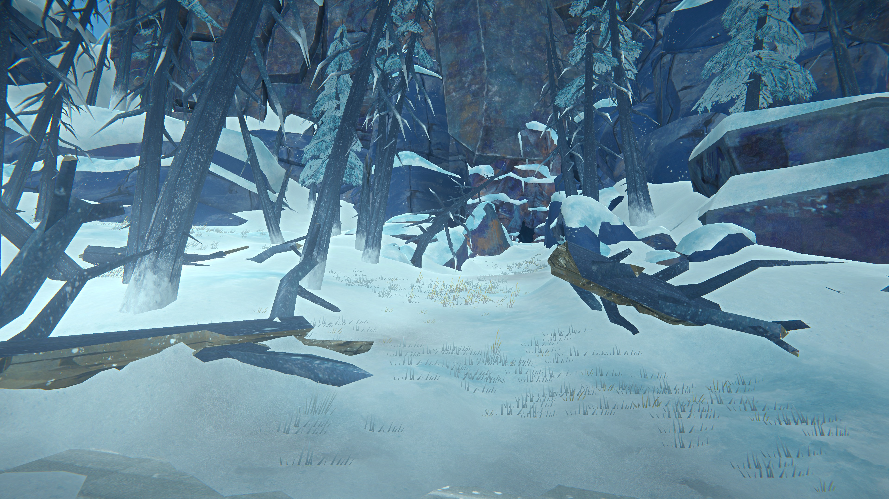

# Wedge Cave

**Categories:** Blackrock, Caves, Locations, Locations in Blackrock, Sheltered locations · **Source:** [Fandom](https://thelongdark.fandom.com/wiki/Wedge_Cave)

**Wedge Cave**

| Property | Details |
| --- | --- |
|  | [Wedge Cave](../assets/Wedge_Cave.jpg) |
| **Location** |  |
|  | [Wedge Cave Location](../assets/Wedge_Cave_Location.png) |
| Region |  |
| Location | In the region's eastern rock wall, near the road |
| **General** |  |
| Type | Cave |
|  | Provides some shelter |

**Wedge Cave** is a small cave located in [Blackrock](./Blackrock.md) in the region's eastern boundary rock wall. [No Road Cave](./No%20Road%20Cave.md) and [Whistling Perch](./Whistling%20Perch.md) are close by. A nearby road leads north to [Mule Bridge](./Mule%20Bridge.md) and south to [Foreman's Clearcut](./Foreman%27s%20Clearcut.md). Packs of [timberwolves](./Timberwolf.md) often roam the hills surrounding this section of the road.

## Gallery

