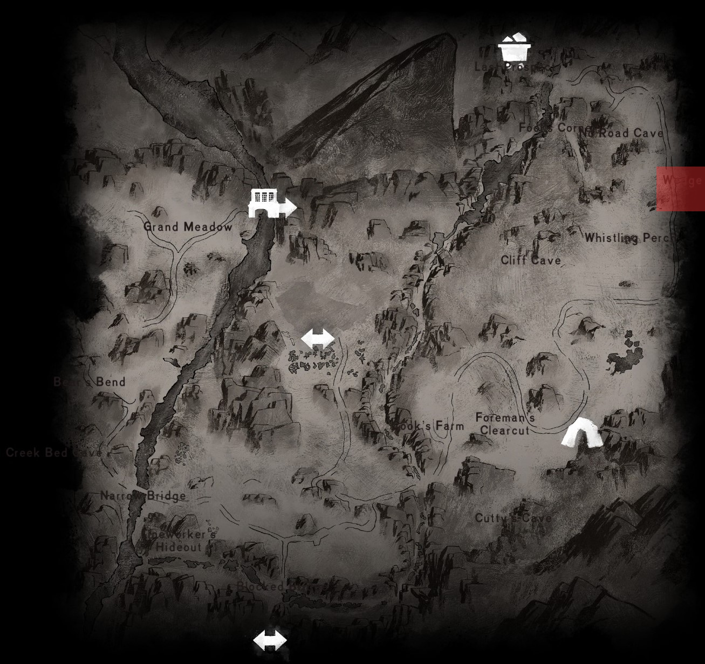

# Wedge Cave

**Wedge Cave**

| Property | Details |
| --- | --- |
|  |  / *Wedge\_Cave.jpg* |
| **Location** |  |
|  |  / *Wedge\_Cave\_Location.png* |
| Region |  |
| Location | In the region's eastern rock wall, near the road |
| **General** |  |
| Type | Cave\|- |
