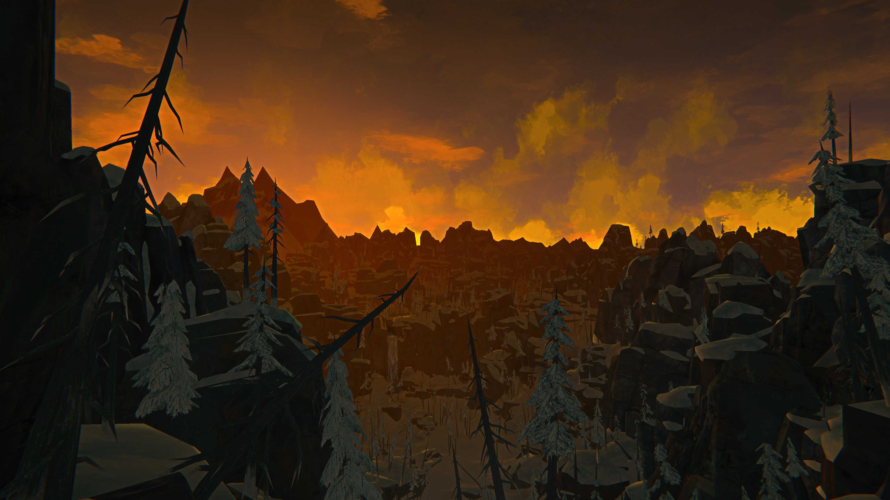
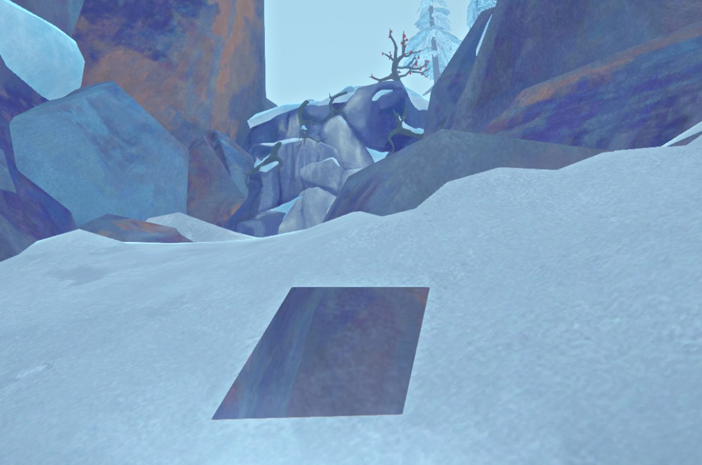

# Welkin's Window

**Categories:** Caves, Locations, Locations in Zone of Contamination, Sheltered locations · **Source:** [Fandom](https://thelongdark.fandom.com/wiki/Welkin's_Window)

**Welkin's Window**

[Welkin's Window](../assets/Welkin%27s_Window.png)

**Location**

[Welkin's Window Location](../assets/Welkin%27s_Window_Location.png)

**Region:** [Zone of Contamination](./Zone%20of%20Contamination.md)

**Type:** Cave

## Overview

The cave is a good source of [Coal](./Coal.md), and provides a nice view overlooking a relatively un-contaminated pond. [Deer](./Deer.md) and [Rabbits](./Rabbit.md) can be found on the pond, along with [Poisoned Wolves](./Poisoned%20Wolf.md). Some bushes of [Rose Hip](./Rose%20Hip.md) can be found in the surroundings.

The information is reliable for older versions of the game: the cave may possibly be called 'Welkin's Window' due to the strange "window" glitch in the snow just to the south of the cave. The glitch can be approached by heading nord-West from the cave along the cliff face until you reach a climbing vine, climb down to discover a square window in the ground with a view of a mountain canyon.

## Gallery

