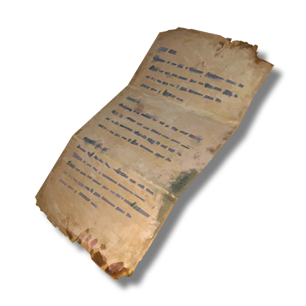

# Wet Paper

**Wet Paper**

| Property | Details |
| --- | --- |
|  |  / *Wet\_Paper\_icon.png* |
| Release | [31 March 2026](./The%20Long%20Dark%20%E2%80%94%20Changelog.md#2.52) |
| Wintermute | [Episode 5: The Light At The End Of All Things](./Episode%205%20-%20The%20Light%20At%20The%20End%20Of%20All%20Things.md) |
| **Properties** |  |
| Item type | [Collectibles](./Collectibles.md)\|- |
| Stackable | No |
| Examine | A scrap of paper. |
| **Values** |  |
| Weight | 0.00 kg (0 lbs) |
| **Actions** |  |
| Backpack | Examine |
| On ground | Take It, Read Text, Leave It |

**Wet Paper** is a [Collectibles](./Collectibles.md) found in [Episode 5](./Episode%205%20-%20The%20Light%20At%20The%20End%20Of%20All%20Things.md) of the [Wintermute](./Wintermute.md) story. It is found inside

in [Perseverance Wilds](./Perseverance%20Wilds.md) in the main mission [To Those Who Are Missing](./To%20Those%20Who%20Are%20Missing.md).

## Transcript

*The following text is transcribed from **Wet Paper***

**Nothing, nothing will stop the voices. Going to go deeper somehow.

Weigh myself down where they can't find me. Where it's cold enough and dark enough.**

## Update history

\* UPDATE **31 March 2026 ([Update](./The%20Long%20Dark%20%E2%80%94%20Changelog.md#2.52)):**

- 
  - Added to game.
