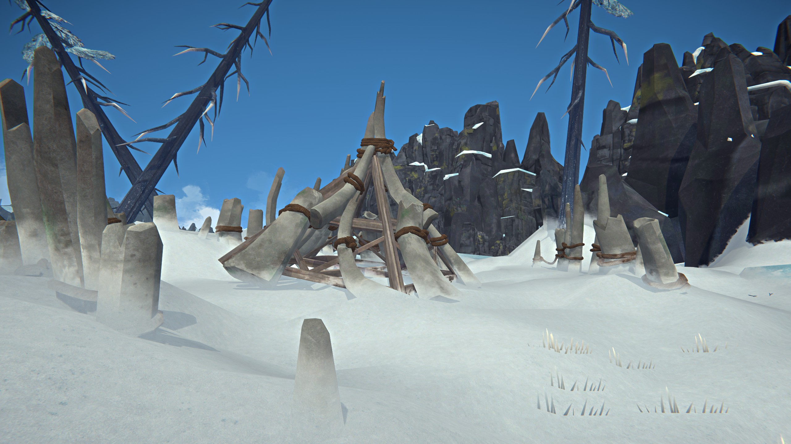
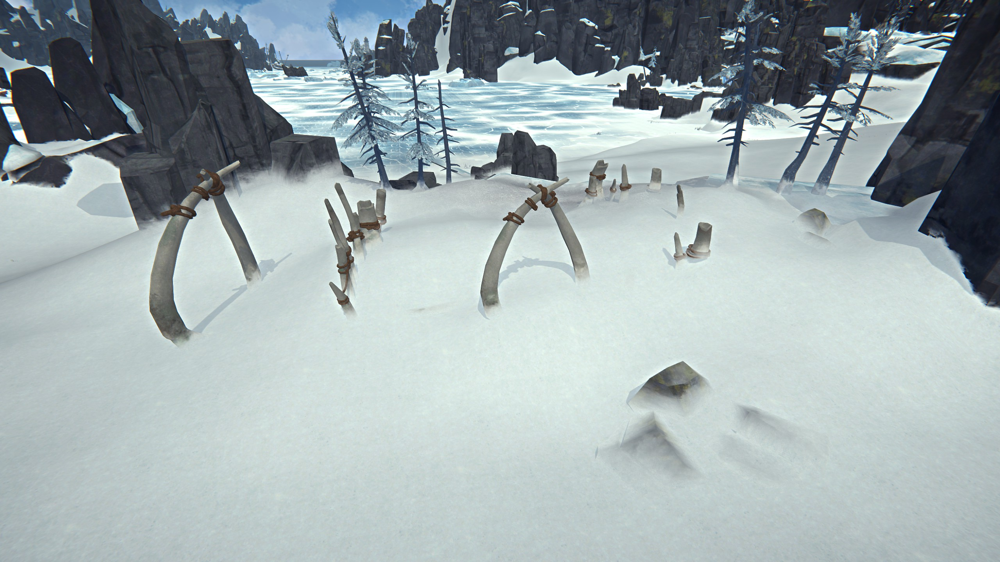
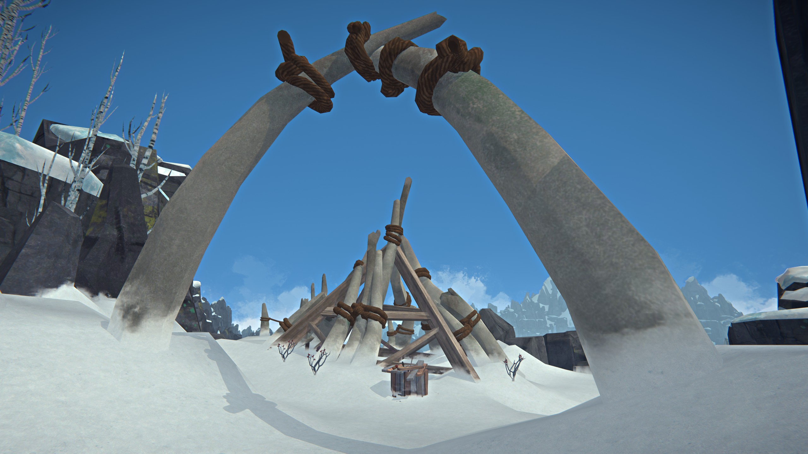
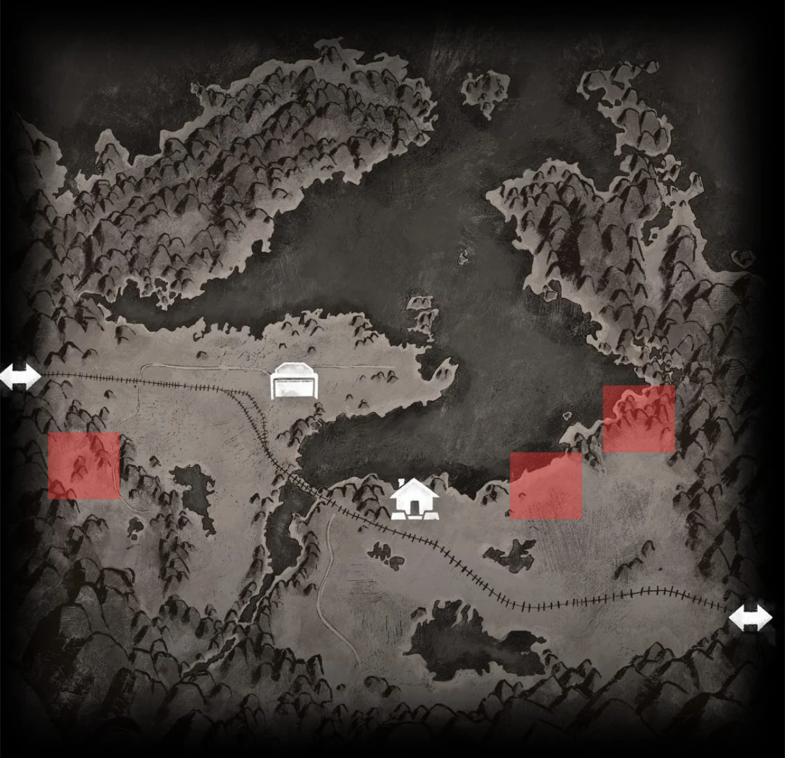

# Whale Bone Shrine

**Categories:** DLC Content, Locations, Locations in Port Remnant, Outdoor locations · **Source:** [Fandom](https://thelongdark.fandom.com/wiki/Whale_Bone_Shrine)

**Contents**

- [Overview](#overview)
- [Shrine 1](#shrine-1)
- [Shrine 2](#shrine-2)
- [Shrine 3](#shrine-3)

_Seal\_icon.png_

**DLC-Exclusive content.** / This content requires the [Iron Road](./Iron%20Road.md) addon to be installed before it can be seen or used in regular gameplay.

\[\[File: /  / _Shrine 1_ /  / _Shrine 2_ /  / _Shrine 3_

250px\]\]

_Shrine 1_

_Shrine 2_

_Shrine 3_

**Location**

_Whale\_Bone\_Shrine\_Location.png_

Region

[Port Remnant](./Port%20Remnant.md)

Description

**General**
