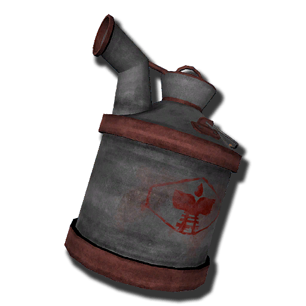

# Whale Oil Can

| Column 1 | Column 2 | Column 3 |
| --- | --- | --- |
|  / *Seal\_icon.png* | **DLC-Exclusive content.** / This content requires the [Iron Road](./Iron%20Road.md) addon to be installed before it can be seen or used in regular gameplay. | \|} / **Whale Oil Can** / \| Property \| Details \| / \| --- \| --- \| / \|  \|  / *Whale\_Oil\_Can\_icon.png* \| / \| **General** \|  \| / \| Item Type \| Tool\\|- \| / \| Renewable \| Yes \| / \| **Statistics** \|  \| / \| Weight \| 0.00-5.10 kg(-11.22 lbs) \| / > “**An old canister of preserved Whale Oil. Pungent stuff, but flammable and a highly efficient fuel source in the right machine.**” / > / > — In-game description / A **Whale Oil Can** is a [Tools](./Tools.md) item exclusively found on [Cauldron Island](./Cauldron%20Island.md) in [*The Long Dark*](./The%20Long%20Dark.md). / ## Overview / Very old fuel cans carrying refined whale oil. These cans are the primary fuel source for the [Prototype Train](./Prototype%20Train.md) and several unique tools. The cans themselves always weight 0.10 kg, with a maximum of 5.00 L of fuel capable of being stored inside (5.10 kg max weight). / Whale Oil Cans are used for: / - The [McLeod Ultra-Efficiency Whale Oil Heater](./McLeod%20Ultra-Efficiency%20Whale%20Oil%20Heater.md). / - The [Prototype Train](./Prototype%20Train.md) / - The Whale Oil Lantern / Whale Oil Cans cannot be used as Accelerant in [Fire Starting](./Fire%20Starting.md). / ## Locations / Whale Oil Cans can always be produced at a train [Oil Tank](./Oil%20Tank.md) refueling depot. These containers take the form of a green tank and can generate up to 5.00 L of cans in 1 minute. These refueling tanks refill after leaving the region for a day. / Some locations where Whale Oil Cans can individually be found in groups are: / - [Repair Depot](./Repair%20Depot.md) - [Anna Island -- Track Section 2](./Anna%20Island%20--%20Track%20Section%202.md) / - [Obstructed Transit](./Obstructed%20Transit.md) / - [Departure's Memory](./Departure%27s%20Memory.md) red warehouse / - [Lighthouse (Port Remnant)](./Lighthouse%20%28Port%20Remnant%29.md) near the [Fulmar Autopilot Boat](./Fulmar%20Autopilot%20Boat.md) / ## Game History / **Template:update history****Lua execution error in Module:Navbox function navbox** / [ru:Канистра с китовым жиром](ru:%D0%9A%D0%B0%D0%BD%D0%B8%D1%81%D1%82%D1%80%D0%B0_%D1%81_%D0%BA%D0%B8%D1%82%D0%BE%D0%B2%D1%8B%D0%BC_%D0%B6%D0%B8%D1%80%D0%BE%D0%BC) |
|  / *Whale\_Oil\_Can\_icon.png* |  |  |
| **General** |  |  |
| Item Type | Tool\|- |  |
| Renewable | Yes |  |
| **Statistics** |  |  |
| Weight | 0.00-5.10 kg(-11.22 lbs) |  |
| “ | **An old canister of preserved Whale Oil. Pungent stuff, but flammable and a highly efficient fuel source in the right machine.** / In-game description | ” |
