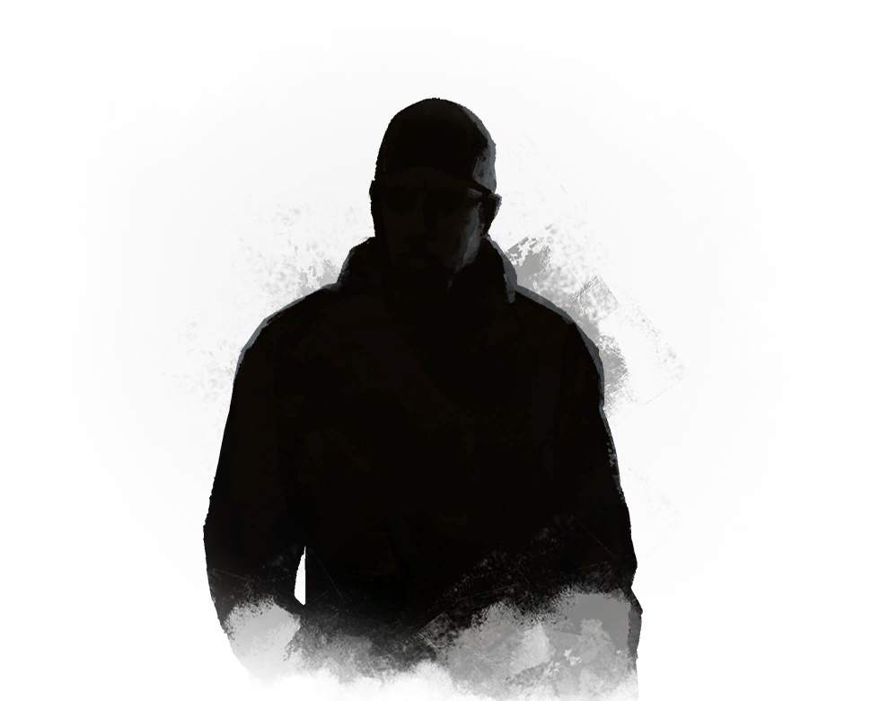
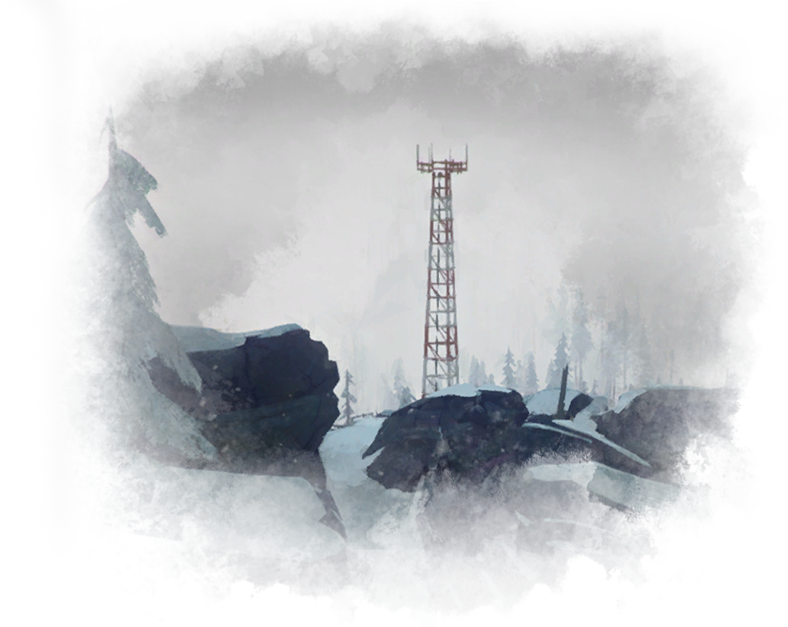
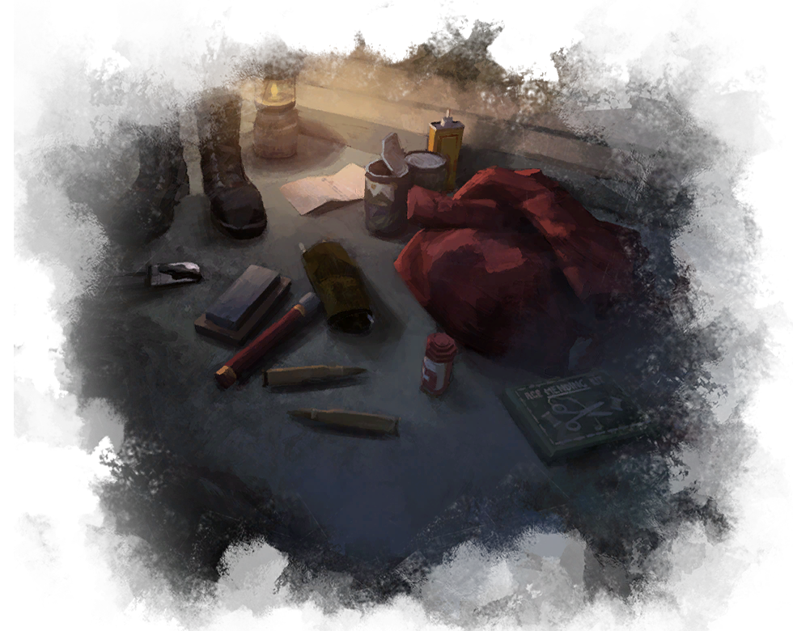
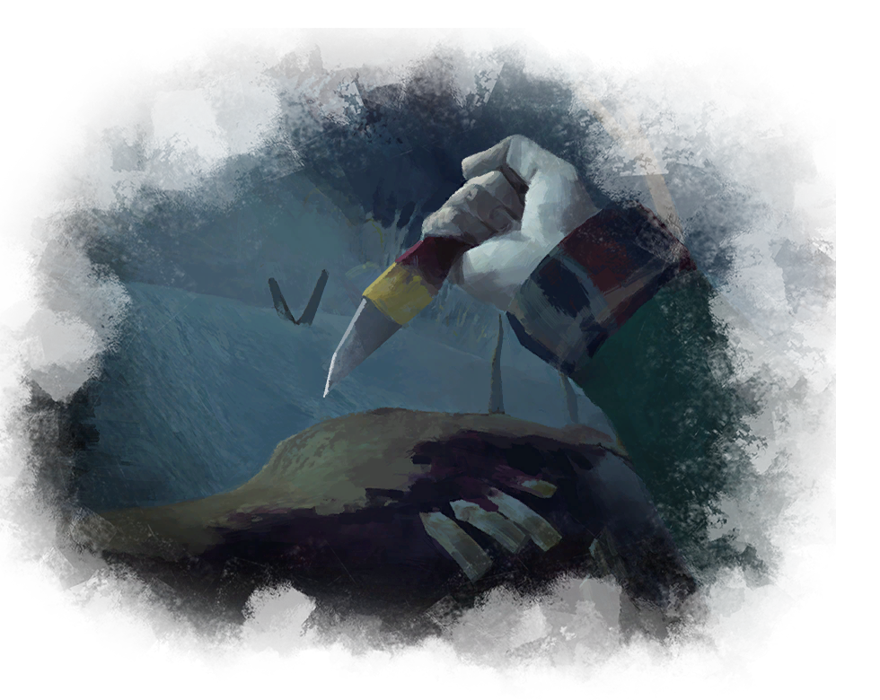

# What I Know

**Contents**

- [Overview](#Overview)
- [People](#People)
- [Episode 1](#Episode_1)
- [Episode 2](#Episode_2)
- [Jeremiah](#Jeremiah)
- [Episode 3](#Episode_3)
- [Episode 4](#Episode_4)
- [Episode 5](#Episode_5)
- [Places](#Places)
- [Episode 1](#Episode_1_2)
- [Episode 2](#Episode_2_2)
- [Episode 3](#Episode_3_2)
- [Episode 4](#Episode_4_2)
- [Things](#Things)
- [Episode 1, 2, and 3](#Episode_1%2C_2%2C_and_3)
- [Episode 4](#Episode_4_3)
- [Episode 5](#Episode_5_2)
- [Cut What I Know](#Cut_What_I_Know)
- [Actions](#Actions)

**"What I Know"** is a part of the <a href="./Journal.md" class="wikilink" title="Journal">Journal</a> that appears while playing <a href="./Wintermute.md" class="wikilink" title="Wintermute">Wintermute</a> and provides useful information about <a href="./Great%20Bear%20Island.md" class="wikilink" title="Great Bear Island">Great Bear Island</a>, its denizens, and how to survive.

## Overview

What I Know contains 4 submenus related to all information gathered about the game world's settings, characters, and items, and is divided into:

- People
- Places
- Things
- Actions

Different People, Places, Things, and Actions are different between Episodes. Unlocked information carries over between <a href="./Episode%201%20-%20Do%20Not%20Go%20Gentle.md" class="wikilink" title="Episode 1: Do Not Go Gentle">Episode 1: Do Not Go Gentle</a> and <a href="./Episode%202%20-%20Luminance%20Fugue.md" class="wikilink" title="Episode 2: Luminance Fugue">Episode 2: Luminance Fugue</a> if they are played in order (until <a href="./Episode%203%20-%20Crossroads%20Elegy.md" class="wikilink" title="Episode 3: Crossroads Elegy">Episode 3: Crossroads Elegy</a> begins)

## People

<figure>

<figcaption>Knowledge_What_I_Know_large_people.png</figcaption>
</figure>

This tab contains all information related to major characters encountered on the Island.

### Episode 1

<a href="./Grey%20Mother.md" class="wikilink" title="Grey Mother">Grey Mother</a>{\| style="margin:auto" \| style="vertical-align:top; font-size:3em; color:#5d5980; padding-right:10px" \|“ \| An elderly blind woman, and possibly the last remaining survivor in Milton. She seems to know something about where Astrid might have gone.

In-game description

\| style="vertical-align:bottom; font-size:3em; color:#5d5980; padding-left:10px" \|” \|} <a href="./Methuselah.md" class="wikilink" title="Methuselah">Methuselah</a>{\| style="margin:auto" \| style="vertical-align:top; font-size:3em; color:#5d5980; padding-right:10px" \|“ \| Ancient in appearance, Methuselah’s clear eyes suggest a deep wisdom and he radiates strength rather than frailty. He has the calm, knowing authority of someone who’s seen a few things in his time.\
\
Methuselah appears to know more than he’s letting on about the events on Great Bear Island. 

In-game description

\| style="vertical-align:bottom; font-size:3em; color:#5d5980; padding-left:10px" \|” \|} <a href="./Hobbs.md" class="wikilink" title="Hobbs">Hobbs</a>**Template:quote2**

### Episode 2

### <a href="./Jeremiah.md" class="wikilink" title="Jeremiah">Jeremiah</a>

<table>
<colgroup>
<col style="width: 33%" />
<col style="width: 33%" />
<col style="width: 33%" />
</colgroup>
<tbody>
<tr>
<td style="vertical-align: top; font-size: 3em; color: #5d5980; padding-right: 10px">
“
</td>
<td>
A tough old trapper and hermit. Lives alone in the wilderness of Mystery Lake. Doesn't seem to like people much.

&#10;

In-game description

</td>
<td style="vertical-align: bottom; font-size: 3em; color: #5d5980; padding-left: 10px">
”
</td>
</tr>
</tbody>
</table>

### Episode 3

<a href="./Molly.md" class="wikilink" title="Molly">Molly</a>{\| style="margin:auto" \| style="vertical-align:top; font-size:3em; color:#5d5980; padding-right:10px" \|“ \| Years on a working farm in a remote corner of Great Bear Island have left their mark on Molly. She’s plain-spoken, often blunt -- she sees the world for what it is. There are no illusions inhabiting Molly’s life and she likes it that way.\
\
Other than the farm and regular subsistence hunting, simple pleasures -- tea and the wanderings of her own imagination -- keep Molly occupied.

In-game description

\| style="vertical-align:bottom; font-size:3em; color:#5d5980; padding-left:10px" \|” \|} <a href="./Father%20Thomas.md" class="wikilink" title="Father Thomas">Father Thomas</a>{\| style="margin:auto" \| style="vertical-align:top; font-size:3em; color:#5d5980; padding-right:10px" \|“ \| Affable and quick to laugh, even in crisis Father Thomas is lifted by his faith rather than weighed down by it. While erudite when he needs to be, he treasures the immediate, pragmatic spiritual needs of life on remote Great Bear Island -- births, baptisms, and funerals, mostly.\
\
Just how and why Father Thomas came to find himself in Pleasant Valley remains a mystery. But it’s clear his devotion to the tiny parish in Thomson’s Crossing has helped bind the community together.

In-game description

\| style="vertical-align:bottom; font-size:3em; color:#5d5980; padding-left:10px" \|” \|}

### Episode 4

<a href="./Mathis.md" class="wikilink" title="Mathis">Mathis</a>**Template:quote2** <a href="./Franklin.md" class="wikilink" title="Franklin">Franklin</a>{\| style="margin:auto" \| style="vertical-align:top; font-size:3em; color:#5d5980; padding-right:10px" \|“ \| The Warden at Blackrock Penitentiary, Franklin has found himself caught up in Mathis’ deadly schemes.\
\
More an administrator than a disciplinarian, no one is more aware of the notorious prison’s dark history than its Warden. But Franklin is clear-eyed about his purpose on Great Bear Island -- the worst of the worst end up with him at Blackrock. And if someone has to be in charge, it might as well be him.

In-game description

\| style="vertical-align:bottom; font-size:3em; color:#5d5980; padding-left:10px" \|” \|} <a href="./Donner.md" class="wikilink" title="Donner">Donner</a>{\| style="margin:auto" \| style="vertical-align:top; font-size:3em; color:#5d5980; padding-right:10px" \|“ \| The man in solitary, the son of Mathis. The reason places like Blackrock exist.\
\
Even post-Collapse, Donner lives apart from anything resembling the regular order of society. And Mathis will stop at nothing in order to unleash his malevolent, unredeemable nature on the world. Starting with Great Bear Island.

In-game description

\| style="vertical-align:bottom; font-size:3em; color:#5d5980; padding-left:10px" \|” \|} <a href="./Jace.md" class="wikilink" title="Jace">Jace</a>{\| style="margin:auto" \| style="vertical-align:top; font-size:3em; color:#5d5980; padding-right:10px" \|“ \| A graduate student in astrophysics, Jace normally has her eyes on the stars. Chance, and the Aurora, have brought her to Blackrock.\
\
Whip-smart, Jace has the air of superiority that many academics inherit. But deep down she is starting to worry that her career choice has left her unprepared for the current situation, especially if the power never comes back.

In-game description

\| style="vertical-align:bottom; font-size:3em; color:#5d5980; padding-left:10px" \|” \|}

### Episode 5

None

## Places

<figure>

<figcaption>Knowledge_What_I_Know_large_places.png</figcaption>
</figure>

Information here was previously found through the cut Trust system (Predux Ep 1 and 2). Redux and onward, all information here is only unlocked when the below notes are found, and is just the entire transcript of these items:

### Episode 1

- <a href="./History%20of%20The%20Collapse.md" class="wikilink" title="History of The Collapse">History of The Collapse</a> (Part 1 and 2)
- <a href="./Town%20of%20Milton.md" class="wikilink" title="Town of Milton">Town of Milton</a>

### Episode 2

- <a href="./History%20of%20The%20Collapse.md" class="wikilink" title="History of The Collapse">History of The Collapse</a> (Part 3 and 4)
- <a href="./Mystery%20Lake%20%26%20Area.md" class="wikilink" title="Mystery Lake &amp; Area">Mystery Lake &amp; Area</a>
- <a href="./Carter%20Hydro%20Dam%20%28Collectible%29.md" class="wikilink" title="Carter Hydro Dam (Collectible)">Carter Hydro Dam (Collectible)</a>

### Episode 3

- <a href="./Pleasant%20Valley%20History.md" class="wikilink" title="Pleasant Valley History">Pleasant Valley History</a>

### Episode 4

- <a href="./Building%20Blackrock.md" class="wikilink" title="Building Blackrock">Building Blackrock</a>

## Things

<figure>

<figcaption>Knowledge_What_I_Know_large_things.png</figcaption>
</figure>

Things give tutorials on subjects such as Tools, world objects, wildlife, and journal/mission mechanics.

### Episode 1, 2, and 3

Controls{\| style="margin:auto" \| style="vertical-align:top; font-size:3em; color:#5d5980; padding-right:10px" \|“ \| The Key to Survival\
Preparation and self-control are vital to your survival. Check your Controls menu if you're unsure of how to do something. This could save your life.

What I Know description

\| style="vertical-align:bottom; font-size:3em; color:#5d5980; padding-left:10px" \|” \|}Side Missions

<table>
<colgroup>
<col style="width: 33%" />
<col style="width: 33%" />
<col style="width: 33%" />
</colgroup>
<tbody>
<tr>
<td style="vertical-align: top; font-size: 3em; color: #5d5980; padding-right: 10px">
“
</td>
<td>
Use the journal to track side mission progress.

&#10;

What I Know description

</td>
<td style="vertical-align: bottom; font-size: 3em; color: #5d5980; padding-left: 10px">
”
</td>
</tr>
</tbody>
</table>

Status{\| style="margin:auto" \| style="vertical-align:top; font-size:3em; color:#5d5980; padding-right:10px" \|“ \| Status is Your Early Warning System\
When you bring up the Quick Stats or the Radial Menu, you'll get a preview of your Current Condition, as well as information about how Cold, Tired, Hungary, and Thirsty you are. Any time one of these status indicators is empty and red, this means you're losing Condition. Lose all your Condition, and you'll die.

What I Know description

\| style="vertical-align:bottom; font-size:3em; color:#5d5980; padding-left:10px" \|” \|} <a href="./Crow.md" class="wikilink" title="Crows">Crows</a>{\| style="margin:auto" \| style="vertical-align:top; font-size:3em; color:#5d5980; padding-right:10px" \|“ \| Your Ears Are Your Best Survival Tool\
Pay attention to your surroundings and you might glean information that's important for your survival. For example, a murder of Crows circling up ahead might suggest an animal carcass -- or even a human corpse -- might be nearby!

What I Know description

\| style="vertical-align:bottom; font-size:3em; color:#5d5980; padding-left:10px" \|” \|} <a href="./Clothing.md" class="wikilink" title="Clothing">Clothing</a>{\| style="margin:auto" \| style="vertical-align:top; font-size:3em; color:#5d5980; padding-right:10px" \|“ \| Clothing Is Armour Against Cold\
Out in the wilderness, clothing is like armour against the elements. Wear layers to stay warm. An remember, wind is your enemy! Clothing offers different protection from cold and windchill. Your clothes can get wet from blowing snow or if you fall into water, which makes them ineffective and increases your risk of hypothermia or even frostbite. Keep your clothes as dry as you can! finally, clothing can protect you from physical injuries as from falling or tangling with wildlife. Balance all these factors against the weight and mobility cost of your combined clothing.

What I Know description

\| style="vertical-align:bottom; font-size:3em; color:#5d5980; padding-left:10px" \|” \|} <a href="./First%20Aid.md" class="wikilink" title="First Aid">First Aid</a>{\| style="margin:auto" \| style="vertical-align:top; font-size:3em; color:#5d5980; padding-right:10px" \|“ \| Study Your Treatments and Learn to Triage\
There are many ways to die in the wilderness. Medical treatments -- man-made or harvested from the natural world -- will save your life. Use the Status screen to check on your health. Apply a Treatment using the First Aid Radial menu. You can also use Treatments from your Pack menu.

What I Know description

\| style="vertical-align:bottom; font-size:3em; color:#5d5980; padding-left:10px" \|” \|} <a href="./Stone.md" class="wikilink" title="Stones">Stones</a>{\| style="margin:auto" \| style="vertical-align:top; font-size:3em; color:#5d5980; padding-right:10px" \|“ \| Aim True and You Won't Go Hungry\
You can pick up small Stones and use them to Stun Rabbits. Equip them, and throw them to hit a Rabbit, then grab it while it's stunned. If you can kill it, you can eat it.

What I Know description

\| style="vertical-align:bottom; font-size:3em; color:#5d5980; padding-left:10px" \|” \|} <a href="./Wolf.md" class="wikilink" title="Wolves">Wolves</a>{\| style="margin:auto" \| style="vertical-align:top; font-size:3em; color:#5d5980; padding-right:10px" \|“ \| Avoid if You Can!\
Wolves are not dogs and out here they are very dangerous. They normally avoid humans, but do you want to take a chance? Like most things in nature, Wolves are afraid of Fire. Campfires, Torches, or Flares can keep them at bay. Thrown Torches or Flares might scare them away. But there are no guarantees. In the end, the best way to avoid tangling with Wolves is to give them a wide berth.\
Remember, they are attracted to Blood, Raw Meat, and Raw Fish. These items can also be used as Decoys to put Wolves off your trail.

What I Know description

\| style="vertical-align:bottom; font-size:3em; color:#5d5980; padding-left:10px" \|” \|} Raw Meat{\| style="margin:auto" \| style="vertical-align:top; font-size:3em; color:#5d5980; padding-right:10px" \|“ \| Everything You Eat, Can Kill You\
When starving, you may feel desperate enough to take your chances, but in general eating raw meat is a bad idea. Cook it to avoid getting Food Poisoning, or Parasites. Cooked meat also lasts longer, and attracts fewer predators.

What I Know description

\| style="vertical-align:bottom; font-size:3em; color:#5d5980; padding-left:10px" \|” \|} <a href="./Frozen%20Corpse.md" class="wikilink" title="Frozen Corpses">Frozen Corpses</a>{\| style="margin:auto" \| style="vertical-align:top; font-size:3em; color:#5d5980; padding-right:10px" \|“ \| A frozen corpse brings Great Bear Island's harsh reality front and centre.\
Leave them in peace, or search the body for supplies to help you avoid their fate.

What I Know description

\| style="vertical-align:bottom; font-size:3em; color:#5d5980; padding-left:10px" \|” \|} Containers{\| style="margin:auto" \| style="vertical-align:top; font-size:3em; color:#5d5980; padding-right:10px" \|“ \| Search Everything!\
Search all the containers you find, as you never know when one might hold life-saving supplies! You can also store things in Containers, to be retrieved later.

What I Know description

\| style="vertical-align:bottom; font-size:3em; color:#5d5980; padding-left:10px" \|” \|} <a href="./Vehicle.md" class="wikilink" title="Vehicles">Vehicles</a>{\| style="margin:auto" \| style="vertical-align:top; font-size:3em; color:#5d5980; padding-right:10px" \|“ \| Take Shelter\
Cars can serve as shelters, protecting you from deadly wind and wildlife. You might even find supplies left inside the glove compartments or trunks.

What I Know description

\| style="vertical-align:bottom; font-size:3em; color:#5d5980; padding-left:10px" \|” \|} <a href="./Fire.md" class="wikilink" title="Fire">Fire</a>

<table>
<colgroup>
<col style="width: 33%" />
<col style="width: 33%" />
<col style="width: 33%" />
</colgroup>
<tbody>
<tr>
<td style="vertical-align: top; font-size: 3em; color: #5d5980; padding-right: 10px">
“
</td>
<td>
Fire Provides Heat, Water, Food, Protection 
Use the Campfire option in the Radial Menu. You'll need all the fixings: a Firestarter, Tinder, and Fuel. Accelerant speeds up the process. Fuel types impact burn time and heat production. An active fire, along with a Can or Pot, can be used to Cook or Boil Water, as well as keep you from freezing to death.

&#10;

What I Know description

</td>
<td style="vertical-align: bottom; font-size: 3em; color: #5d5980; padding-left: 10px">
”
</td>
</tr>
</tbody>
</table>

<a href="./Bedroll.md" class="wikilink" title="Bedrolls">Bedrolls</a>

<table>
<colgroup>
<col style="width: 33%" />
<col style="width: 33%" />
<col style="width: 33%" />
</colgroup>
<tbody>
<tr>
<td style="vertical-align: top; font-size: 3em; color: #5d5980; padding-right: 10px">
“
</td>
<td>
Resting Heals You and Saves Your Progress 
Resting restores lost Condition and helps you recover from Afflictions. You can Rest in beds you find as you explore the world. A Bedroll allows you to Rest whenever you like. Remember that Resting uses up Calories and the hours that pass make you Hungry and Thirsty.

&#10;

What I Know description

</td>
<td style="vertical-align: bottom; font-size: 3em; color: #5d5980; padding-left: 10px">
”
</td>
</tr>
</tbody>
</table>

<a href="./Old%20Man%27s%20Beard%20Lichen.md" class="wikilink" title="Old Man&#39;s Beard">Old Man's Beard</a>{\| style="margin:auto" \| style="vertical-align:top; font-size:3em; color:#5d5980; padding-right:10px" \|“ \| Moss to Prevent Infection\
Old Man's Beard Lichen has long been appreciated for its anti-bacterial properties. First, prepare it to be used for treatment. Then, apply it to injuries to reduce Infection Risk.

What I Know description

\| style="vertical-align:bottom; font-size:3em; color:#5d5980; padding-left:10px" \|” \|} <a href="./Bandage.md" class="wikilink" title="Bandages">Bandages</a>

<table>
<colgroup>
<col style="width: 33%" />
<col style="width: 33%" />
<col style="width: 33%" />
</colgroup>
<tbody>
<tr>
<td style="vertical-align: top; font-size: 3em; color: #5d5980; padding-right: 10px">
“
</td>
<td>
Craft Them to Stop the Bleeding! 
Blood loss will kill you unless you stop it. A simple cloth Bandage might save your life. Use the Crafting Menu to make a Bandage from Cloth, which you can find in the world. Or Harvest it from existing Clothing items.

&#10;

What I Know description

</td>
<td style="vertical-align: bottom; font-size: 3em; color: #5d5980; padding-left: 10px">
”
</td>
</tr>
</tbody>
</table>

<a href="./Rose%20Hip.md" class="wikilink" title="Rose Hips">Rose Hips</a>{\| style="margin:auto" \| style="vertical-align:top; font-size:3em; color:#5d5980; padding-right:10px" \|“ \| Mother Nature's Painkiller\
Sometimes Mother Nature is your pharmacist. Craft Rose-hips into a preparation that can be boiled in water to produce a tea with pain-relieving properties. Keep your eyes open for other natural remedies.

What I Know description

\| style="vertical-align:bottom; font-size:3em; color:#5d5980; padding-left:10px" \|” \|} <a href="./Birch%20Bark.md" class="wikilink" title="Birch Bark">Birch Bark</a>

<table>
<colgroup>
<col style="width: 33%" />
<col style="width: 33%" />
<col style="width: 33%" />
</colgroup>
<tbody>
<tr>
<td style="vertical-align: top; font-size: 3em; color: #5d5980; padding-right: 10px">
“
</td>
<td>
Prepare Birch Bark before brewing it into a natural tea. Drink to gradually restore some lost Condition.

&#10;

What I Know description

</td>
<td style="vertical-align: bottom; font-size: 3em; color: #5d5980; padding-left: 10px">
”
</td>
</tr>
</tbody>
</table>

<a href="./Snare.md" class="wikilink" title="Snares">Snares</a>{\| style="margin:auto" \| style="vertical-align:top; font-size:3em; color:#5d5980; padding-right:10px" \|“ \| You can use your energy chasing Rabbits and trying to stun them with stones, or you can use a more long-term strategy: Snares. Look for areas of high Rabbit activity, and place a Snare nearby. Check on it daily. You may get lucky and catch a Rabbit. You can set up multiple snares to increase your chances. A well maintained Trapline can be an excellent long-term source of food. Just remember, it may attract other wildlife!

What I Know description

\| style="vertical-align:bottom; font-size:3em; color:#5d5980; padding-left:10px" \|” \|}

### Episode 4

Item Confiscation

<table>
<colgroup>
<col style="width: 33%" />
<col style="width: 33%" />
<col style="width: 33%" />
</colgroup>
<tbody>
<tr>
<td style="vertical-align: top; font-size: 3em; color: #5d5980; padding-right: 10px">
“
</td>
<td>
To avoid items being confiscated, hide them out of sight in containers or places far away from the convicts.

&#10;

What I Know description

</td>
<td style="vertical-align: bottom; font-size: 3em; color: #5d5980; padding-left: 10px">
”
</td>
</tr>
</tbody>
</table>

<a href="./Noisemaker.md" class="wikilink" title="Noisemaker">Noisemaker</a>

<table>
<colgroup>
<col style="width: 33%" />
<col style="width: 33%" />
<col style="width: 33%" />
</colgroup>
<tbody>
<tr>
<td style="vertical-align: top; font-size: 3em; color: #5d5980; padding-right: 10px">
“
</td>
<td>
Noisemakers can be used to effectively scare off wildlife. Use with care to avoid injury!

&#10;

What I Know description

</td>
<td style="vertical-align: bottom; font-size: 3em; color: #5d5980; padding-left: 10px">
”
</td>
</tr>
</tbody>
</table>

Pressure Gauges

<table>
<colgroup>
<col style="width: 33%" />
<col style="width: 33%" />
<col style="width: 33%" />
</colgroup>
<tbody>
<tr>
<td style="vertical-align: top; font-size: 3em; color: #5d5980; padding-right: 10px">
“
</td>
<td>
Look at the pressure gauges to see the steam pressure for each pipe. 
Without enough pressure, the steam won't be flowing through the pipes to thaw them.

&#10;

What I Know description

</td>
<td style="vertical-align: bottom; font-size: 3em; color: #5d5980; padding-left: 10px">
”
</td>
</tr>
</tbody>
</table>

Point Of No Return

<table>
<colgroup>
<col style="width: 33%" />
<col style="width: 33%" />
<col style="width: 33%" />
</colgroup>
<tbody>
<tr>
<td style="vertical-align: top; font-size: 3em; color: #5d5980; padding-right: 10px">
“
</td>
<td>
Make sure you have completed all other missions and tasks before returning to the Prison. 
This is the point of no return.

&#10;

What I Know description

</td>
<td style="vertical-align: bottom; font-size: 3em; color: #5d5980; padding-left: 10px">
”
</td>
</tr>
</tbody>
</table>

### Episode 5

Respirator

<table>
<colgroup>
<col style="width: 33%" />
<col style="width: 33%" />
<col style="width: 33%" />
</colgroup>
<tbody>
<tr>
<td style="vertical-align: top; font-size: 3em; color: #5d5980; padding-right: 10px">
“
</td>
<td>
Equip to protect yourself from toxic gas and other environmental hazards. Requires Canisters to function.

&#10;

What I Know description

</td>
<td style="vertical-align: bottom; font-size: 3em; color: #5d5980; padding-left: 10px">
”
</td>
</tr>
</tbody>
</table>

Steam Train's Speed{\| style="margin:auto" \| style="vertical-align:top; font-size:3em; color:#5d5980; padding-right:10px" \|“ \| The Steam Train can move at two speeds "Slow" and "Fast". When the Steam Train is moving fast enough it can break through obstacles that would otherwise block its path. But increasing the Steam Train's speed will consume PSI.

What I Know description

\| style="vertical-align:bottom; font-size:3em; color:#5d5980; padding-left:10px" \|” \|} Steam Train Throttle{\| style="margin:auto" \| style="vertical-align:top; font-size:3em; color:#5d5980; padding-right:10px" \|“ \| Move the throttle up through gears 1 and 2 to increase the Steam Train's Speed or into Reverse to change directions. Using the Brake will automatically put the Steam Train into its Neutral Gear. The Throttle can only be adjusted if the Brake is off and the Steam Train can only change directions when it is fully stopped.

What I Know description

\| style="vertical-align:bottom; font-size:3em; color:#5d5980; padding-left:10px" \|” \|}Steam Train's Firebox{\| style="margin:auto" \| style="vertical-align:top; font-size:3em; color:#5d5980; padding-right:10px" \|“ \| Use Coal to get the Steam Train Firebox temperature up to 125 degrees to start building pressure (PSI). The firebox will slowly cool off over time if you don't keep feeding it coal but never below 125 degrees.

What I Know description

\| style="vertical-align:bottom; font-size:3em; color:#5d5980; padding-left:10px" \|” \|}

### Cut What I Know

<a href="./Condition.md" class="wikilink" title="Condition">Condition</a>

<table>
<colgroup>
<col style="width: 33%" />
<col style="width: 33%" />
<col style="width: 33%" />
</colgroup>
<tbody>
<tr>
<td style="vertical-align: top; font-size: 3em; color: #5d5980; padding-right: 10px">
“
</td>
<td>
Sleep Restores Condition 
When your Condition gets too low, you'll start to become dizzy, your vision will blur, and eventually you'll lose fine motor controls. This is all a warning that you improve your situation ASAP. Ever hour of Rest will restore lost Condition, and you'll also gain a bit of Condition for every hour you don't have an affliction risk or low status in Hunger, Thirst, Cold, or Fatigue. Your Status screen can help you keep track of your Condition, any current Afflictions, as well as help you understand how to treat injuries you may have sustained. Check it often.

&#10;

What I Know description

</td>
<td style="vertical-align: bottom; font-size: 3em; color: #5d5980; padding-left: 10px">
”
</td>
</tr>
</tbody>
</table>

Knowledge{\| style="margin:auto" \| style="vertical-align:top; font-size:3em; color:#5d5980; padding-right:10px" \|“ \| What You Know Can Save You\
As you learn things about the world -- either through your own actions, or through interacting with people -- you unlock Knowledge about People, Places, Things, and Actions. Deeper Knowledge can be revealed when you gain the Trust of other survivors you meet. This Knowledge is tracked in your Journal, for future reference.

What I Know description

\| style="vertical-align:bottom; font-size:3em; color:#5d5980; padding-left:10px" \|” \|} <a href="./Flashlight.md" class="wikilink" title="Flashlight">Flashlight</a>{\| style="margin:auto" \| style="vertical-align:top; font-size:3em; color:#5d5980; padding-right:10px" \|“ \| They Hate the Light\
As you explore the world, you may discover that some electrical tools that have been inert since the First Flare, like Flashlights, are brought to life by the strange aurora lights in the night sky. The Flashlight can help you find your way in the darkness. It may also have unexpected effects on wildlife.

What I Know description

\| style="vertical-align:bottom; font-size:3em; color:#5d5980; padding-left:10px" \|” \|} Rifle{\| style="margin:auto" \| style="vertical-align:top; font-size:3em; color:#5d5980; padding-right:10px" \|“ \| Use Guns Wisely\
Rifle condition affects its reliability. Use a Rifle Cleaning Kit to keep it in good-working order. Take care of your rifle, and it'll take care of you. You wouldn't want it to jam when you need it most.

What I Know description

\| style="vertical-align:bottom; font-size:3em; color:#5d5980; padding-left:10px" \|” \|}

## Actions

<figure>

<figcaption>Knowledge_What_I_Know_large_actions.png</figcaption>
</figure>

Actions gives information on basic gameplay mechanics.

Journal Objectives

<table>
<colgroup>
<col style="width: 33%" />
<col style="width: 33%" />
<col style="width: 33%" />
</colgroup>
<tbody>
<tr>
<td style="vertical-align: top; font-size: 3em; color: #5d5980; padding-right: 10px">
“
</td>
<td>
View your Journal and current Mission objectives through the Radial Menu. 
To show the Radial Menu, press and hold [SPACE].

&#10;

What I Know description

</td>
<td style="vertical-align: bottom; font-size: 3em; color: #5d5980; padding-left: 10px">
”
</td>
</tr>
</tbody>
</table>

Food

<table>
<colgroup>
<col style="width: 33%" />
<col style="width: 33%" />
<col style="width: 33%" />
</colgroup>
<tbody>
<tr>
<td style="vertical-align: top; font-size: 3em; color: #5d5980; padding-right: 10px">
“
</td>
<td>
Use the Radial Menu to quickly eat Food items by pressing [SPACE]. Or use use (sic) the Backpack screen to see all your Food items and eat from there. 
Tip: From your Backpack, you can assign your favourite Food to the radial menu (sic) for quick access.

&#10;

What I Know description

</td>
<td style="vertical-align: bottom; font-size: 3em; color: #5d5980; padding-left: 10px">
”
</td>
</tr>
</tbody>
</table>

Fire{\| style="margin:auto" \| style="vertical-align:top; font-size:3em; color:#5d5980; padding-right:10px" \|“ \| Use the Radial Menu to quickly eat Food items by pressing \[SPACE\]. Or use use (sic) the Backpack screen to see all your Food items and eat from there.\
Tip: From your Backpack, you can assign your favourite Food to the radial menu (sic) for quick access.

What I Know description

\| style="vertical-align:bottom; font-size:3em; color:#5d5980; padding-left:10px" \|” \|} Clothing Basics{\| style="margin:auto" \| style="vertical-align:top; font-size:3em; color:#5d5980; padding-right:10px" \|“ \| Use the radial menu to select "Status", then go to the clothing tab to view clothing items you have equipped, see their status and equip new clothing items.

What I Know description

\| style="vertical-align:bottom; font-size:3em; color:#5d5980; padding-left:10px" \|” \|} Sprinting{\| style="margin:auto" \| style="vertical-align:top; font-size:3em; color:#5d5980; padding-right:10px" \|“ \| Run For Your Life\
Walking through the snow with a heavy pack can get tiring, but sometimes you just have to run. Escape wildlife, avoid weak ice, or get to shelter faster by Sprinting. Keep in mind that Sprinting uses up more Calories than Walking, and your Sprint stamina is limited by how restrictive your Clothing is. It takes you a little while to recover Sprint stamina, so use it wisely!

What I Know description

\| style="vertical-align:bottom; font-size:3em; color:#5d5980; padding-left:10px" \|” \|} Cooking Meat{\| style="margin:auto" \| style="vertical-align:top; font-size:3em; color:#5d5980; padding-right:10px" \|“ \| Raw Meat can be Cooked directly on any cooking surface, or by using a Cooking Pot.\
Use the Radial Menu to select "food" and place the Meat from there.

What I Know description

\| style="vertical-align:bottom; font-size:3em; color:#5d5980; padding-left:10px" \|” \|} Forge{\| style="margin:auto" \| style="vertical-align:top; font-size:3em; color:#5d5980; padding-right:10px" \|“ \| Use the forge to melt down scrap metal and craft various items. Forges need to be very hot before you can use them!\
Tip: different fuels burn at varying temperatures, coal burns the hottest.

What I Know description

\| style="vertical-align:bottom; font-size:3em; color:#5d5980; padding-left:10px" \|” \|} Setting the Spear{\| style="margin:auto" \| style="vertical-align:top; font-size:3em; color:#5d5980; padding-right:10px" \|“ \| Select the Bear Spear from the Radial Menu, then press and hold \[LMB\] to Set the Spear against a charging Bear, as long as you have enough Stamina.

What I Know description

\| style="vertical-align:bottom; font-size:3em; color:#5d5980; padding-left:10px" \|” \|} Crouching{\| style="margin:auto" \| style="vertical-align:top; font-size:3em; color:#5d5980; padding-right:10px" \|“ \| Get Under Stuff\
Occasionally you'll encounter an obstacle in your path. Crouching (using \[L Ctrl\]) might help to get under it. Crouching also makes you less obvious to wildlife, from a distance. You move more slowly, but also more silently, so you might get closer.

What I Know description

\| style="vertical-align:bottom; font-size:3em; color:#5d5980; padding-left:10px" \|” \|} Light{\| style="margin:auto" \| style="vertical-align:top; font-size:3em; color:#5d5980; padding-right:10px" \|“ \| Each Light Source has Pros and Cons\
You may need to improvise Light Sources to see in the dark. you can Craft Torches out of available materials. Flares provide a one-off light source. Lanterns last longer, but use up Oil. Darkness hides dangers, and also prevents you from Crafting, Repairing your gear, and other actions.

What I Know description

\| style="vertical-align:bottom; font-size:3em; color:#5d5980; padding-left:10px" \|” \|} Perseverance Mills Infiltration

<table>
<colgroup>
<col style="width: 33%" />
<col style="width: 33%" />
<col style="width: 33%" />
</colgroup>
<tbody>
<tr>
<td style="vertical-align: top; font-size: 3em; color: #5d5980; padding-right: 10px">
“
</td>
<td>
Sentry Convicts watch the path into town and must be avoided. Some Convicts have their backs to you -- these can be Choked and Taken Down.

&#10;

What I Know description

</td>
<td style="vertical-align: bottom; font-size: 3em; color: #5d5980; padding-left: 10px">
”
</td>
</tr>
</tbody>
</table>

