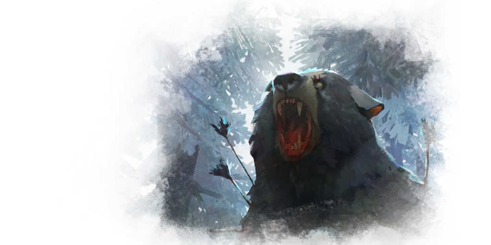

# What One Man Can Do/Transcript

**Categories:** Episode 2 · **Source:** [Fandom](https://thelongdark.fandom.com/wiki/What_One_Man_Can_Do%2FTranscript)

**What One Man Can Do/Transcript**

| Property | Details |
| --- | --- |
|  |  / _Missions\_story\_ep2\_What\_One\_Man\_Can\_Do.png_ |
| Episode | [Episode 2](./Episode%202%20-%20Luminance%20Fugue.md)\|- |
| Previous | [Signal to Noise/Transcript](./Signal%20to%20Noise%20%E2%80%94%20Transcript.md) |
| Current | What One Man Can Do/Transcript |
| Next | [Renewed Hope/Transcript](./Renewed%20Hope%20%E2%80%94%20Transcript.md) |
| Region | [Forlorn Muskeg](./Forlorn%20Muskeg.md) |
| Characters | [Mackenzie](./Will%20Mackenzie.md) [Old Bear](./Old%20Bear.md) / [Jeremiah](./Jeremiah.md) / [Radio Voice Man](./Characters.md#Radio_Voice_Man) |

This is the mission transcript for mission 4 [What One Man Can Do](./What%20One%20Man%20Can%20Do.md) of [Episode 2: Luminance Fugue](./Episode%202%20-%20Luminance%20Fugue.md).

## Transcript

_Mackenzie pushes himself off of a cave floor._

Mackenzie: "Whe...where am I? Holy shit. The [bear](./Old%20Bear.md). It's...right...there."

CHAPTER FOUR

WHAT ONE MAN CAN DO

Mackenzie: "Damn. Where the hell's that spear?"

_Mackenzie realizes all of his belongings, aside from the torn clothes on his back, are all gone. He begins walking away from the bear, as it feasts on a [Wolf Carcass](./Wolf%20Carcass.md). As he slowly walks to a nearby [Rock Climb](./Rock%20Climb.md) past the bear, he says:_

Mackenzie: "Way too close."

_Mackenzie climbs the wall, finding a narrow tunnel to crouch through as he wanders through the cave. After walking awhile, he sees a hole in the floor, with the Old Bear below as it begins following him. Mackenzie comes to a large chamber with a waterfall._

Mackenzie: "If I don't keep my distance, I'm done for. Got to find that spear."

_Weaving through rocky passages too small for the bear to reach, Mackenzie eventually passes through a waterfall chamber as the bear feasts on a [Frozen Corpse](./Frozen%20Corpse.md). No matter what path lies ahead, the Old Bear follows through the tunnels. Eventually the Pilot finds a body with a [Torn Paper](./Torn%20Paper.md) on it and some medical supplies, and moves on to not join the doomed man and finds another large cavern._

Mackenzie: "Have to stay back."

_Mackenzie bobs and weaves through more small passages that the bear cannot follow. The next chamber is_ _a large room with an open ceiling, and_ _he_ _spots the red ribbon tied to his Spear_ _sitting on a rock._

Mackenzie: "There it is! The spear. Somehow, I gotta grab it. That'll even the odds."

_The Old Bear enters the chamber, continuing its pursuit of the pilot. Mackenzie squeezes through more small passages, patiently moving through the room until it is safe to grab the spear. He eventually makes a run for it, and grabs it._

Mackenzie: "Gotcha!"

_Mackenzie then goes on the offense, attacking the bear 3 times in a "Bear Spear Struggle" by plunging the spear into the overgrown mankiller's stomach. On the last attempt he finally kills the bear, getting the upper hand and repeatedly plunging the spear into the beast's neck. Mackenzie catches his breath as he looks over the lifeless body of the bear._

Mackenzie: "I'm...I'm sorry. Such a majestic creature. I didn't want to kill you. But this world will make murders of us all."

_The screen fades to black, and fades in with Mackenzie staggering into the Trapper's Homestead and falling on the floor._

Jeremiah: "Mackenzie?"

_The Trapper's [Deerskin Boots](./Deerskin%20Boots.md) appear as Jeremiah walks over to the exhausted pilot and picks him up._

Mackenzie: "The bear...is dead."

_Mackenzie falls to the floor and passes out. When he wakes up, time has passed and he finds himself in the Trapper's bed, the lights of the Aurora flickering outside the cabin. He starts getting out of bed as Jeremiah sees him._

Jeremiah: "Good! You're up. And just in time."

Mackenzie: "What happened?"

Jeremiah: "You passed out. I let you rest, since I needed time to fix the radio. Ha. And what did I tell you? Those transponder parts did the trick. They were perfect. You did good, Mackenzie. You did good. Signal strength looks like it might be sufficient. But who knows how long it'll last, with this unpredictable aurora in the sky."

Mackenzie: "Ok...so can we call Perseverance Mills?"

_Jeremiah gets off his stool and gestures the shortwave_

Jeremiah: "I've already set the frequency. Just toggle the CALL button and cross your fingers."

_Mackenzie gets out of bed and sits on the stool, then flips the shortwave's CALL button on._

Mackenzie: "Here goes nothing."

[Radio Voice Man](./Characters.md#Radio_Voice_Man): "...\[static\]... This is...Mills...come in..."

Mackenzie: "Hello? Is this the radio station at Perseverance Mills?"

Radio Voice Man: "We need help...Some kind of...quarantine..."

_Mackenzie fiddles with a radio dial, trying to fix the signal_

Mackenzie: "Hello? What do you mean, quarantine? Is there a doctor with you?"

Radio Voice Man: "We need a...doctor...or medical assistance. Anything."

_The radio begins sparking as Mackenzie fiddles with the dial more._

Mackenzie: "Can you..."

_The radio complexly shorts out_

Mackenzie: "Damn it!!"

Jeremiah: "NO!!! Damn it!!!"

_Jeremiah bangs the Work Bench in sheer frustration as the radio dies and loses power. He sits down, head in his hands in defeat._

Mackenzie: "I...I'm sorry, Jeremiah."

Jeremiah: "That was my only chance."

Mackenzie: "Only chance...for what?"

Jeremiah: "You need to find your lady friend. I need to reach someone too. And that was my only chance."

Mackenzie: "Well...we can find another radio. Or repair this one. Get new parts..."

Jeremiah: "No. There's only one way now. You need to do it."

Mackenzie: "Me? Need to do what?"

Jeremiah: "You need to take my message. You need to deliver it for me. It's important. You need to do it for me Mackenzie. It'll be weeks before I can travel that far...you need to do it for me Mackenzie."

Mackenzie: "Ok...ok take it easy."

Jeremiah: "You don't understand. You don't understand what's coming, Mackenzie. You have to take my message. Or else...none of the rest of it matters."

Mackenzie: "Ok, Jeremiah...I'll take your message."

Jeremiah: "It's only a little detour for you, on the way to Perseverance Mills. A little detour that can change a lot. Maybe everything."

Mackenzie: "I'm listening."

Jeremiah: "Go through Carter. You'll need to get the old elevator system working again. With the Aurora...it just might work. Go through Carter, the lower part of the dam. Look out for..."

Mackenzie: "Yeah. I know. "Unstable"."

Jeremiah: "Right, right. Through Carter, out the other side. You'll find your way to Signal Hill. Old weather service radio there. More powerful than my shortwave. You should be able to reach them."

Mackenzie: "Reach who?"

Jeremiah: "I'll give you the frequency. Ask for "Atwood"."

Mackenzie: "Atwood. Got it. What's the message?"

Jeremiah: " "Wintermute." "

Mackenzie: "Winter-mute?"

Jeremiah: "Yeah, just that. Atwood will know what it means. Once you've done that...keep following the roads North, and you'll eventually get to Perseverance Mills. You'll start seeing the signs a few days walk out."

Mackenzie: "O...Ok. Got it. And what will you do?"

Jeremiah: "A couple more days to recover. And then...Something else I gotta do."

Mackenzie: "You're in no state to..."

Jeremiah: "Relax, Mackenzie. It's only a short trip, but one I gotta take. And with the Old Bear out of the picture, I may have half a chance now. Thanks to you."

Mackenzie: "Well...don't make all my hard work keeping you alive be for nothing."

Jeremiah: "Good luck finding your lady, Mackenzie. I hope she's ok. This upside-down world won't be easy on the good people. I think you know that."

Mackenzie: "Thanks. She's out there somewhere. And she's a strong one. She'll make it. And I'll find her again. In Perseverance Mills."

Jeremiah: "Don't forget about Atwood."

Mackenzie: "Take care of yourself, Jeremiah."

_The screen fades to black._
