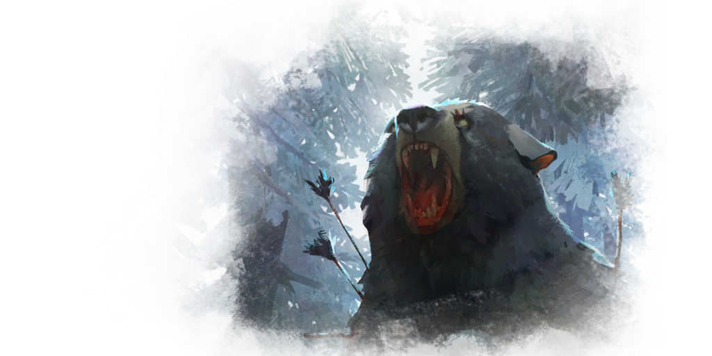

# What One Man Can Do

<table class="infobox">
<caption>What One Man Can Do</caption>
<colgroup>
<col style="width: 50%" />
<col style="width: 50%" />
</colgroup>
<tbody>
<tr>
<td colspan="2"><figure>

<figcaption>Missions_story_ep2_What_One_Man_Can_Do.png</figcaption>
</figure></td>
</tr>
<tr>
<td>
Episode
</td>
<td>
<a href="./Episode%202%20-%20Luminance%20Fugue.md" class="wikilink" title="Episode 2">Episode 2</a>|-
</td>
</tr>
<tr>
<td>
Previous
</td>
<td>
<a href="./Signal%20to%20Noise.md" class="wikilink" title="Signal to Noise">Signal to Noise</a>
</td>
</tr>
<tr>
<td>
Current
</td>
<td>
What One Man Can Do
</td>
</tr>
<tr>
<td>
Next
</td>
<td>
<a href="./Renewed%20Hope.md" class="wikilink" title="Renewed Hope">Renewed Hope</a>
</td>
</tr>
<tr>
<td>
Region
</td>
<td>
<a href="./Forlorn%20Muskeg.md" class="wikilink" title="Forlorn Muskeg">Forlorn Muskeg</a>
</td>
</tr>
<tr>
<td>
Characters
</td>
<td>
<a href="./Will%20Mackenzie.md" class="wikilink" title="Mackenzie">Mackenzie</a> <a href="./Old%20Bear.md" class="wikilink" title="Old Bear">Old Bear</a> 
<a href="./Jeremiah.md" class="wikilink" title="Jeremiah">Jeremiah</a> 
<a href="./Characters.md#Radio_Voice_Man" class="wikilink" title="Radio Voice Man">Radio Voice Man</a>
</td>
</tr>
</tbody>
</table>

**Template:spoiler**

<table>
<colgroup>
<col style="width: 33%" />
<col style="width: 33%" />
<col style="width: 33%" />
</colgroup>
<tbody>
<tr>
<td style="vertical-align: top; font-size: 3em; color: #5d5980; padding-right: 10px">
“
</td>
<td>
The Old Bear has dragged Mackenzie to its lair. Will he put the legendary bear's story to an end?

&#10;

In-game description

</td>
<td style="vertical-align: bottom; font-size: 3em; color: #5d5980; padding-left: 10px">
”
</td>
</tr>
</tbody>
</table>

**What One Man Can Do** is the fourth mission in <a href="./Episode%202%20-%20Luminance%20Fugue.md" class="wikilink" title="Episode 2">Episode 2</a> of the <a href="./Wintermute.md" class="wikilink" title="Story">Story</a>. During the mission <a href="./Signal%20to%20Noise.md" class="wikilink" title="Signal to Noise">Signal to Noise</a>, <a href="./Will%20Mackenzie.md" class="wikilink" title="Mackenzie">Mackenzie</a> is ambushed by the <a href="./Old%20Bear.md" class="wikilink" title="Old Bear">Old Bear</a>, who drags him to its den. Now with no belongings and only his wits to aid in his survival, Mackenzie must run and crawl throughout the <a href="./Old%20Bear%27s%20Den.md" class="wikilink" title="Old Bear&#39;s Den">Old Bear's Den</a> until he find the <a href="./Bear%20Spear.md" class="wikilink" title="Bear Spear">Bear Spear</a>, and finally kill the Old Bear.

A body with the <a href="./Torn%20Paper.md" class="wikilink" title="Torn Paper">Torn Paper</a> note can be found halfway through the cave system.

Mackenzie ultimately succeeds in finding the spear and killing the beast, lamenting that he had to put down "such a majestic creature" but that "this new world makes murderers of us all".

## Objectives

- Search the cave for your Bear Spear.
- Kill the Old Bear.

## Notes

- The player cannot Pass Time during this mission.
- At the end of the mission, the player will spawn outside of the trapper's cabin with no way to re-enter. All items that were stored or dropped inside the cabin will be subsequently returned to the player's inventory. Players may want to consider moving stored items to another location prior to beginning this mission, in order to avoid being encumbered.
- Unlike the pre-redux version of Wintermute, the Old Bear cannot be harvested upon death. Killing the bear, triggers an immediate cutscene, removing the player from the area.
- You will lose everything in your backpack from being dragged and thrown about by the bear. Your belongings will be returned after the bear is killed.

## Trivia

- The title is a reference to the 1997 film The Edge, starring Anthony Hopkins and Alec Baldwin.  In the film, a bear is stalking three men after their floatplane crashes in the Alaskan wilderness.

**Lua execution error in Module:Navbox function navboxLua execution error in Module:Navbox function navbox**

