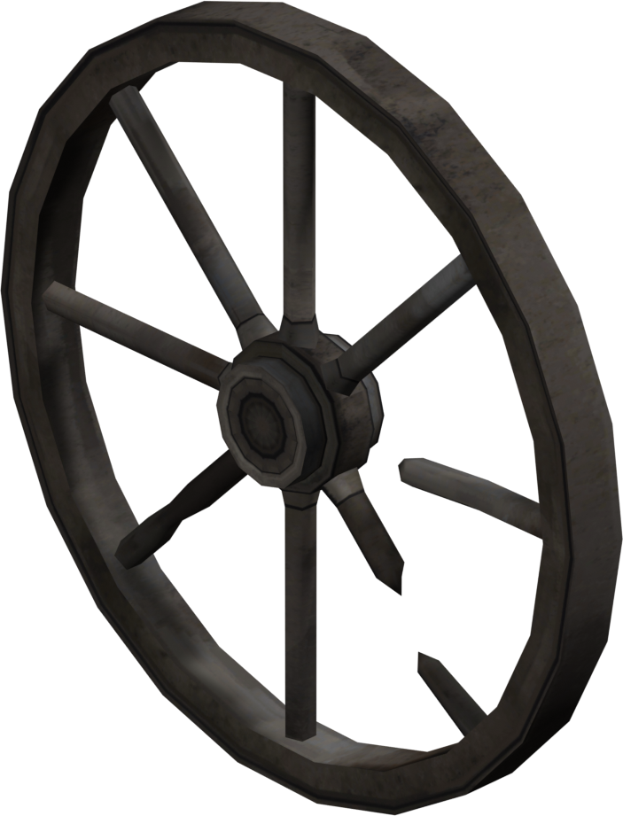
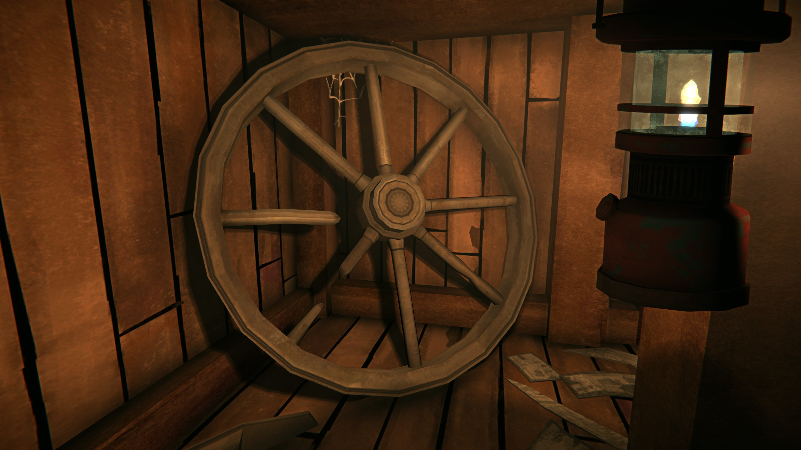
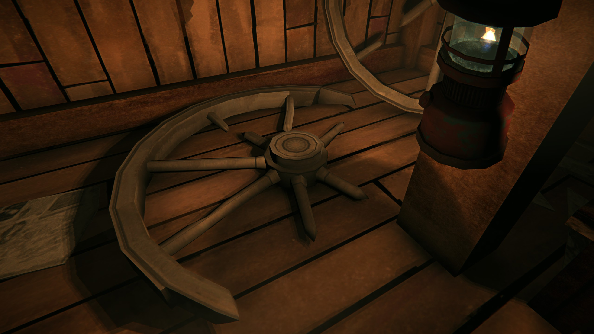

# Wheel

**Wheel**

| Property | Details |
| --- | --- |
| \[\[File: / \|  / *Full* \|  / *Broken* \| / \| --- \| --- \| | 250px\]\] |
|  / *Full* |  / *Broken* |
| Release | 1 August 2017 |
| Update | [1.00](./The%20Long%20Dark%20%E2%80%94%20Early%20Access%20Changelog.md#1.00) |
| Story item | No |
| **Advanced data** |  |
| Object key | GAMEPLAY\_CartWheel |

A **Wheel** is a wooden carriage wheel that can be broken down and harvested for materials. They come in either an intact form or broken form.

Harvesting either form with a [Hatchet](./Hatchet.md) yields 3 [Reclaimed Wood](./Reclaimed%20Wood.md). A Wheel can be found in the following places:

- [Barn (Molly's)](./Barn%20%28Molly%27s%29.md)
- 2 under the stairs of [Camp Office](./Camp%20Office.md)
- [Hunting Lodge](./Hunting%20Lodge.md) basement
- [Langston Mine](./Langston%20Mine.md)
- [Headframe Building](./Headframe%20Building.md)

| Reclaimed Wood | Time | Calories | Condition of Tool |
| --- | --- | --- | --- |
| 6 | 38 minutes | 112 | -2% Hatchet |
| 6 | 49 minutes | 146 | -3% Improvised Hatchet |
| 6 | 56 minutes | 169 | -0.5% Heavy Hammer |

## Gallery

| Column 1 | Column 2 |
| --- | --- |
|  / *The Wheel in the Camp Office* |  / *Ditto, broken* |

**Lua execution error in Module:Navbox function navbox**
