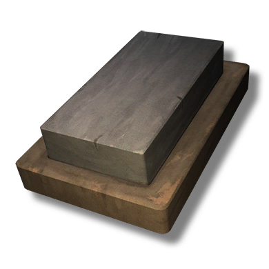
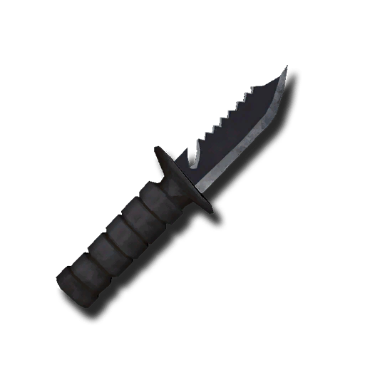

# Whetstone

**Contents**

- [Overview](#overview)
- [Use](#use)
- [Sharpening](#sharpening)
- [Tips](#tips)
- [Update history](#update-history)

**Whetstone**

| Property | Details |
| --- | --- |
|  |  / *Whetstone\_icon.png* |
| Release | [16 December 2015](./The%20Long%20Dark%20%E2%80%94%20Changelog.md#0.298) |
| Wintermute | No |
| Renewable | Yes |
| **Properties** |  |
| Item type | [Tools](./Tools.md)\|- |
| Stackable | No |
| Examine | A whetstone used to sharpen blades. |
| **Values** |  |
| Weight | 0.10 kg (0.22 lbs) |

> “**Out here, people understand the value of hard work, good tools, and working with their hands...They say the most important tool out here is a hatchet or knife. But keeping em' sharp is the secret.**”
>
> — [Grey Mother](./Grey%20Mother.md)

The **Whetstone**, or **Sharpening Stone**, is a tool used to sharpen bladed tools.

## Overview

The Whetstone weighs 0.10 kilograms and can be found in containers and buildings likely to contain tools. It is always found in 100% condition. It generally spawns in industrial or sporting-type locations, (e.g., [Quonset Gas Station](./Quonset%20Garage.md) or [Trapper's Homestead](./Trapper%27s%20Homestead.md)).

### Use

The Whetstone is used in the [Sharpening](./Sharpening.md) gameplay mechanic to restore the condition of bladed tools. Each use degrades the Whetstone 5% (20 max uses), but restores less than that amount in the target tool.

### Sharpening

The [Sharpening](./Sharpening.md) [Skill](./Skills.md), which is only visible when maintaining a bladed tool and not listed in the player's journal, starts at 30 points. The skill points increase by 1 for each time the blade is sharpened.

The Whetstone can only be used to sharpen the following tools:

| Column 1 | Column 2 |
| --- | --- |
|  / *Hunting\_Knife\_icon.png* | [Hunting Knife](./Hunting%20Knife.md) |
|  / *Improvised\_Knife\_icon.png* | [Improvised Knife](./Improvised%20Knife.md) |
|  / *Scrap\_Metal\_Shard\_icon.png* | [Scrap Metal Shard](./Scrap%20Metal%20Shard.md) |
|  / *Jeremiah's\_Knife\_icon.png* | [Jeremiah's Knife](./Jeremiah%27s%20Knife.md) |
|  / *Cougar\_Claw\_Knife\_icon.png* | [Cougar Claw Knife](./Cougar%20Claw%20Knife.md) |
|  / *Survival\_Knife\_icon.png* | [Survival Knife](./Survival%20Knife.md) |
|  / *Hatchet\_icon.png* | [Hatchet](./Hatchet.md) |
|  / *Improvised\_Hatchet\_icon.png* | [Improvised Hatchet](./Improvised%20Hatchet.md) |

## Tips

- New Whetstones can either be very rarely found while [Beachcombing](./Beachcombing.md) or purchased - maximum 1 per trade - from the [Trader](./Trader.md) after completing 4 Special Requests.

## Update history

- UPDATE **16 December 2015 ([Update](./The%20Long%20Dark%20%E2%80%94%20Early%20Access%20Changelog.md#0.298)):**
  - Added to game.

**Lua execution error in Module:Navbox function navbox** [ru:Точильный камень](ru:%D0%A2%D0%BE%D1%87%D0%B8%D0%BB%D1%8C%D0%BD%D1%8B%D0%B9_%D0%BA%D0%B0%D0%BC%D0%B5%D0%BD%D1%8C)
