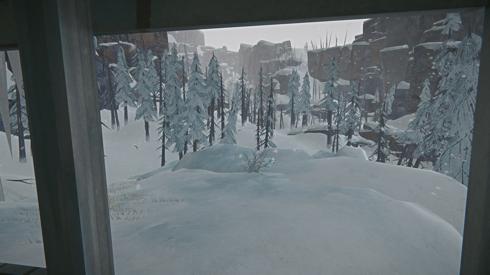
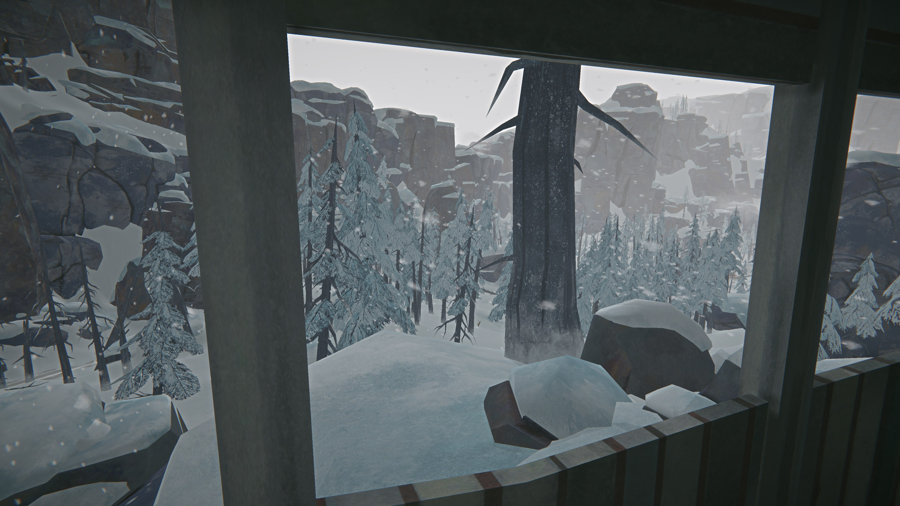

# Whistling Perch

**Categories:** Blackrock, Locations, Locations in Blackrock, Military/Sporting locations, Outdoor locations · **Source:** [Fandom](https://thelongdark.fandom.com/wiki/Whistling_Perch)

**Whistling Perch**

| Property | Details |
| --- | --- |
| | [Whistling Perch](../assets/Whistling_Perch.jpg) |
| **Location** | |
| | [Whistling Perch Location](../assets/Whistling_Perch_Location.png) |
| Region | |
| Location | In the hills surrounding the road in the region's east |
| **General** | |
| Type | Military/Sporting |
| | Has no shelter |

**Whistling Perch** is a hunting blind located in the east of [Blackrock](./Blackrock.md) region. [Wedge Cave](./Wedge%20Cave.md) is just to the northeast. A nearby road leads north to [Mule Bridge](./Mule%20Bridge.md) and south to [Foreman's Clearcut](./Foreman%27s%20Clearcut.md). Packs of [timberwolves](./Timberwolf.md) often roam the hills between the blind and this road.

High-quality loot can sometimes be found at Whistling Perch. It is also the possible location of a [polaroid](./Polaroids.md).

## Gallery

_View south from Whistling Perch towards [Bricklayer's Retreat](./Bricklayer%27s%20Retreat.md)_
