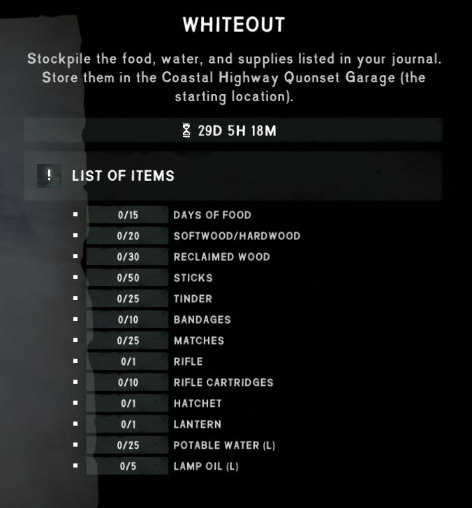
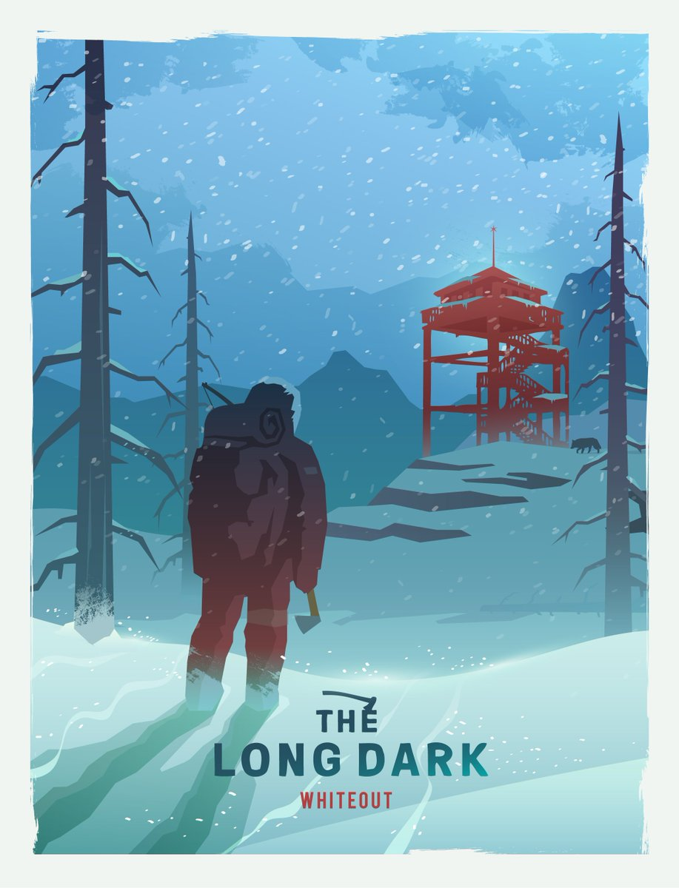
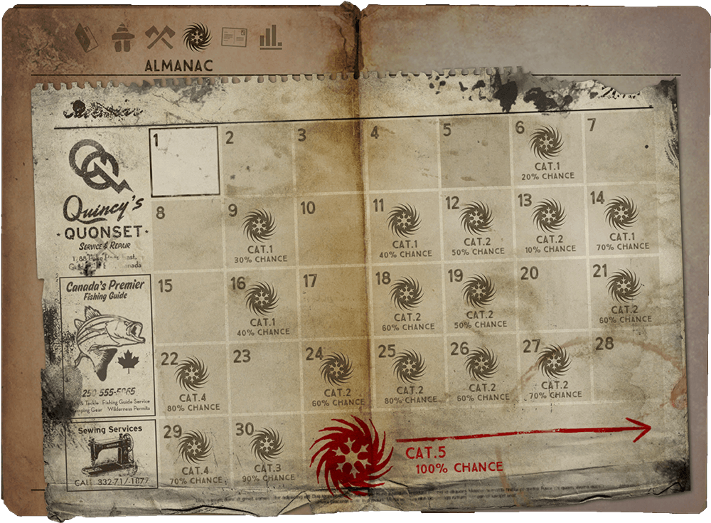

# Whiteout

**Categories:** Challenges · **Source:** [Fandom](https://thelongdark.fandom.com/wiki/Whiteout)

**Contents**

- [Overview](#overview)
- [Almanac](#almanac)
- [Items](#items)
- [Tips](#tips)
- [Food](#food)
- [Firewood](#firewood)
- [Weapons and ammunition](#weapons-and-ammunition)
- [Kerosene](#kerosene)
- [Tools](#tools)
- [Gallery](#gallery)

**Whiteout**

[Challenge Whiteout](../assets/Challenge_Whiteout.png)

**Details**

**Regions:** [Coastal Highway](./Coastal%20Highway.md)

**Difficulty:** 4

**Date Added:** June 2016

> “__A monster blizzard is on the way. Will you be ready when it arrives?  
 The storm arrives in 30 days. Stockpile enough food, water, and supplies in the Coastal Highway Quonset Garage before it hits.__”
>
> — Main Menu description

**Whiteout** is one of eight [challenges](./Challenge.md) in [_The Long Dark_](./The%20Long%20Dark.md).

## Overview

> “**Stockpile the food, water, and supplies listed in your journal. Store them in the Coastal Highway Quonset Garage (the starting location).**”
>
> — Journal Objective

The objective of the challenge is to locate and retrieve all of the items listed in the journal during the allotted 30 days. The survivor spawns inside the [Quonset Garage](./Quonset%20Garage.md) with 2000 calories, fully rested, fully warm, and with no thirst. The survivor's inventory has a [Bedroll](./Bedroll.md), low grade [Clothing](./Clothing.md), and some other miscellaneous items.

The Gas Station will be entirely empty when starting ([Medicine Shelf](./Medicine%20Shelf.md), [First Aid Kit](./First%20Aid%20Kit.md), [Drawer](./Drawer.md), [Register](./Register.md), [Locker](./Locker.md), [Metal Container](./Metal%20Container.md), both [Fridges](./Fridge.md). The [Basin](./Basin.md) will also be missing on the Work Bench). The only loot inside the Station are [Cardboard Boxes](./Cardboard%20Box.md) and wooden [Crates](./Crate.md) that can be broken down, a [Toilet](./Toilet.md) that contains a small amount of potable water, and 2 [Recycled Cans](./Recycled%20Can.md) (one is found under the bed, the other near the store shelves). Two [Work Benches](./Work%20Bench.md), a [Fire Barrel](./Fire%20Barrel.md), and a [Bed](./Bed.md) are still located inside to be used. The area around the [Coastal Townsite](./Coastal%20Townsite.md) will still be filled with objects such as Cars and [Pallets](./Pallets.md) to search.

As the challenge progresses, the weather gets harsher and hostile animals spawn in greater numbers. Initially however, conditions may still be challenging. Although predator spawns may be less common in the beginning, the player's lack of weapons (unless a revolver and ammunition spawned in the gas station) and protective clothing mean the relatively high density of wolves (and possibly a bear) near Quonset Garage can be deadly. Extra caution is required when entering and leaving the garage or when searching the area for supplies.

Note that the player does not have to survive the prophesied blizzard nor the entire allotted 30 days. Once all the items on the list are inside the gas station, the challenge ends. If the player fails to fully stock the Gas Station within 30 days, the Challenge will fail and must be restarted. 

### Almanac

There is a new section of the [Journal](./Journal.md) exclusive to this Challenged called The "[Almanac](./Almanac.md)" which will tell the player the likelihood of a blizzard in the next 30 days, as well as its intensity on a scale from 1 to 5. This is similar to the [Saffir-Simpson wind scale](wikipedia:SSHS) used to measure the strength of hurricanes.

## Items

All of the following Items are required to complete the challenge:

- 15 days of [Food](./Food%20And%20Drink.md)
- 20 Softwood/Hardwood
- 30 [Reclaimed Wood](./Reclaimed%20Wood.md)
- 50 [Sticks](./Stick.md)
- 25 Tinder
- 10 [Bandages](./Bandage.md)
- 25 [Matches](./Matches%20%28disambiguation%29.md)
- 1 [Hunting Rifle](./Hunting%20Rifle.md)
- 10 [Rifle Ammunition](./Rifle%20Ammunition.md)
- 1 [Hatchet](./Hatchet.md) or [Improvised Hatchet](./Improvised%20Hatchet.md)
- 1 [Storm Lantern](./Storm%20Lantern.md)
- 25 liters [Water (Potable)](./Water%20%28Potable%29.md) (6.6 gal)
- 5 liters [Lantern Fuel](./Lantern%20Fuel.md) (1.3 gal)

### Tips

Items can be dropped onto the floor of the gas station or put inside containers in the gas station to be counted. Items in the survivor's inventory are not counted. The journal contains a live count; items removed from the gas station will be subtracted from the list progress. If the player is struggling to find resources, a trip to the [Summit](./Summit.md) of [Timberwolf Mountain](./Timberwolf%20Mountain.md) will provide everything necessary to complete the challenge.

#### Food

The list does not seem to care whether meat is ruined or not so long as it is not picked up and placed back down. If Ruined food disappears while in containers, it will subtract from the total calories needed to complete the stored food objective. Taking food out and eating it also subtracts from the total.

One day's worth of food translates to roughly 3000 calories. Drinks such as sodas will contribute to the count, but [Herbal Tea](./Herbal%20Tea.md) and [Tin of Coffee](./Tin%20of%20Coffee.md) will not unless they are prepared into [Cup of Herbal Tea](./Cup%20of%20Herbal%20Tea.md) or [Cup of Coffee](./Cup%20of%20Coffee.md). [Reishi Tea](./Reishi%20Tea.md), [Rose Hip Tea](./Rose%20Hip%20Tea.md), [Burdock Tea](./Burdock%20Tea.md), and [Birch Bark Tea](./Birch%20Bark%20Tea.md) do count as calories for purposes of food. Lots of food can be found in the houses around the region, but this will not be enough to complete the challenge. Killing a [moose](./Moose.md) or [bear](./Bear.md) will provide ample food, and more can be found in the houses at [Thomson's Crossing](./Thomson%27s%20Crossing.md) and the [Crash Site](./Crash%20Site%20%28Pleasant%20Valley%29.md) in [Pleasant Valley](./Pleasant%20Valley.md).

#### Firewood

Softwood/Hardwood includes [Cedar Firewood](./Cedar%20Firewood.md) and [Fir Firewood](./Fir%20Firewood.md), but not [Firelogs](./Firelog.md). Reclaimed Wood is easily obtained from the [Pallets](./Pallets.md) outside the garage, while sticks and limbs are common throughout the forest around the [Coastal Townsite](./Coastal%20Townsite.md).

#### Weapons and ammunition

A Hunting Rifle must be stored for this objective, a Revolver will not count. Extra rifles spawn in Coastal Highway compared with a normal survival game, rifles are extremely rare in other regions.

Rifle cartridges may be loaded into the hunting rifle or unloaded. If there aren't enough cartridges in Coastal Highway, sufficient numbers can usually be found in [Desolation Point](./Desolation%20Point.md) or [Pleasant Valley](./Pleasant%20Valley.md).

#### Kerosene

[Lantern Fuel](./Lantern%20Fuel.md) that is within the [Storm Lantern](./Storm%20Lantern.md) counts toward the Lantern Fuel requirement. If the player does not have enough, Ice fishing near the garage will yield more lamp oil. [Jerry Cans](./Jerry%20Can.md) will also add to the total Lamp Fuel needed.

#### Tools

If the player can't find a [Hatchet](./Hatchet.md), it may be easier to head to [Desolation Point](./Desolation%20Point.md) and forge an [Improvised Hatchet](./Improvised%20Hatchet.md) at [The Riken](./The%20Riken.md), as the Improvised Hatchet counts as an acceptable substitute. The [Heavy Hammer](./Heavy%20Hammer.md) required for forging the hatchet can usually be found either at The Riken or nearby in [Hibernia Processing](./Hibernia%20Processing.md).

## Gallery

