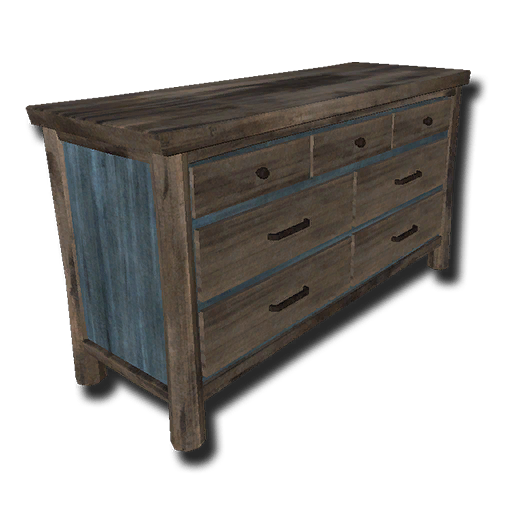

# Wide Dresser

**Categories:** Interactable Objects · **Source:** [Fandom](https://thelongdark.fandom.com/wiki/Wide_Dresser)

**Wide Dresser**

| Property | Details |
| --- | --- |
|  |  / _Wide\_Dresser\_icon.png_ |
| Release | [TFTFT Part 6 Broken Silence](./The%20Long%20Dark%20%E2%80%94%20Changelog.md#2.33) |
| **Values** |  |
| Weight | 25.00 kg (55 lbs) |
| **Actions** |  |
| Backpack | Drop, Place |

The **Wide** **Dresser** is a [Decorations](./Decorations.md) item that can be [Crafted](./Crafting.md) as part of the [Safehouse Customization](./Safehouse%20Customization.md) feature.

## Overview

A makeshift wooden dresser, a Wide Dresser can be crafted at a [Furniture Workbench](./Furniture%20Workbench.md), but requires [Woodworking Tools](./Woodworking%20Tools.md).

The dresser has many compartments for storage:

- 3 smaller drawers having a capacity of 6.00 kg each
- 4 larger drawers having a capacity of 10.00 kg each
- Total storage capacity of 58.00 kg.

Progress for Crafting this item will be stored in the Furniture Workbench's container inventory, rather than the player's inventory. Once crafted, the item can be automatically placed in the Safehouse. Canceling this prompt will force the item back into the Furniture Workbench's container inventory. The dresser can only be placed on a wide, clear space on the floor or a flat surface when in Customization Mode.

Despite having a Backpack carry weight value, the dresser cannot be picked up and placed back into the player's inventory once crafted, and so it cannot be carried from one base to another. The only option is to move or destroy it (destroying the dresser will yield no resources, so consider the material cost/time investment before creating this item).

## Crafting

**Wide Dresser**

| Property | Details |
| --- | --- |
|  | - |
|  | - |
|  | 660 minutes (11 hour 0 minutes) |
| **Requirements** |  |
| Facility | **Template:iconlink** |
| Tool | **Template:iconlink** |
| **Materials** |  |
| **Template:iconlink plain** |  |
| Item | [Fir Firewood](./Fir%20Firewood.md) |
| Quantity | 16 |
| **Template:iconlink plain** |  |
|  | [Reclaimed Wood](./Reclaimed%20Wood.md) |
|  | 6 |

## Update History
