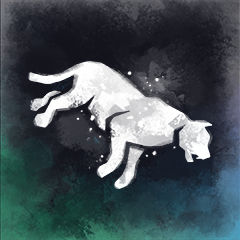

# Wild At Heart

**Categories:** Achievements, Pages with update history · **Source:** [Fandom](https://thelongdark.fandom.com/wiki/Wild_At_Heart)

**Wild At Heart**

_Wild\_At\_Heart\_icon.png_

**Description:** Defeat and kill the Cougar stalking the Geothermal Region.

**Wild At Heart** is a hidden [achievement](./The%20Long%20Dark%20%E2%80%94%20Achievements.md) in _[Wintermute](./Wintermute.md)_ [Episode 5: The Light At The End Of All Things](./Episode%205%20-%20The%20Light%20At%20The%20End%20Of%20All%20Things.md) of _[The Long Dark](./The%20Long%20Dark.md)_.

## Guide

This is a missable hidden achievement granted after killing the [Cougar](./Cougar.md) near the end of the main story mission [High Energy](./High%20Energy.md). After reactivating all 3 Geothermal Stations in the [Suzuki Geothermal Region](./Suzuki%20Geothermal%20Region.md) Mackenzie will have to exit the region to return to the [Suzuki Radio Telescope](./Suzuki%20Radio%20Telescope.md). Near the end of the region, Mackenzie will encounter a Cougar, and must kill it to unlock the achievement.

Using the [Shotgun](./Shotgun.md) found in the region and hiding on terrain where the Cougar cannot reach you is the best way to kill the creature while also using [Military Stims](./Military%20Stim.md) to heal from Condition damage. Make a save before attempting to get this achievement however, as there is a time limit that the player must follow that can expire while trying to kill the big cat (the player needs to return to Suzuki before nightfall).

## Game History

\* UPDATE **31 March 2026 ([Update](./The%20Long%20Dark%20%E2%80%94%20Changelog.md#2.52)):**

  - Added to game.
